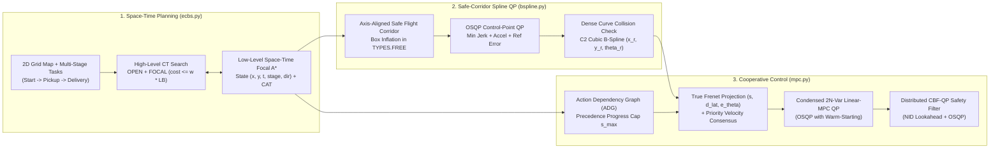

# Multi-AGV Space-Time Planning (Focal ECBS), Safe-Corridor B-Spline Optimization, and Distributed CBF-MPC Control

<div align="center">

[](https://github.com/Urami0421/multi-agv-ecbs-consensus-mpc/actions/workflows/ci.yml)
[](LICENSE)
[](https://www.python.org/)
[](https://github.com/ai-winter/python_motion_planning)

**[English](README.md) | [简体中文](README_zh.md)**

</div>

This repository implements a hierarchical multi-agent planning, trajectory optimization, and closed-loop tracking control pipeline for differential-drive Automated Guided Vehicles (AGVs) operating in multi-aisle warehouse environments. Built upon the single-robot motion planning library [`python_motion_planning`](https://github.com/ai-winter/python_motion_planning) (see [`docs/upstream.md`](docs/upstream.md) for upstream documentation), this project extends the framework from single-robot path planning to multi-agent space-time planning, convex safe-corridor spline optimization, schedule-synchronized execution, and quadratic-programming-based cooperative control.

---

## Visual Overview

| 2D Continuous Simulation (`Visualizer2D` + ESDF + MPC Horizon) | 3D Off-Screen PyVista/VTK Warehouse Simulation (`Visualizer3D`) |
| :---: | :---: |
|  |  |
| **8 Differential-Drive AGVs** executing two-stage (`Start -> Pickup -> Delivery`) tasks across 12 storage racks, 20 intersections, and 8 bottleneck hazards | **Synchronized 3D PyVista/VTK Scene** with 48 warehouse shelf meshes, 12 pallet stacks, and 8 Neobotix `MP-400` robot models |

---

## What Was Built (Upstream vs. This Project)

To clearly separate the foundational infrastructure inherited from [`ai-winter/python_motion_planning`](https://github.com/ai-winter/python_motion_planning) from the algorithms developed in this repository:

| Layer | Inherited Upstream Infrastructure ([`docs/upstream.md`](docs/upstream.md)) | Added / Upgraded in This Repository |
| :--- | :--- | :--- |
| **Environment & Simulation** | `Grid` occupancy map, Euclidean Signed Distance Field (`esdf`), `DiffDriveRobot`, `ToySimulator`, `Visualizer2D`, `Visualizer3D` | 72m x 44m 12-rack two-stage (`Start -> Pickup -> Delivery`) warehouse configuration ([`warehouse_8agv.yaml`](scripts/configs/warehouse_8agv.yaml)), MovingAI `.map`/`.scen` benchmark loader, and 3D multi-rack/multi-AGV scene renderer |
| **Global Multi-Agent Planning** | Single-agent 2D graph search (`AStar`, `Dijkstra`, `ThetaStar`) | **Turn-Penalized Focal ECBS & Exact CBS** ([`ecbs.py`](src/python_motion_planning/path_planner/graph_search/ecbs.py)): full two-level `OPEN` + `FOCAL` priority queues (`SOC <= w * LB`), $O(T \cdot N)$ spatial-hash conflict detection, multi-stage waypoint state expansion `(x, y, t, stage, dir)`, and Conflict Avoidance Table (`CAT`) |
| **Trajectory Optimization** | Parametric curve generators (`BSpline`, `CubicSpline`, `Bezier`, `Dubins`) | **Fixed `BSpline._approximation`** (Piegl & Tiller Eq. 9.68–9.69 knot vector averaging + SVD least-squares) and added **`SafeCorridorBSplineOptimizer`** ([`bspline.py`](src/python_motion_planning/traj_optimizer/curve_generator/point_based/bspline.py)) solving an `osqp` QP inside inflated `TYPES.FREE` axis-aligned safe corridors |
| **Schedule Synchronization** | None | **Action Dependency Graph (`ActionDependencyGraph` / `ADG`)** ([`mpc.py`](src/python_motion_planning/controller/path_tracker/mpc.py)): extracts Type-2 inter-agent spatial ordering dependencies from discrete `ECBS` plans to prevent intersection collisions under execution delays |
| **Closed-Loop Control** | Single-agent trackers (`PurePursuit`, `RPP`, `PID`, `DWA`, `APF`) | **Linearized Error-State Receding-Horizon MPC** (`MPC` via condensed $2N$-variable `osqp` QP with warm-starting and true Frenet projection), **Distributed CBF-QP Safety Filter** (`cbf_qp_filter` via Near-Identity Diffeomorphism and `osqp`), **`ConsensusMPC`** (`ADG + Linear-MPC + CBF-QP`), and **`ORCAController`** (Reciprocal Velocity Obstacles QP baseline) |

---

## System Architecture & Mathematical Formulation



### 1. Turn-Penalized Focal ECBS ([`ecbs.py`](src/python_motion_planning/path_planner/graph_search/ecbs.py))

Given $M$ agents with ordered task stops $\mathcal{W}_i = (s_i, p_i, g_i)$, the low-level planner searches over the augmented state space $\sigma = (x, y, t, k_{\text{stage}}, d_{\text{prev}})$ with step cost:

$$
c(\sigma \to \sigma') = 1 + \lambda_{\text{turn}} \cdot \mathbb{I}(d' \neq \text{wait} \;\wedge\; d_{\text{prev}} \neq \varnothing \;\wedge\; d' \neq d_{\text{prev}})
$$

Both the low-level search and high-level Constraint Tree (CT) maintain complete `OPEN` and `FOCAL` priority queues with lazy deletion and dynamic threshold updates whenever $f_{\min}$ or $LB_{\min} = \min_{N \in \text{OPEN}} \sum_i f_{\min, i}(N)$ increases:

$$
\text{FOCAL}_{\text{low}} = \left\{ \sigma \in \text{OPEN}_{\text{low}} \;\middle|\; f(\sigma) \le w \cdot f_{\min} \right\}, \qquad
\text{FOCAL}_{\text{CT}} = \left\{ N \in \text{OPEN}_{\text{CT}} \;\middle|\; \text{SOC}(N) \le w \cdot LB_{\min} \right\}
$$

Vertex and edge-swap conflicts are detected in $O(T \cdot M)$ time per CT node via spatial hash tables (`ECBS.detect_conflicts`).

### 2. Safe-Corridor $C^2$ Cubic B-Spline Optimization ([`bspline.py`](src/python_motion_planning/traj_optimizer/curve_generator/point_based/bspline.py))

1. **Upstream Approximation Bug Fix**: Upstream `BSpline._approximation` previously passed a knot vector of length $n + k + 1$ when solving for $h = n - 1$ control points, causing the basis partition of unity $\sum_{i=0}^{h} N_{i,k}(t) = 1$ to break down near $t \to 1$. We implemented Piegl & Tiller (1997) Eq. 9.68–9.69 parameter averaging (`_approximation_knot_generation`) to construct the exact $(h + k + 1)$-length knot vector and solved the normal equations via SVD (`np.linalg.lstsq`), reducing collinear approximation error below $10^{-14}\text{ m}$.
2. **OSQP Safe-Corridor Control-Point QP (`SafeCorridorBSplineOptimizer`)**: Around each non-pinned waypoint $p_i^{\text{ref}} = (x_i^{\text{ref}}, y_i^{\text{ref}})$, an axis-aligned box $[l_{x,i}, u_{x,i}] \times [l_{y,i}, u_{y,i}] \subset \text{TYPES.FREE}$ is inflated up to $\pm 0.42\text{ m}$. Control points $c \in \mathbb{R}^m$ are optimized via `osqp`:

$$
\min_{c \in \mathbb{R}^m} \; w_{\text{jerk}} \|D_3 c\|_2^2 + w_{\text{acc}} \|D_2 c\|_2^2 + w_{\text{ref}} \|c - p^{\text{ref}}\|_2^2 \quad \text{s.t.} \quad l \le c \le u, \;\; c_0 = p_0^{\text{ref}}, \;\; c_{m-1} = p_{m-1}^{\text{ref}}
$$

By the convex hull property of B-Splines and a dense post-optimization check along all sampled curve points, 100% of the continuous trajectory remains inside `TYPES.FREE`.

### 3. Action Dependency Graph, Linear-MPC & Distributed CBF-QP ([`mpc.py`](src/python_motion_planning/controller/path_tracker/mpc.py))

1. **Action Dependency Graph (`ActionDependencyGraph`)**: Extracts Type-2 precedence constraints $(i, s_i^{\text{leave}}) \prec (j, s_j^{\text{hold}})$ whenever agent $i$ visits a shared cell/corridor at discrete step $t_i < t_j$. During continuous execution, agent $j$'s reference arc-length progress is capped at $s_j^{\text{hold}}$ until agent $i$ clears $s_i^{\text{leave}}$.
2. **Condensed Linearized Error-State MPC (`MPC`)**: Projects the robot pose onto the reference curve to obtain exact Frenet coordinates $(s, d_{\text{lat}}, e_\theta)$, linearizes the unicycle error dynamics $e_{k+1} = A_k e_k + B_k \tilde{u}_k$ over horizon $N = 8$, and solves the condensed $2N$-variable QP via `osqp` with primal warm-starting:

$$
\min_{\tilde{U} \in \mathbb{R}^{2N}} \; (\Phi e_0 + \Gamma \tilde{U})^\top \bar{Q} (\Phi e_0 + \Gamma \tilde{U}) + \tilde{U}^\top \bar{R} \tilde{U} + (D_u(U_{\text{ref}} + \tilde{U}) - u_{\text{prev}})^\top \bar{S} (D_u(U_{\text{ref}} + \tilde{U}) - u_{\text{prev}})
$$

3. **Distributed CBF-QP Safety Filter (`cbf_qp_filter`)**: Maps unicycle state $(x_i, y_i, \theta_i)$ to a lookahead control point $p_i = [x_i + l\cos\theta_i,\; y_i + l\sin\theta_i]^\top$ via Near-Identity Diffeomorphism ($\dot{p}_i = R(\theta_i)\text{diag}(1, l)[v_i, \omega_i]^\top = u_i$). For all neighbors $j$ within sensing range, `osqp` solves the 2-variable safety filter:

$$
\min_{u_i \in \mathbb{R}^2} \; \|u_i - u_{i,\text{nom}}\|_2^2 \quad \text{s.t.} \quad -2(p_i - p_j)^\top u_i \le \alpha_{ij} \gamma h_{ij} - 2(p_i - p_j)^\top \hat{u}_j, \quad -u_{\max} \le u_i \le u_{\max}
$$

where $h_{ij} = \|p_i - p_j\|_2^2 - d_{\text{safe}}^2$. If the local half-plane intersection becomes infeasible, `cbf_qp_filter` returns a safe stop $u_i = [0, 0]^\top$.

---

## Experimental Evaluation

> **Experimental Environment**: All benchmarks were executed on Windows 11 (Python 3.13.7, NumPy 2.x, SciPy 1.15, OSQP 1.1.2) using single-threaded CPU execution. Planning wall-clock times are measured with `time.perf_counter()` over 10 independent repetitions (reporting median and P90). All raw benchmark outputs are committed in [`results/`](results/).

### 1. 4-Group MAPF Ablation on the 8-AGV Two-Stage Warehouse ([`results/mapf_ablation.csv`](results/mapf_ablation.csv))


| Planner Variant | $w$ | $\lambda_{\text{turn}}$ | Vertex/Edge Conflicts | High-Level CT Nodes | Low-Level Expanded States | Total Steps | Total 90° Turns | Suboptimality (`SOC / LB`) | Median Time (ms) | P90 Time (ms) |
| :--- | :---: | :---: | :---: | :---: | :---: | :---: | :---: | :---: | :---: | :---: |
| **Independent A\*** (No Coordination) | 1.00 | 0.00 | 3 | 1 | 1,621 | 465 | 91 | 1.0000 | 43.35 | 44.88 |
| **CBS** (Exact Baseline) | 1.00 | 0.00 | **0** | 8 | 2,188 | 466 | 46 | 1.0000 | 26.24 | 28.84 |
| **CBS + Turn Penalty** | 1.00 | 0.45 | **0** | 15 | 6,245 | 466 | 28 | 1.0000 | 70.34 | 72.97 |
| **ECBS** (Focal Only) | 1.08 | 0.00 | **0** | **1** | **650** | 466 | 46 | 1.0022 | **8.76** | **9.04** |
| **ECBS + Turn Penalty (Ours)** | 1.08 | 0.45 | **0** | **1** | **1,302** | 467 | **27** | 1.0120 | **15.69** | **15.98** |

**Key Findings from the 4-Group Ablation**:
- **Role of Turn Penalty ($\lambda_{\text{turn}} = 0.45$)**: Adding $\lambda_{\text{turn}} = 0.45$ reduces 90-degree turns from `46` to `27–28` (`-41.3%`), eliminating staircase oscillations. However, under exact search (`CBS + Turn`), expanding over heading directions `(x, y, t, dir)` increases low-level expansions from `2,188` to `6,245` (`26.24 ms -> 70.34 ms`).
- **Role of Focal Heuristic ($w = 1.08$)**: Introducing the focal queue with the Conflict Avoidance Table (`CAT`) resolves all inter-agent conflicts at the root CT node (`HL = 1`), reducing low-level state expansions by **79.2%** compared to `CBS + Turn` (`6,245 -> 1,302` states, **4.48x speedup**) and by **40.5%** compared to standard `CBS` (`2,188 -> 1,302` states, **1.67x speedup**), while increasing total path length by only 1 grid step (`466 -> 467`).
- Full parameter sweep across $w \in \{1.01, 1.05, 1.08, 1.20, 1.50\} \times \lambda_{\text{turn}} \in \{0.00, 0.20, 0.45, 1.00\}$ is available in [`results/mapf_param_sweep.csv`](results/mapf_param_sweep.csv).

### 2. Standardized MovingAI Benchmark Evaluation ([`results/movingai_benchmark.csv`](results/movingai_benchmark.csv))

Evaluated on 3 MovingAI benchmark maps ([`scripts/maps/`](scripts/maps/)) for $N \in \{8, 16, 32\}$ agents with a high-level expansion limit of 250 CT nodes:

| Map (`scripts/maps/`) | Agents ($N$) | Planner | Solved | High-Level CT Nodes | Low-Level Expanded | Total Steps | Total Turns | `SOC / LB` | Planning Time (ms) |
| :--- | :---: | :--- | :---: | :---: | :---: | :---: | :---: | :---: | :---: |
| `warehouse-10-20-10-2-1` | 16 | CBS ($w=1.0, \lambda=0$) | Yes | 3 | 1,312 | 295 | 30 | 1.0000 | 12.21 |
| `warehouse-10-20-10-2-1` | 16 | **ECBS ($w=1.08, \lambda=0.45$)** | **Yes** | **1** | **1,044** | 295 | **20** | 1.0048 | **13.33** |
| `warehouse-10-20-10-2-1` | 32 | CBS ($w=1.0, \lambda=0$) | No (Limit) | 250 | 136,397 | — | — | — | 1,450.18 |
| `warehouse-10-20-10-2-1` | 32 | **ECBS ($w=1.08, \lambda=0.45$)** | **Yes** | **3** | **4,127** | 630 | **41** | 1.0184 | **53.47** |
| `random-32-32-20` | 32 | CBS ($w=1.0, \lambda=0$) | Yes | 16 | 7,239 | 532 | 108 | 1.0000 | 75.81 |
| `random-32-32-20` | 32 | **ECBS ($w=1.08, \lambda=0.45$)** | **Yes** | **6** | **5,483** | 534 | **58** | 1.0146 | **73.76** |
| `room-32-32-4` | 16 | CBS ($w=1.0, \lambda=0$) | Yes | 123 | 133,695 | 273 | 62 | 1.0000 | 1,188.94 |
| `room-32-32-4` | 16 | **ECBS ($w=1.08, \lambda=0.45$)** | **Yes** | **4** | **12,368** | 274 | **30** | 1.0170 | **124.79** |
| `room-32-32-4` | 32 | CBS ($w=1.0, \lambda=0$) | No (Limit) | 250 | 18,531 | — | — | — | 424.80 |
| `room-32-32-4` | 32 | **ECBS ($w=1.08, \lambda=0.45$)** | **Yes** | **8** | **14,425** | 561 | **57** | 1.0357 | **170.12** |

### 3. 6-Method Multi-Agent Controller Ablation ([`results/control_ablation.csv`](results/control_ablation.csv))


All 6 controllers track the same 8-AGV `ECBS + SafeCorridorBSplineOptimizer` trajectories (`dt = 0.1 s`, physical contact threshold $2R = 0.88\text{ m}$, safety envelope $0.90\text{ m}$):

| Controller | Category | Collision Events | Min Pairwise Dist (m) | Two-Stage Completion (`Start->Pickup->Goal`) | Deadlocked Agents | Makespan (s) | Mean Speed (m/s) | Total Stop Time (s) | Mean Terminal Error (m) | Mean / P95 OSQP Time ($\mu$s) |
| :--- | :--- | :---: | :---: | :---: | :---: | :---: | :---: | :---: | :---: | :---: |
| `PurePursuit` | Single-Agent Baseline | 4 | 0.504 | 100.0% | 0 | 26.6 | 2.535 | 0.8 | 0.209 | — |
| `RPP` | Single-Agent Baseline | 2 | 0.509 | 87.5% | 1 | 30.5 | 2.343 | 10.1 | 0.249 | — |
| `DWA` | Local Reactive Baseline | 1 | 0.639 | 0.0% | 8 | 30.5 | 2.001 | 10.3 | 19.557 | — |
| `ORCA` (`ORCAController`) | Multi-Agent Velocity Obstacle QP | 7 | 0.566 | 87.5% | 1 | 30.5 | 2.292 | 6.8 | 1.155 | 2,418.3 / 2,729.0 |
| `ADG + PurePursuit` | Schedule-Synchronized Baseline | 1 | 0.828 | 87.5% | 1 | 30.5 | 2.368 | 10.7 | 0.252 | — |
| **`ADG + Linear-MPC + CBF-QP` (`ConsensusMPC`)** | **Proposed Cooperative Control** | **0** | **0.996** | **100.0%** | **0** | **27.5** | **2.343** | **3.4** | **0.563** | **3,148.8 / 3,714.0** |

**Why Pure `ORCA` Collides in Narrow Warehouse Aisles**: Standard reciprocal velocity obstacles (`ORCA`) assume omnidirectional holonomic velocity Response in open space; when mapped to non-holonomic differential-drive kinematics inside single-lane aisles bounded by rack obstacles, reciprocal half-plane deflections push AGVs laterally toward rack walls or oncoming lanes, causing 7 close-quarter collisions (`min_dist = 0.566 m`). Combining `ADG` schedule ordering with `Linear-MPC` and the priority-weighted `CBF-QP` safety filter achieves **0 collisions** (`min_dist = 0.996 m > 0.88 m`) and **100% two-stage completion** with a mean OSQP solve time of **3.15 ms** per control step.

### 4. Random Actuator Stall & Velocity Perturbation Robustness ([`results/perturbation_robustness.csv`](results/perturbation_robustness.csv))

Across 5 random trials, 2 AGVs are subjected to a **2.5-second complete actuator freeze** (`v = 0, omega = 0`) while entering central aisle intersections, combined with $15\times$ higher Gaussian acceleration noise (`noise = 0.015`):

| Controller | Trials | Mean Collisions | Max Collisions | Worst-Case Min Clearance (m) | Mean Two-Stage Completion | Mean Makespan (s) |
| :--- | :---: | :---: | :---: | :---: | :---: | :---: |
| `PurePursuit` (Open-Loop Schedule) | 5 | 4.20 | 5 | 0.453 | 97.5% | 29.34 |
| `ORCA` (Reactive Only, No ADG) | 5 | 7.80 | 14 | 0.500 | 97.5% | 31.60 |
| `ADG + PurePursuit` (Schedule Hold Only) | 5 | 1.60 | 3 | 0.582 | 90.0% | 32.56 |
| **`ADG + Linear-MPC + CBF-QP` (`ConsensusMPC`)** | 5 | **0.00** | **0** | **0.988** | **90.0%** | **31.44** |

---

## Quickstart & Reproducibility

### 1. Installation

```bash
git clone https://github.com/Urami0421/multi-agv-ecbs-consensus-mpc.git
cd multi-agv-ecbs-consensus-mpc

# Core planning & control dependencies only (numpy, scipy, osqp, pyyaml)
pip install -e .

# Full installation including 2D/3D visualization, simulator, and test suite
pip install -e ".[all]"
```

### 2. Run Unit Tests (12 Test Cases)

```bash
pytest -v
```

### 3. Reproduce Benchmarks, CSV Tables & Visualizations

```bash
# 1. Run 4-group MAPF ablation (10 repeats), (w, turn_penalty) sweep, and MovingAI benchmark
python scripts/benchmark_mapf.py

# 2. Run 6-method controller ablation and 5-seed delay/perturbation robustness suite
python scripts/benchmark_control.py

# 3. Render 2D Matplotlib simulation GIF (assets/multi_agv_consensus_mpc_2d.gif)
python scripts/render_2d.py

# 4. Render 3D PyVista/VTK off-screen simulation GIF (assets/multi_agv_consensus_mpc_3d.gif)
python scripts/render_3d.py

# Or run the entire pipeline end-to-end (use --skip-gifs for fast benchmark-only execution)
python scripts/run_multi_agv_ecbs_consensus_demo.py --skip-gifs
```

---

## Limitations & Future Work

1. **Discrete-Time Grid Abstraction vs. Continuous Kinodynamics**: `ECBS` plans on a 4-connected grid with unit time steps (`1 cell / step`) and models 90-degree turns via an additive cost penalty $\lambda_{\text{turn}}$ rather than exact continuous-time acceleration/deceleration profiles. While `ActionDependencyGraph` (`ADG`) compensates for execution timing drift between the discrete plan and continuous unicycle dynamics, integrating kinodynamic SIPP (Safe Interval Path Planning) at the low level would tighten makespan estimates.
2. **Axis-Aligned Decoupled Corridor QP**: `SafeCorridorBSplineOptimizer` inflates axis-aligned bounding boxes inside `TYPES.FREE` and solves decoupled convex QPs in $x$ and $y$. In diagonal corridors, axis-aligned boxes are more conservative than general oriented polytopes (e.g., Liu et al., IEEE RA-L 2017).
3. **Near-Identity Diffeomorphism (NID) Lookahead Offset in CBF-QP**: To obtain relative-degree-1 barrier constraints for both $(v, \omega)$, `cbf_qp_filter` controls a lookahead point at $l = 0.20\text{ m}$ ahead of the rear axle, requiring an extra $O(l)$ safety margin in $d_{\text{safe}}$. Higher-Order CBFs (HOCBF) acting directly on wheel accelerations could reduce conservatism in tight spaces.
4. **High-Density Scalability**: On strongly bottlenecked maps such as `room-32-32-4` with $N \ge 64$ agents, standard focal ECBS high-level branching still grows combinatorially; integrating disjoint splitting or LaCAM* is a natural next step for 100+ agent fleets.

---

## References

1. **ECBS**: Barer, M., Sharon, G., Stern, R., & Felner, A. (2014). Suboptimal Variants of the Conflict-Based Search Algorithm for the Multi-Agent Pathfinding Problem. *Annual Symposium on Combinatorial Search (SoCS)*, 19–27.
2. **CBS**: Sharon, G., Stern, R., Felner, A., & Sturtevant, N. R. (2015). Conflict-Based Search for Optimal Multi-Agent Pathfinding. *Artificial Intelligence*, 219, 40–66.
3. **MAPF Benchmarks**: Stern, R., Sturtevant, N. R., Felner, A., Koenig, S., Ma, H., Walker, T. T., Li, J., Atzmon, D., Cohen, L., Kumar, T. K. S., Boyarski, E., & Bartak, R. (2019). Multi-Agent Pathfinding: Definitions, Variants, and Benchmarks. *SoCS*, 151–158.
4. **NURBS / B-Spline Approximation**: Piegl, L., & Tiller, W. (1997). *The NURBS Book* (2nd ed., Chapter 9, Eq. 9.68–9.69). Springer-Verlag.
5. **Action Dependency Graph (ADG)**: Hönig, W., Kiesel, S., Tinka, A., Durham, J. W., & Ayanian, N. (2019). Persistent and Robust Execution of MAPF Schedules in Warehouses. *IEEE Robotics and Automation Letters*, 4(2), 1125–1131.
6. **Linearized Mobile Robot MPC**: Kühne, F., Lages, W. F., & Gomes da Silva Jr, J. M. (2004). Model Predictive Control of a Mobile Robot Using Linearization. *Proceedings of Mechatronics and Robotics*, 525–530.
7. **Control Barrier Functions**: Ames, A. D., Xu, X., Grizzle, J. W., & Tabuada, P. (2017). Control Barrier Function Based Quadratic Programs for Safety Critical Systems. *IEEE Transactions on Automatic Control*, 62(8), 3861–3876.
8. **Multi-Robot Safety Barrier Certificates**: Wang, L., Ames, A. D., & Egerstedt, M. (2017). Safety Barrier Certificates for Collisions-Free Multirobot Systems. *IEEE Transactions on Robotics*, 33(3), 661–674.
9. **ORCA**: van den Berg, J., Guy, S. J., Lin, M., & Manocha, D. (2011). Reciprocal $n$-Body Collision Avoidance. *Robotics Research (ISRR)*, Springer, 3–19.

---

## Acknowledgement

This project is built on top of [`ai-winter/python_motion_planning`](https://github.com/ai-winter/python_motion_planning) (v2.1, GPL-3.0 License) by **Haodong Yang** and **Maojia Wu**. Details of the retained upstream modules, tutorials, and citation information are provided in [`docs/upstream.md`](docs/upstream.md).
