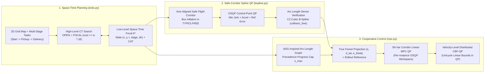

# Multi-AGV Space-Time Planning (Focal ECBS), Safe-Corridor B-Spline Optimization, and Distributed CBF-MPC Control

<div align="center">

[](https://github.com/Urami0421/multi-agv-ecbs-consensus-mpc/actions/workflows/ci.yml)
[](LICENSE)
[](https://www.python.org/)
[](https://github.com/ai-winter/python_motion_planning)

**[English](README.md) | [简体中文](README_zh.md)**

</div>

This repository implements a hierarchical multi-agent planning, trajectory optimization, and closed-loop tracking control pipeline for differential-drive Automated Guided Vehicles (AGVs) operating in multi-aisle warehouse environments. Built upon the single-robot motion planning library [`python_motion_planning`](https://github.com/ai-winter/python_motion_planning) (see [`docs/upstream.md`](docs/upstream.md) for upstream documentation), this project extends the framework from single-robot path planning to multi-agent space-time planning, safe-corridor spline optimization, schedule-synchronized execution, and quadratic-programming-based cooperative control.

---

## Visual Overview

| 2D Continuous Simulation (`Visualizer2D` + ESDF + MPC Horizon) | 3D Off-Screen PyVista/VTK Warehouse Simulation (`Visualizer3D`) |
| :---: | :---: |
|  |  |
| **8 Differential-Drive AGVs** executing two-stage (`Start -> Pickup -> Delivery`) tasks across 12 storage racks, 20 intersections, and 8 bottleneck hazards | **Synchronized 3D PyVista/VTK Scene** with 48 warehouse shelf meshes, 12 pallet stacks, and 8 Neobotix `MP-400` robot models |

### Key Results at a Glance

- **Turn-Penalized Focal ECBS (`w = 1.08, λ_turn = 0.45`)**: Cuts 90° turns by **41.3%** (`46 -> 27`) and reduces low-level state expansions by **79.2%** vs. `CBS + Turn` (`6,245 -> 1,302`, **4.18x speedup**) on the 8-AGV two-stage warehouse; on bottlenecked synthetic grids, solves 16-agent rooms **3.94x faster** than `CBS` (`131.59 ms` vs. `517.87 ms`) and solves 32-agent warehouse (`55.00 ms`) & room (`168.81 ms`) instances where exact `CBS` hits the 250-CT-node cap.
- **20-Trial Randomized Stall Robustness (`160` Agent-Runs, `60.0 s` Horizon)**: `ConsensusMPC_Corridor` (`ADG + Corridor-Linear-MPC + Velocity-Level CBF-QP`) achieves **0 inter-AGV collisions** across all 20 random 2.0–3.5s actuator-stall trials (`20/20` collision-free trials, 95% Wilson CI `[83.9%, 100.0%]`) and **100.0% full completion** (`160/160` agent-runs, 95% Wilson CI `[97.7%, 100.0%]`, finish time median `25.1 s`, P90 `30.32 s`, max `38.2 s`).
- **Safe-Corridor Reuse in Planning & Control**: Axis-aligned free-space corridors inflated in `TYPES.FREE` both constrain the $C^2$ cubic B-Spline control points (`SafeCorridorBSplineOptimizer`, verified `collision_free = True` on dense arc-length samples) and bound the receding-horizon lateral deviation inside the `MPC` OSQP (`use_corridor=True`), reducing nominal 8-AGV makespan from `28.1 s` to **`26.6 s`** with `0` obstacle contacts.
- **Real-Time Per-Instance OSQP Execution**: Each controller instance maintains isolated persistent OSQP workspaces updated via `prob.update(Px, q, Ax, l, u)`, solving the $3N$-variable (`24`-var) `MPC` QP in **`53.6–65.0 µs`** mean internal C time (`10.2 µs` for the 2-variable `CBF-QP` filter).

---

## What Was Built (Upstream vs. This Project)

To clearly separate the foundational infrastructure inherited from [`ai-winter/python_motion_planning`](https://github.com/ai-winter/python_motion_planning) from the algorithms developed in this repository:

| Layer | Inherited Upstream Infrastructure ([`docs/upstream.md`](docs/upstream.md)) | Added / Upgraded in This Repository |
| :--- | :--- | :--- |
| **Environment & Simulation** | `Grid` occupancy map, Euclidean Signed Distance Field (`esdf`), `DiffDriveRobot`, `ToySimulator`, `Visualizer2D`, `Visualizer3D` | 72m x 44m 12-rack two-stage (`Start -> Pickup -> Delivery`) warehouse configuration ([`warehouse_8agv.yaml`](scripts/configs/warehouse_8agv.yaml)), multi-scale synthetic `.map`/`.scen` benchmark suite ([`scripts/maps/`](scripts/maps/)), and 3D multi-rack/multi-AGV scene renderer |
| **Global Multi-Agent Planning** | Single-agent 2D graph search (`AStar`, `Dijkstra`, `ThetaStar`) | **Turn-Penalized Focal ECBS & Exact CBS** ([`ecbs.py`](src/python_motion_planning/path_planner/graph_search/ecbs.py)): full two-level `OPEN` + `FOCAL` priority queues (`SOC <= w * LB`), $O(T \cdot N)$ spatial-hash conflict detection, multi-stage waypoint state expansion `(x, y, t, stage, dir)` (automatically collapsing `dir` when $\lambda_{\text{turn}} = 0$), and Conflict Avoidance Table (`CAT`) |
| **Trajectory Optimization** | Parametric curve generators (`BSpline`, `CubicSpline`, `Bezier`, `Dubins`) | **Fixed `BSpline._approximation`** (Piegl & Tiller Eq. 9.68–9.69 knot vector averaging + SVD least-squares) and added **`SafeCorridorBSplineOptimizer`** ([`bspline.py`](src/python_motion_planning/traj_optimizer/curve_generator/point_based/bspline.py)) solving an `osqp` QP inside inflated `TYPES.FREE` axis-aligned boxes with iterative arc-length-densified curve verification (`collision_free` flag) |
| **Schedule Synchronization** | None | **ADG-Inspired Arc-Length Precedence Graph (`ActionDependencyGraph`)** ([`mpc.py`](src/python_motion_planning/controller/path_tracker/mpc.py)): extracts the complete partial order of shared-cell visits from discrete `ECBS` plans across the full horizon to prevent intersection collisions under arbitrary execution delays |
| **Closed-Loop Control** | Single-agent trackers (`PurePursuit`, `RPP`, `PID`, `DWA`, `APF`) | **Rollout-Linearized Receding-Horizon MPC with Safe-Corridor Constraints** (`MPC` via per-instance persistent `osqp.update()` workspace, true Frenet projection, and optional 1-Lipschitz lateral obstacle corridor bounds `use_corridor=True`), **Velocity-Level Distributed CBF-QP Safety Filter** (`cbf_qp_filter` with exact linear unicycle velocity bounds inside the QP, full $2l$ lookahead offset compensation, and zero post-blending), **`ConsensusMPC` / `ConsensusMPC_Corridor`**, and **Non-Holonomic `ORCAController`** (Alonso-Mora et al., 2013) |

---

## System Architecture & Mathematical Formulation



### 1. Turn-Penalized Focal ECBS ([`ecbs.py`](src/python_motion_planning/path_planner/graph_search/ecbs.py))

Given $M$ agents with ordered task stops $\mathcal{W}_i = (s_i, p_i, g_i)$, the low-level planner searches over the augmented state space $\sigma = (x, y, t, k_{\text{stage}}, d_{\text{prev}})$ with step cost:

$$
c(\sigma \to \sigma') = 1 + \lambda_{\text{turn}} \cdot \mathbb{I}(d' \neq \text{wait} \;\wedge\; d_{\text{prev}} \neq \varnothing \;\wedge\; d' \neq d_{\text{prev}})
$$

When $\lambda_{\text{turn}} = 0$, the heading component $d_{\text{prev}}$ is fixed to $-1$ so zero-turn-penalty baselines (`CBS` and `ECBS` with $\lambda_{\text{turn}} = 0$) never expand redundant direction states. Both the low-level search and high-level Constraint Tree (CT) maintain complete `OPEN` and `FOCAL` priority queues with lazy deletion and dynamic threshold updates whenever $f_{\min}$ or $LB_{\min} = \min_{N \in \text{OPEN}} \sum_i f_{\min, i}(N)$ increases:

$$
\text{FOCAL}_{\text{low}} = \left\{ \sigma \in \text{OPEN}_{\text{low}} \;\middle|\; f(\sigma) \le w \cdot f_{\min} \right\}, \qquad
\text{FOCAL}_{\text{CT}} = \left\{ N \in \text{OPEN}_{\text{CT}} \;\middle|\; \text{SOC}(N) \le w \cdot LB_{\min} \right\}
$$

Vertex and edge-swap conflicts are detected in $O(T \cdot M)$ time per CT node via spatial hash tables (`ECBS.detect_conflicts`).

### 2. Safe-Corridor $C^2$ Cubic B-Spline Optimization ([`bspline.py`](src/python_motion_planning/traj_optimizer/curve_generator/point_based/bspline.py))

1. **Upstream Approximation Bug Fix**: Upstream `BSpline._approximation` previously passed a knot vector of length $n + k + 1$ when solving for $h = n - 1$ control points, causing the basis partition of unity $\sum_{i=0}^{h} N_{i,k}(t) = 1$ to break down near $t \to 1$. We implemented Piegl & Tiller (1997) Eq. 9.68–9.69 parameter averaging (`_approximation_knot_generation`) to construct the exact $(h + k + 1)$-length knot vector and solved the normal equations via SVD (`np.linalg.lstsq`), reducing collinear approximation error below $10^{-14}\text{ m}$.
2. **OSQP Safe-Corridor Control-Point QP (`SafeCorridorBSplineOptimizer`)**: Around each non-pinned waypoint $p_i^{\text{ref}} = (x_i^{\text{ref}}, y_i^{\text{ref}})$, an axis-aligned box $[l_{x,i}, u_{x,i}] \times [l_{y,i}, u_{y,i}] \subset \text{TYPES.FREE}$ is inflated up to $\pm 0.42\text{ m}$. Control points $c \in \mathbb{R}^m$ are optimized via `osqp`:

$$
\min_{c \in \mathbb{R}^m} \; w_{\text{jerk}} \|D_3 c\|_2^2 + w_{\text{acc}} \|D_2 c\|_2^2 + w_{\text{ref}} \|c - p^{\text{ref}}\|_2^2 \quad \text{s.t.} \quad l \le c \le u, \;\; c_0 = p_0^{\text{ref}}, \;\; c_{m-1} = p_{m-1}^{\text{ref}}
$$

Because assigning an independent box $[l_i, u_i]$ to each control point does not guarantee that the 4-point convex hull of consecutive control points stays inside non-convex corner transitions, `SafeCorridorBSplineOptimizer` performs an **iterative post-optimization dense curve verification and control-point pull-back loop** (up to 8 iterations). `find_violations` densifies every curve segment at arc-length step $\le 0.25 \cdot \text{resolution}$ so sparse segments cannot straddle an obstacle cell, records `info["collision_free"]`, `info["num_violations"]`, and `info["repair_iters"]`, and requires `collision_free == True` for `info["success"]`.

### 3. Arc-Length Precedence Graph, Corridor-Constrained Linear-MPC & Velocity-Level CBF-QP ([`mpc.py`](src/python_motion_planning/controller/path_tracker/mpc.py))

1. **ADG-Inspired Arc-Length Precedence Graph (`ActionDependencyGraph`)**: Adapted from Hönig et al. (IEEE RA-L 2019) for continuous arc-length parameterized paths, this module extracts the complete partial order of shared-cell visits $(i, s_i^{\text{leave}}) \prec (j, s_j^{\text{hold}})$ across the entire `ECBS` plan horizon ($t_i < t_j$, with no time-window cutoff). During execution, agent $j$'s reference arc-length progress is capped at $s_j^{\text{hold}}$ until predecessor $i$ clears $s_i^{\text{leave}}$.
2. **Rollout-Linearized Error-State MPC with Lateral Safe-Corridor Constraints (`MPC`)**: Projects the robot pose onto the reference curve to obtain exact Frenet coordinates $(s, d_{\text{lat}}, e_\theta)$, rolls out a kinematically consistent nominal trajectory $\bar{x}_{k+1} = f(\bar{x}_k, u_{\text{ref},k})$ from $\bar{x}_0 = x_0$ over horizon $N = 8$, and solves a $3N$-variable (`2N` input offsets $\tilde{U} \in \mathbb{R}^{2N}$ + `N` non-negative corridor slacks $\xi \in \mathbb{R}_{\ge 0}^N$) QP via a per-controller persistent `osqp` workspace (`self._mpc_osqp.update(Px=..., q=..., Ax=..., l=..., u=...)` with warm-starting, taking $\sim 54\text{–}65\,\mu\text{s}$ mean internal C solve time):

$$
\begin{aligned}
\min_{\tilde{U} \in \mathbb{R}^{2N},\; \xi \in \mathbb{R}_{\ge 0}^N} \quad & (e_{\text{free}} + \Gamma \tilde{U})^\top \bar{Q} (e_{\text{free}} + \Gamma \tilde{U}) + \tilde{U}^\top \bar{R} \tilde{U} + (D_u(U_{\text{ref}} + \tilde{U}) - u_{\text{prev}})^\top \bar{S} (D_u(U_{\text{ref}} + \tilde{U}) - u_{\text{prev}}) + w_{\text{corridor}} \|\xi\|_2^2 \\
\text{s.t.} \quad & 0 \le v_{\text{ref},k} + \tilde{v}_k \le v_{\text{cap}}, \qquad -\omega_{\max} \le \omega_{\text{ref},k} + \tilde{\omega}_k \le \omega_{\max}, \qquad \xi_k \ge 0 \\
& -d_k - \xi_k \le n_k^\top \left( e_{\text{free},p,k} + \Gamma_{p,k} \tilde{U} \right) \le d_k + \xi_k, \qquad \forall k \in \{0, \dots, N-1\}
\end{aligned}
$$

where $n_k = [-\sin\theta_{\text{ref},k},\; \cos\theta_{\text{ref},k}]^\top$ is the reference path unit normal and $d_k = \max(0,\; c_{\text{obs}}(s_k) - R_{\text{robot}} - d_{\text{margin}})$ is the 1-Lipschitz certified obstacle-free lateral half-width computed from exact `TYPES.OBSTACLE` surface distances (`MPC.corridor_half_widths`, enabled when `use_corridor=True`). The first-step QP solution $u_0 = u_{\text{ref},0} + \tilde{u}_0^\star$ is applied directly without heuristic steering overrides or post-blending.
3. **Velocity-Level Distributed CBF-QP Safety Filter (`cbf_qp_filter`)**: Maps unicycle state $(x_i, y_i, \theta_i)$ to a lookahead point $p_i = [x_i + l\cos\theta_i,\; y_i + l\sin\theta_i]^\top$ via Near-Identity Diffeomorphism ($l = 0.04\text{ m}$), where $\dot{p}_i = J(\theta_i)[v_i, \omega_i]^\top = u_i$ and $J(\theta_i) = R(\theta_i)\operatorname{diag}(1, l)$. For all neighbors $j$ within sensing range (using neighbor $j$'s true lookahead velocity $\hat{u}_j = J(\theta_j)[v_j, \omega_j]^\top$ and full $2l$ offset compensation $d_{\text{safe,eff}} = r_i + r_j + 2l + d_{\text{margin}}$ so $\|p_i - p_j\|_2 \ge d_{\text{safe,eff}} \implies \|x_i - x_j\|_2 \ge r_i + r_j + d_{\text{margin}}$), each controller's dedicated 2-variable `QP2DWorkspace` (`self._cbf_ws`) solves:

$$
\begin{aligned}
\min_{u_i \in \mathbb{R}^2} \quad & (u_i - u_{i,\text{nom}})^\top M(\theta_i) (u_i - u_{i,\text{nom}}) \\
\text{s.t.} \quad & -2(p_i - p_j)^\top u_i \le \alpha_{ij} \gamma h_{ij} - 2(p_i - p_j)^\top \hat{u}_j, \quad \forall j \in \mathcal{N}_i \\
& 0 \le [\cos\theta_i,\; \sin\theta_i] u_i \le v_{\max}, \qquad -\omega_{\max} \le \tfrac{1}{l}[-\sin\theta_i,\; \cos\theta_i] u_i \le \omega_{\max}
\end{aligned}
$$

where $h_{ij} = \|p_i - p_j\|_2^2 - d_{\text{safe,eff}}^2$ and $M(\theta_i) = J(\theta_i)^{-\top}\operatorname{diag}(1, \rho_\omega)J(\theta_i)^{-1}$. Because the linear unicycle velocity bounds $0 \le v_i \le v_{\max}$ and $|\omega_i| \le \omega_{\max}$ are enforced directly inside the QP, the inverse-NID command $[v_{i,\text{safe}}, \omega_{i,\text{safe}}]^\top = J(\theta_i)^{-1} u_i^\star$ satisfies both the CBF barrier inequality and the velocity limits at the **kinematic velocity-command level** without post-clipping or angular-velocity blending (see [Limitations](#limitations--trade-off-analysis) for the distinction between velocity-level QP exactness and bounded-acceleration discrete-time simulation).

---

## Experimental Evaluation

> **Experimental Environment**: All benchmarks were executed on Windows 11 (Python 3.13.7, NumPy 2.x, SciPy 1.15, OSQP 1.1.2) using single-threaded CPU execution. Planning wall-clock times are measured with `time.perf_counter()` over 10 independent repetitions (reporting median and P90). All raw benchmark outputs are committed in [`results/`](results/).

### 1. 4-Group MAPF Ablation on the 8-AGV Two-Stage Warehouse ([`results/mapf_ablation.csv`](results/mapf_ablation.csv))


All 5 methods use the **exact same low-level space-time A\* engine** (`ECBS._focal_low_level_astar`, with heading state `dir` omitted when $\lambda_{\text{turn}} = 0$) so that state expansions and runtimes are directly comparable:

| Planner Variant | $w$ | $\lambda_{\text{turn}}$ | Vertex/Edge Conflicts | High-Level CT Nodes | Low-Level Expanded States | Total Steps | Total 90° Turns | Suboptimality (`SOC / LB`) | Median Time (ms) | P90 Time (ms) |
| :--- | :---: | :---: | :---: | :---: | :---: | :---: | :---: | :---: | :---: | :---: |
| **Independent A\*** (No Inter-Agent Constraints) | 1.00 | 0.00 | 2 (Infeasible) | 1 | 597 | 465 | 44 | N/A | 5.91 | 6.06 |
| **CBS** (Exact Baseline) | 1.00 | 0.00 | **0** | 8 | 1,890 | 466 | 46 | 1.0000 | 24.21 | 25.28 |
| **CBS + Turn Penalty** | 1.00 | 0.45 | **0** | 15 | 6,245 | 466 | 28 | 1.0000 | 72.88 | 75.81 |
| **ECBS** (Focal Only) | 1.08 | 0.00 | **0** | **1** | **619** | 466 | 46 | 1.0022 | **8.71** | **9.24** |
| **ECBS + Turn Penalty (Ours)** | 1.08 | 0.45 | **0** | **1** | 1,302 | 467 | **27** | 1.0120 | 17.44 | 18.91 |

**Key Findings from the 4-Group Ablation**:
- **Role of Turn Penalty ($\lambda_{\text{turn}} = 0.45$)**: Adding $\lambda_{\text{turn}} = 0.45$ reduces 90-degree turns from `46` to `27–28` (`-41.3%`), eliminating staircase oscillations. Under exact search (`CBS + Turn`), expanding over heading directions `(x, y, t, dir)` increases low-level expansions from `1,890` to `6,245` (`24.21 ms -> 72.88 ms`).
- **Role of Focal Heuristic ($w = 1.08$)**: Introducing the focal queue with the Conflict Avoidance Table (`CAT`) resolves all inter-agent conflicts at the root CT node (`HL = 1`), reducing low-level state expansions by **67.2%** at $\lambda_{\text{turn}} = 0$ (`1,890 -> 619` states, **2.78x speedup**), by **79.2%** compared to `CBS + Turn` (`6,245 -> 1,302` states, **4.18x speedup**), and by **31.1%** compared to standard `CBS` (`1,890 -> 1,302` states, **1.39x speedup**), while increasing total path length by only 1 grid step (`466 -> 467`).
- Full parameter sweep across $w \in \{1.01, 1.05, 1.08, 1.20, 1.50\} \times \lambda_{\text{turn}} \in \{0.00, 0.20, 0.45, 1.00\}$ is available in [`results/mapf_param_sweep.csv`](results/mapf_param_sweep.csv).

### 2. Multi-Scale Synthetic Grid Benchmark ([`results/synthetic_grid_benchmark.csv`](results/synthetic_grid_benchmark.csv))

Evaluated across **all 9 map/scale combinations** (`3` self-contained synthetic grid topologies in [`scripts/maps/`](scripts/maps/) $\times$ $N \in \{8, 16, 32\}$ agents) with a default high-level expansion cap of 250 CT nodes:

| Synthetic Map (`scripts/maps/`) | Free Cells | Agents ($N$) | Planner | Solved | High-Level CT Nodes | Low-Level Expanded | Total Steps | Total Turns | `SOC / LB` | Planning Time (ms) |
| :--- | :---: | :---: | :--- | :---: | :---: | :---: | :---: | :---: | :---: | :---: |
| `synthetic_warehouse_48x32` | 1,080 | 8 | CBS ($w=1.0, \lambda=0$) | Yes | 2 | **548** | 153 | 15 | 1.0000 | **6.70** |
| `synthetic_warehouse_48x32` | 1,080 | 8 | ECBS ($w=1.08, \lambda=0.45$) | Yes | **1** | 839 | 153 | **10** | 1.0000 | 8.84 |
| `synthetic_warehouse_48x32` | 1,080 | 16 | CBS ($w=1.0, \lambda=0$) | Yes | 3 | **775** | 295 | 30 | 1.0000 | **8.24** |
| `synthetic_warehouse_48x32` | 1,080 | 16 | ECBS ($w=1.08, \lambda=0.45$) | Yes | **1** | 1,044 | 295 | **20** | 1.0048 | 12.32 |
| `synthetic_warehouse_48x32` | 1,080 | 32 | CBS ($w=1.0, \lambda=0$) | No (Cap 250) | 250 | 57,384 | — | — | — | 746.66 |
| `synthetic_warehouse_48x32` | 1,080 | 32 | ECBS ($w=1.08, \lambda=0.45$) | **Yes** | **3** | **4,127** | **630** | **41** | 1.0184 | **55.00** |
| `synthetic_random_32x32_20` | 813 | 8 | CBS ($w=1.0, \lambda=0$) | Yes | 2 | **280** | 144 | 30 | 1.0000 | **3.63** |
| `synthetic_random_32x32_20` | 813 | 8 | ECBS ($w=1.08, \lambda=0.45$) | Yes | **1** | 437 | 144 | **13** | 1.0000 | 6.28 |
| `synthetic_random_32x32_20` | 813 | 16 | CBS ($w=1.0, \lambda=0$) | Yes | 5 | **1,045** | 292 | 52 | 1.0000 | **12.47** |
| `synthetic_random_32x32_20` | 813 | 16 | ECBS ($w=1.08, \lambda=0.45$) | Yes | **2** | 2,074 | 292 | **24** | 1.0082 | 27.25 |
| `synthetic_random_32x32_20` | 813 | 32 | CBS ($w=1.0, \lambda=0$) | Yes | 16 | **3,637** | **532** | 108 | 1.0000 | **47.96** |
| `synthetic_random_32x32_20` | 813 | 32 | ECBS ($w=1.08, \lambda=0.45$) | Yes | **6** | 5,483 | 534 | **58** | 1.0146 | 84.25 |
| `synthetic_room_32x32_4` | 801 | 8 | CBS ($w=1.0, \lambda=0$) | Yes | 3 | **2,393** | **145** | 28 | 1.0000 | **25.58** |
| `synthetic_room_32x32_4` | 801 | 8 | ECBS ($w=1.08, \lambda=0.45$) | Yes | **2** | 8,202 | 146 | **15** | 1.0126 | 138.14 |
| `synthetic_room_32x32_4` | 801 | 16 | CBS ($w=1.0, \lambda=0$) | Yes | 123 | 54,971 | **273** | 62 | 1.0000 | 517.87 |
| `synthetic_room_32x32_4` | 801 | 16 | ECBS ($w=1.08, \lambda=0.45$) | Yes | **4** | **12,368** | 274 | **30** | 1.0170 | **131.59** |
| `synthetic_room_32x32_4` | 801 | 32 | CBS ($w=1.0, \lambda=0$) | No (Cap 250) | 250 | 15,354 | — | — | — | 402.34 |
| `synthetic_room_32x32_4` | 801 | 32 | ECBS ($w=1.08, \lambda=0.45$) | **Yes** | **8** | **14,425** | **561** | **57** | 1.0357 | **168.81** |

**When Does `ECBS` Outperform `CBS` (and When Does It Not)?**
- **Low-Conflict Instances ($N \le 16$ on warehouse/random grids, $N = 32$ on open random grids, $N = 8$ on rooms)**: When `CBS (w=1.0, λ=0)` only needs `2–16` high-level CT nodes to resolve sparse conflicts on the position-time state space `(x, y, t)`, `ECBS (w=1.08, λ=0.45)` is **slower in wall-clock time** (`8.84 ms` vs. `6.70 ms` and `12.32 ms` vs. `8.24 ms` on `synthetic_warehouse_48x32` at $N=8, 16$; `6.28–84.25 ms` vs. `3.63–47.96 ms` on `synthetic_random_32x32_20`; `138.14 ms` vs. `25.58 ms` on `synthetic_room_32x32_4` at $N=8$). This is because `ECBS (w=1.08, λ=0.45)` searches over the $4\times$ larger direction-augmented state space `(x, y, t, dir)` to cut 90-degree turns by `33%–57%`, while also maintaining the Conflict Avoidance Table (`CAT`) and dual `OPEN`/`FOCAL` heaps.
- **High-Density / Bottlenecked Instances ($N \ge 16$ in rooms, $N = 32$ in warehouse and rooms)**: Once doorway or aisle congestion triggers combinatorial high-level CT branching in `CBS`, `ECBS` achieves substantial gains: **3.94x faster** on `synthetic_room_32x32_4` at $N=16$ (`131.59 ms` vs. `517.87 ms`, `4` vs. `123` CT nodes, `12,368` vs. `54,971` low-level states), and solves both $N=32$ `synthetic_warehouse_48x32` (`55.00 ms`, `3` CT nodes) and $N=32$ `synthetic_room_32x32_4` (`168.81 ms`, `8` CT nodes) where `CBS` exhausts the 250-node cap (if the cap is raised to 5,000 CT nodes, `CBS` requires `~35 s` and `2,677` CT nodes on `synthetic_warehouse_48x32` at $N=32$, and still fails to solve `synthetic_room_32x32_4` at $N=32$).

### 3. 11-Variant Component-Isolation Controller Ablation ([`results/control_ablation.csv`](results/control_ablation.csv))


To isolate the exact contribution of **`ADG`**, **`Linear-MPC`**, **lateral safe-corridor constraints (`Corridor`)**, and **velocity-level `CBF-QP`**, all 11 controller variants track the same 8-AGV `ECBS + SafeCorridorBSplineOptimizer` trajectories (`dt = 0.1 s`, horizon `30.5 s`, physical inter-AGV contact threshold $2R = 0.88\text{ m}$, safety envelope $0.90\text{ m}$). Both **inter-AGV collisions**, **rack/obstacle contact events**, **OSQP internal C solver time** (`osqp_mean_us / osqp_p95_us`), and **total Python + OSQP step wall time** (`wall_mean_us / wall_p95_us`) are reported:

| Controller Variant | Active Modules (`ADG` / `Tracker` / `Safety`) | Inter-AGV Collisions | Min Pairwise Dist (m) | Obstacle Contacts | Two-Stage Completion | Incomplete Agents | Makespan (s) | Mean Speed (m/s) | Mean Terminal Error (m) | OSQP Internal C Time Mean / P95 ($\mu$s) | Step Wall Time Mean / P95 ($\mu$s) |
| :--- | :--- | :---: | :---: | :---: | :---: | :---: | :---: | :---: | :---: | :---: | :---: |
| `PurePursuit` | — / `PurePursuit` / — | 4 | 0.504 | 0 | 100.0% | 0 | 26.6 | 2.535 | 0.209 | — | — |
| `RPP` | — / `Regulated PP` / — | 2 | 0.509 | 0 | 100.0% | 0 | 27.2 | 2.467 | 0.249 | — | — |
| `DWA` | — / `DWA` / Local Cost | 1 | 0.639 | 6 | 0.0% | 8 | 30.5 | 2.001 | 19.557 | — | — |
| `ORCA` (`NH-ORCA`) | — / `Lookahead` / `NH-ORCA QP` | 4 | 0.626 | 0 | 50.0% | 4 | 30.5 | 1.235 | 18.644 | 5.1 / 13.4 | 66.1 / 140.4 |
| `ADG_ORCA` | `ADG` / `Lookahead` / `NH-ORCA QP` | **0** | 0.923 | **0** | **100.0%** | **0** | 29.8 | 2.235 | **0.173** | **1.1 / 11.0** | **24.5 / 99.6** |
| `ADG_PurePursuit` | `ADG` / `PurePursuit` / — | 3 | 0.662 | 0 | 100.0% | 0 | **26.3** | 2.478 | 0.209 | — | — |
| `ADG_PurePursuit_CBF` | `ADG` / `PurePursuit` / `CBF-QP` | **0** | **1.047** | **0** | **100.0%** | **0** | 27.0 | 2.306 | 0.206 | 10.2 / 24.1 | 115.8 / 220.2 |
| `ADG_LinearMPC` | `ADG` / `Linear-MPC` / — | **0** | 0.991 | **0** | **100.0%** | **0** | 26.5 | 2.410 | 0.544 | 53.9 / 105.6 | 561.7 / 689.7 |
| `LinearMPC_CBF` | — / `Linear-MPC` / `CBF-QP` | **0** | 0.977 | 2 | 75.0% | 2 | 30.5 | 2.148 | 1.386 | 61.0 / 121.8 | 601.9 / 778.0 |
| **`ConsensusMPC`** | **`ADG` / `Linear-MPC` / `CBF-QP`** | **0** | **1.030** | **0** | **100.0%** | **0** | 28.1 | 2.305 | 0.538 | 53.6 / 98.0 | 564.0 / 695.5 |
| **`ConsensusMPC_Corridor`** | **`ADG` / `Corridor-MPC` / `CBF-QP`** | **0** | **1.011** | **0** | **100.0%** | **0** | **26.6** | 2.321 | 0.546 | 65.0 / 125.4 | 608.9 / 759.7 |

### 4. 20-Seed Randomized Actuator Stall & Perturbation Robustness (`33.5 s` Cutoff vs. `60.0 s` Full Horizon, [`results/perturbation_robustness.csv`](results/perturbation_robustness.csv))

In each of **20 genuinely randomized trials** (`rng = random.Random(1000 + trial_idx)`, `160` total agent-runs), 2 AGVs are sampled uniformly at random without replacement (`rng.sample(rids, k=2)`) and subjected to a complete actuator freeze (`v = 0, omega = 0`) starting at a random step $t_{\text{start}} \sim \mathcal{U}\{35, \dots, 110\}$ for a random duration $\Delta t \sim \mathcal{U}[2.0, 3.5]\text{ s}$, combined with $15\times$ higher Gaussian velocity noise (`noise = 0.015`). Each trial is simulated for a **full `60.0 s` (`600` steps)** while also recording completion at the nominal **`33.5 s` (`335` steps)** cutoff, along with **95% Wilson score confidence intervals** and **agent finish-time distributions**:

| Controller Variant | Mean / Max Collisions | Collision-Free Trials (`95% Wilson CI`) | Worst Min Dist (m) | Mean Obstacle Contacts | Completion `@ 33.5s` (`95% Wilson CI`, $n=160$) | Completion `@ 60.0s` (`95% Wilson CI`, $n=160$) | Agent Finish Time Median / P90 / Max (s) | Full-Completion Trials (`/20`) |
| :--- | :---: | :---: | :---: | :---: | :---: | :---: | :---: | :---: |
| `PurePursuit` | 4.10 / 5 | 0/20 (`[0.0%, 16.1%]`) | 0.434 | 0.40 | **100.0%** (`[97.7%, 100.0%]`) | **100.0%** (`[97.7%, 100.0%]`) | 21.9 / 26.70 / 30.3 | 20/20 |
| `ORCA` (`NH-ORCA`) | 3.60 / 4 | 0/20 (`[0.0%, 16.1%]`) | 0.602 | 0.00 | 66.2% (`[58.6%, 73.1%]`) | 66.2% (`[58.6%, 73.1%]`) | 22.6 / 29.00 / 33.2 | 2/20 |
| `ADG_ORCA` | 0.85 / 2 | 6/20 (`[14.5%, 51.9%]`) | 0.707 | 0.00 | 85.6% (`[79.4%, 90.2%]`) | 85.6% (`[79.4%, 90.2%]`) | 24.2 / 29.80 / 33.1 | 13/20 |
| `ADG_PurePursuit` | 2.30 / 4 | 0/20 (`[0.0%, 16.1%]`) | 0.614 | 0.00 | **100.0%** (`[97.7%, 100.0%]`) | **100.0%** (`[97.7%, 100.0%]`) | 22.4 / 26.40 / 30.2 | 20/20 |
| `ADG_PurePursuit_CBF` | **0.00 / 0** | **20/20** (`[83.9%, 100.0%]`) | **1.016** | 0.60 | 90.0% (`[84.4%, 93.8%]`) | 90.6% (`[85.1%, 94.2%]`) | 23.9 / 28.04 / 34.4 | 16/20 |
| `ADG_LinearMPC` | 0.60 / 2 | 9/20 (`[25.8%, 65.8%]`) | 0.550 | 0.00 | 99.4% (`[96.5%, 99.9%]`) | **100.0%** (`[97.7%, 100.0%]`) | 24.4 / 29.21 / 34.1 | 20/20 |
| `LinearMPC_CBF` | 0.05 / 1 | 19/20 (`[76.4%, 99.1%]`) | 0.835 | 8.70 | 84.4% (`[78.0%, 89.2%]`) | 96.9% (`[92.9%, 98.7%]`) | 25.8 / 33.96 / 44.1 | 15/20 |
| **`ConsensusMPC`** | **0.00 / 0** | **20/20** (`[83.9%, 100.0%]`) | 0.926 | 0.25 | 96.3% (`[92.1%, 98.3%]`) | 98.1% (`[94.6%, 99.4%]`) | 25.6 / 29.90 / 36.4 | 19/20 |
| **`ConsensusMPC_Corridor`** | **0.00 / 0** | **20/20** (`[83.9%, 100.0%]`) | **0.978** | 0.30 | 96.3% (`[92.1%, 98.3%]`) | **100.0%** (`[97.7%, 100.0%]`) | 25.1 / 30.32 / 38.2 | **20/20** |

**Component-Isolation Findings (Nominal vs. 20 Random Perturbation Trials)**:
1. **Contribution of Velocity-Level `CBF-QP` (`ADG_LinearMPC` vs. `ConsensusMPC` / `ConsensusMPC_Corridor`)**:
   - On the nominal unperturbed schedule, `ADG_LinearMPC` achieves `0` collisions (`min_dist = 0.991 m`). However, under random 2.0–3.5s stalls, an AGV frozen in a non-intersection corridor segment cannot be bypassed safely by `ADG` alone, causing `ADG_LinearMPC` to suffer **`0.60` mean collisions (`11/20` trials with collisions, `min_clearance = 0.550 m`)** and `ADG_PurePursuit` to suffer **`2.30` mean collisions (`20/20` trials with collisions)**.
   - Adding the velocity-level `CBF-QP` filter (`ConsensusMPC`, `ConsensusMPC_Corridor`, and `ADG_PurePursuit_CBF`) eliminates **100% of inter-AGV collisions across all 20 trials (`20/20` collision-free trials, 95% Wilson CI `[83.9%, 100.0%]`, worst-case clearance `0.926–1.016 m` > $2R = 0.88\text{ m}$)**.
2. **Contribution of `ADG` (`LinearMPC_CBF` vs. `ConsensusMPC`, and `ORCA` vs. `ADG_ORCA`)**:
   - Without `ADG` (`LinearMPC_CBF`), purely reactive `CBF-QP` braking near aisle intersections pushes 2 agents into rack corners (`2` nominal obstacle contacts, `75.0%` nominal completion; **`8.70` mean obstacle contacts** and `84.4%` `@33.5s` completion under random stalls). Combining `ADG` with `Linear-MPC + CBF-QP` (`ConsensusMPC`) eliminates nominal obstacle contacts (`0`) and raises `@33.5s` perturbed completion from `84.4%` to `96.3%`.
3. **Contribution of Lateral Safe-Corridor Constraints in `MPC` (`ConsensusMPC` vs. `ConsensusMPC_Corridor`)**:
   - Enabling `use_corridor=True` inside `MPC` (`ConsensusMPC_Corridor`) bounds predicted lateral excursions within the obstacle-free corridor, reducing nominal makespan from `28.1 s` to **`26.6 s`**, increasing worst-case perturbed inter-AGV clearance from `0.926 m` to **`0.978 m`**, and eliminating the single post-stall multi-agent standoff trial seen in `ConsensusMPC` (`19/20 -> 20/20` full-completion trials, raising `@60.0s` completion from `98.1%` to **`100.0%`**).

---

## Quickstart & Reproducibility

### 1. Installation

```bash
git clone https://github.com/Urami0421/multi-agv-ecbs-consensus-mpc.git
cd multi-agv-ecbs-consensus-mpc

# Core planning & control dependencies only (numpy, scipy, osqp, pyyaml)
pip install -e .

# Full installation including 2D/3D visualization, simulator, and test suite
pip install -e ".[all]"
```

### 2. Run Unit Tests (13 Test Cases)

```bash
pytest -v
```

### 3. Reproduce Benchmarks, CSV Tables & Visualizations

```bash
# 1. Run 4-group MAPF ablation (10 repeats), (w, turn_penalty) sweep, and synthetic grid benchmark
python scripts/benchmark_mapf.py

# 2. Run 11-variant controller ablation and 20-seed 60s randomized perturbation robustness suite
python scripts/benchmark_control.py

# 3. Render 2D Matplotlib simulation GIF (assets/multi_agv_consensus_mpc_2d.gif)
python scripts/render_2d.py

# 4. Render 3D PyVista/VTK off-screen simulation GIF (assets/multi_agv_consensus_mpc_3d.gif)
python scripts/render_3d.py

# Or run the entire pipeline end-to-end (use --skip-gifs for fast benchmark-only execution)
python scripts/run_multi_agv_ecbs_consensus_demo.py --skip-gifs
```

---

## Limitations & Trade-Off Analysis

1. **Velocity-Level `CBF-QP` vs. Unmodeled Acceleration Limits & Discrete-Time Execution**:
   - While `cbf_qp_filter` enforces exact linear unicycle velocity bounds ($0 \le v \le v_{\max}, |\omega| \le \omega_{\max}$) without post-blending, the underlying simulator (`DiffDriveRobot` / `PathTracker._get_desired_action`) converts desired velocities into acceleration commands via $(v_{\text{des}} - v) / \Delta t$ clipped to $\pm 3.5\text{ m/s}^2$ and integrates at discrete step $\Delta t = 0.1\text{ s}$. Consequently, neither $v_{\text{safe}}$ nor the infeasible fallback ($v = 0, \omega = 0$) can be achieved instantaneously when a robot is already moving at high speed, and the continuous-time condition $\dot{h}_{ij} + \gamma h_{ij} \ge 0$ incurs $O(\Delta t)$ discretization error. Therefore, **the observed `0` inter-AGV collisions across our benchmarks is an empirical simulation result rather than a formal closed-loop forward-invariance proof**. Formal guarantees under bounded acceleration and discrete sampling would require High-Order CBF (HOCBF) or Discrete-Time CBF formulations.
2. **Longitudinal-Dominated Avoidance Authority ($l = 0.04\text{ m}$)**:
   - Setting the Near-Identity Diffeomorphism lookahead distance to $l = 0.04\text{ m}$ keeps the lookahead-to-center geometric offset small ($2l = 0.08\text{ m}$), avoiding overly conservative safety bubbles in narrow `1.0 m`-grid aisles. However, because the lateral velocity of the lookahead point is bounded by $l \cdot \omega_{\max} \approx 0.04 \times 3.14 \approx 0.13\text{ m/s}$, `CBF-QP` has very limited lateral steering authority and resolves conflicts **almost entirely via longitudinal braking/deceleration** along the reference path.
3. **`33.5 s` Cutoff vs. `60.0 s` Full-Horizon Completion & Wilson Confidence Intervals**:
   - Extending the 20 random stall trials from `33.5 s` to `60.0 s` ([`results/perturbation_robustness.csv`](results/perturbation_robustness.csv)) separates horizon truncation from genuine post-stall deadlocks:
     - **`ConsensusMPC_Corridor`**: All `6/160` agent-runs that were unfinished at `33.5 s` (`96.3%`, 95% Wilson CI `[92.1%, 98.3%]`) finish between `33.6 s` and `38.2 s`, achieving **`100.0%` (`160/160`, 95% Wilson CI `[97.7%, 100.0%]`, `20/20` trials)** at `60.0 s`.
     - **`ConsensusMPC` (no corridor constraints)**: `3` of the `6` delayed agent-runs finish by `36.4 s`, reaching **`98.1%` (`157/160`, 95% Wilson CI `[94.6%, 99.4%]`, `19/20` trials)** at `60.0 s`, while `3` agents in 1 trial remain stuck in a post-stall standoff.
     - **`ADG_PurePursuit_CBF`**: Completion rises only from `90.0%` at `33.5 s` to **`90.6%` (`145/160`, 95% Wilson CI `[85.1%, 94.2%]`, `16/20` trials)** at `60.0 s` (`max finish time = 34.4 s`), as `15` agent-runs across 4 trials remain permanently deadlocked after `PurePursuit` corner-cutting triggers mutual CBF braking.
     - **Statistical Significance ($n = 160$)**: Because 20 trials $\times$ 8 agents yield $n = 160$ agent-runs, the 95% Wilson confidence intervals at `33.5 s` for `ConsensusMPC_Corridor` (`[92.1%, 98.3%]`), `ADG_LinearMPC` (`[96.5%, 99.9%]`), and `PurePursuit` (`[97.7%, 100.0%]`) overlap; at `60.0 s`, `ConsensusMPC_Corridor` (`[97.7%, 100.0%]`) matches `ADG_LinearMPC` while showing a statistically non-overlapping improvement over `ADG_PurePursuit_CBF` (`[85.1%, 94.2%]`).
4. **Terminal Stopping Error (`0.538–0.546 m` for `ConsensusMPC` vs. `0.209 m` for `PurePursuit`)**:
   - `Linear-MPC` penalizes control effort ($\bar{R}$) and slew rate ($\bar{S}$) over the 8-step horizon and decelerates smoothly as `dist_to_goal` enters `goal_dist_tol = 0.70 m`, whereas `PurePursuit` drives at higher speed until crossing the stopping threshold. Tightening `goal_dist_tol` to `0.25 m` reduces terminal error at the cost of a `~1.5 s` longer makespan.
5. **Small-Instance Overhead of `ECBS` ($N \le 16$)**:
   - On low-conflict instances where `CBS` expands only `2–16` CT nodes (`synthetic_warehouse_48x32` at $N=8, 16$, `synthetic_random_32x32_20` at $N=8, 16, 32$, and `synthetic_room_32x32_4` at $N=8$), `ECBS (w=1.08, λ=0.45)` is slower in wall-clock time due to `CAT` construction, dual-queue (`OPEN`/`FOCAL`) maintenance, and 4-direction turn-penalized state expansion. `ECBS` is specifically advantageous when bottleneck congestion causes `CBS` high-level branching to blow up ($N \ge 16$ in rooms, $N = 32$ in warehouse/rooms).
6. **Simplified Arc-Length `ADG` & Decoupled Axis-Aligned Corridor Boxes**:
   - `ActionDependencyGraph` enforces fixed-path spatial precedence in continuous arc-length $s$ without online MAPF re-routing around permanently failed robots. `SafeCorridorBSplineOptimizer` uses decoupled axis-aligned boxes per control point plus up to 8 iterations of dense curve pull-back (`collision_free` verification) rather than constraining 4-point B-Spline convex hulls inside overlapping general polytopes (Liu et al., IEEE RA-L 2017).

---

## References

1. **ECBS**: Barer, M., Sharon, G., Stern, R., & Felner, A. (2014). Suboptimal Variants of the Conflict-Based Search Algorithm for the Multi-Agent Pathfinding Problem. *Annual Symposium on Combinatorial Search (SoCS)*, 19–27.
2. **CBS**: Sharon, G., Stern, R., Felner, A., & Sturtevant, N. R. (2015). Conflict-Based Search for Optimal Multi-Agent Pathfinding. *Artificial Intelligence*, 219, 40–66.
3. **MAPF Benchmarks**: Stern, R., Sturtevant, N. R., Felner, A., Koenig, S., Ma, H., Walker, T. T., Li, J., Atzmon, D., Cohen, L., Kumar, T. K. S., Boyarski, E., & Bartak, R. (2019). Multi-Agent Pathfinding: Definitions, Variants, and Benchmarks. *SoCS*, 151–158.
4. **NURBS / B-Spline Approximation**: Piegl, L., & Tiller, W. (1997). *The NURBS Book* (2nd ed., Chapter 9, Eq. 9.68–9.69). Springer-Verlag.
5. **Action Dependency Graph (ADG)**: Hönig, W., Kiesel, S., Tinka, A., Durham, J. W., & Ayanian, N. (2019). Persistent and Robust Execution of MAPF Schedules in Warehouses. *IEEE Robotics and Automation Letters*, 4(2), 1125–1131.
6. **Linearized Mobile Robot MPC**: Kühne, F., Lages, W. F., & Gomes da Silva Jr, J. M. (2004). Model Predictive Control of a Mobile Robot Using Linearization. *Proceedings of Mechatronics and Robotics*, 525–530.
7. **Control Barrier Functions**: Ames, A. D., Xu, X., Grizzle, J. W., & Tabuada, P. (2017). Control Barrier Function Based Quadratic Programs for Safety Critical Systems. *IEEE Transactions on Automatic Control*, 62(8), 3861–3876.
8. **Multi-Robot Safety Barrier Certificates**: Wang, L., Ames, A. D., & Egerstedt, M. (2017). Safety Barrier Certificates for Collisions-Free Multirobot Systems. *IEEE Transactions on Robotics*, 33(3), 661–674.
9. **ORCA & Non-Holonomic Lookahead ORCA**: van den Berg, J., Guy, S. J., Lin, M., & Manocha, D. (2011). Reciprocal $n$-Body Collision Avoidance. *Robotics Research (ISRR)*, Springer, 3–19; Alonso-Mora, J., Breitenmoser, A., Rufli, M., Beardsley, P., & Siegwart, R. (2013). Optimal Reciprocal Collision Avoidance for Multiple Non-Holonomic Robots. *Distributed Autonomous Robotic Systems (DARS)*, 203–216.

---

## Acknowledgement

This project is built on top of [`ai-winter/python_motion_planning`](https://github.com/ai-winter/python_motion_planning) (v2.1, GPL-3.0 License) by **Haodong Yang** and **Maojia Wu**. Details of the retained upstream modules, tutorials, and citation information are provided in [`docs/upstream.md`](docs/upstream.md).
