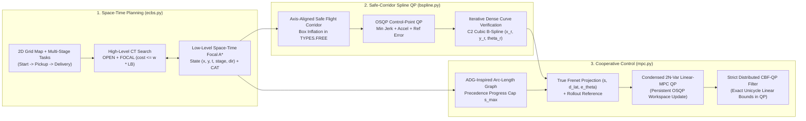

# Multi-AGV Space-Time Planning (Focal ECBS), Safe-Corridor B-Spline Optimization, and Distributed CBF-MPC Control

<div align="center">

[](https://github.com/Urami0421/multi-agv-ecbs-consensus-mpc/actions/workflows/ci.yml)
[](LICENSE)
[](https://www.python.org/)
[](https://github.com/ai-winter/python_motion_planning)

**[English](README.md) | [简体中文](README_zh.md)**

</div>

This repository implements a hierarchical multi-agent planning, trajectory optimization, and closed-loop tracking control pipeline for differential-drive Automated Guided Vehicles (AGVs) operating in multi-aisle warehouse environments. Built upon the single-robot motion planning library [`python_motion_planning`](https://github.com/ai-winter/python_motion_planning) (see [`docs/upstream.md`](docs/upstream.md) for upstream documentation), this project extends the framework from single-robot path planning to multi-agent space-time planning, safe-corridor spline optimization, schedule-synchronized execution, and quadratic-programming-based cooperative control.

---

## Visual Overview

| 2D Continuous Simulation (`Visualizer2D` + ESDF + MPC Horizon) | 3D Off-Screen PyVista/VTK Warehouse Simulation (`Visualizer3D`) |
| :---: | :---: |
|  |  |
| **8 Differential-Drive AGVs** executing two-stage (`Start -> Pickup -> Delivery`) tasks across 12 storage racks, 20 intersections, and 8 bottleneck hazards | **Synchronized 3D PyVista/VTK Scene** with 48 warehouse shelf meshes, 12 pallet stacks, and 8 Neobotix `MP-400` robot models |

---

## What Was Built (Upstream vs. This Project)

To clearly separate the foundational infrastructure inherited from [`ai-winter/python_motion_planning`](https://github.com/ai-winter/python_motion_planning) from the algorithms developed in this repository:

| Layer | Inherited Upstream Infrastructure ([`docs/upstream.md`](docs/upstream.md)) | Added / Upgraded in This Repository |
| :--- | :--- | :--- |
| **Environment & Simulation** | `Grid` occupancy map, Euclidean Signed Distance Field (`esdf`), `DiffDriveRobot`, `ToySimulator`, `Visualizer2D`, `Visualizer3D` | 72m x 44m 12-rack two-stage (`Start -> Pickup -> Delivery`) warehouse configuration ([`warehouse_8agv.yaml`](scripts/configs/warehouse_8agv.yaml)), multi-scale synthetic `.map`/`.scen` benchmark suite ([`scripts/maps/`](scripts/maps/)), and 3D multi-rack/multi-AGV scene renderer |
| **Global Multi-Agent Planning** | Single-agent 2D graph search (`AStar`, `Dijkstra`, `ThetaStar`) | **Turn-Penalized Focal ECBS & Exact CBS** ([`ecbs.py`](src/python_motion_planning/path_planner/graph_search/ecbs.py)): full two-level `OPEN` + `FOCAL` priority queues (`SOC <= w * LB`), $O(T \cdot N)$ spatial-hash conflict detection, multi-stage waypoint state expansion `(x, y, t, stage, dir)`, and Conflict Avoidance Table (`CAT`) |
| **Trajectory Optimization** | Parametric curve generators (`BSpline`, `CubicSpline`, `Bezier`, `Dubins`) | **Fixed `BSpline._approximation`** (Piegl & Tiller Eq. 9.68–9.69 knot vector averaging + SVD least-squares) and added **`SafeCorridorBSplineOptimizer`** ([`bspline.py`](src/python_motion_planning/traj_optimizer/curve_generator/point_based/bspline.py)) solving an `osqp` QP inside inflated `TYPES.FREE` axis-aligned boxes with iterative dense curve verification |
| **Schedule Synchronization** | None | **ADG-Inspired Arc-Length Precedence Graph (`ActionDependencyGraph`)** ([`mpc.py`](src/python_motion_planning/controller/path_tracker/mpc.py)): extracts the complete partial order of shared-cell visits from discrete `ECBS` plans across the full horizon to prevent intersection collisions under arbitrary execution delays |
| **Closed-Loop Control** | Single-agent trackers (`PurePursuit`, `RPP`, `PID`, `DWA`, `APF`) | **Rollout-Linearized Receding-Horizon MPC** (`MPC` via persistent `osqp.update()` workspace and true Frenet projection), **Strict Distributed CBF-QP Safety Filter** (`cbf_qp_filter` with exact linear unicycle bounds inside the QP, full $2l$ lookahead offset compensation, and zero post-blending), **`ConsensusMPC`** (`ADG + Linear-MPC + CBF-QP`), and **Non-Holonomic `ORCAController`** (Alonso-Mora et al., 2013) |

---

## System Architecture & Mathematical Formulation



### 1. Turn-Penalized Focal ECBS ([`ecbs.py`](src/python_motion_planning/path_planner/graph_search/ecbs.py))

Given $M$ agents with ordered task stops $\mathcal{W}_i = (s_i, p_i, g_i)$, the low-level planner searches over the augmented state space $\sigma = (x, y, t, k_{\text{stage}}, d_{\text{prev}})$ with step cost:

$$
c(\sigma \to \sigma') = 1 + \lambda_{\text{turn}} \cdot \mathbb{I}(d' \neq \text{wait} \;\wedge\; d_{\text{prev}} \neq \varnothing \;\wedge\; d' \neq d_{\text{prev}})
$$

Both the low-level search and high-level Constraint Tree (CT) maintain complete `OPEN` and `FOCAL` priority queues with lazy deletion and dynamic threshold updates whenever $f_{\min}$ or $LB_{\min} = \min_{N \in \text{OPEN}} \sum_i f_{\min, i}(N)$ increases:

$$
\text{FOCAL}_{\text{low}} = \left\{ \sigma \in \text{OPEN}_{\text{low}} \;\middle|\; f(\sigma) \le w \cdot f_{\min} \right\}, \qquad
\text{FOCAL}_{\text{CT}} = \left\{ N \in \text{OPEN}_{\text{CT}} \;\middle|\; \text{SOC}(N) \le w \cdot LB_{\min} \right\}
$$

Vertex and edge-swap conflicts are detected in $O(T \cdot M)$ time per CT node via spatial hash tables (`ECBS.detect_conflicts`).

### 2. Safe-Corridor $C^2$ Cubic B-Spline Optimization ([`bspline.py`](src/python_motion_planning/traj_optimizer/curve_generator/point_based/bspline.py))

1. **Upstream Approximation Bug Fix**: Upstream `BSpline._approximation` previously passed a knot vector of length $n + k + 1$ when solving for $h = n - 1$ control points, causing the basis partition of unity $\sum_{i=0}^{h} N_{i,k}(t) = 1$ to break down near $t \to 1$. We implemented Piegl & Tiller (1997) Eq. 9.68–9.69 parameter averaging (`_approximation_knot_generation`) to construct the exact $(h + k + 1)$-length knot vector and solved the normal equations via SVD (`np.linalg.lstsq`), reducing collinear approximation error below $10^{-14}\text{ m}$.
2. **OSQP Safe-Corridor Control-Point QP (`SafeCorridorBSplineOptimizer`)**: Around each non-pinned waypoint $p_i^{\text{ref}} = (x_i^{\text{ref}}, y_i^{\text{ref}})$, an axis-aligned box $[l_{x,i}, u_{x,i}] \times [l_{y,i}, u_{y,i}] \subset \text{TYPES.FREE}$ is inflated up to $\pm 0.42\text{ m}$. Control points $c \in \mathbb{R}^m$ are optimized via `osqp`:

$$
\min_{c \in \mathbb{R}^m} \; w_{\text{jerk}} \|D_3 c\|_2^2 + w_{\text{acc}} \|D_2 c\|_2^2 + w_{\text{ref}} \|c - p^{\text{ref}}\|_2^2 \quad \text{s.t.} \quad l \le c \le u, \;\; c_0 = p_0^{\text{ref}}, \;\; c_{m-1} = p_{m-1}^{\text{ref}}
$$

Because assigning an independent box $[l_i, u_i]$ to each control point does not guarantee that the 4-point convex hull of consecutive control points stays inside non-convex corner transitions, `SafeCorridorBSplineOptimizer` performs an **iterative post-optimization dense curve sampling verification and control-point pull-back loop** (up to 8 iterations at step `0.02`), verifying that 100% of sampled trajectory points lie strictly inside `TYPES.FREE`.

### 3. Arc-Length Precedence Graph, Pure Rollout Linear-MPC & Strict CBF-QP ([`mpc.py`](src/python_motion_planning/controller/path_tracker/mpc.py))

1. **ADG-Inspired Arc-Length Precedence Graph (`ActionDependencyGraph`)**: Adapted from Hönig et al. (IEEE RA-L 2019) for continuous arc-length parameterized paths, this module extracts the complete partial order of shared-cell visits $(i, s_i^{\text{leave}}) \prec (j, s_j^{\text{hold}})$ across the entire `ECBS` plan horizon ($t_i < t_j$, with no time-window cutoff). During execution, agent $j$'s reference arc-length progress is capped at $s_j^{\text{hold}}$ until predecessor $i$ clears $s_i^{\text{leave}}$.
2. **Pure Rollout-Linearized Error-State MPC (`MPC`)**: Projects the robot pose onto the reference curve to obtain exact Frenet coordinates $(s, d_{\text{lat}}, e_\theta)$, rolls out a kinematically consistent nominal trajectory $\bar{x}_{k+1} = f(\bar{x}_k, u_{\text{ref},k})$ from $\bar{x}_0 = x_0$ over horizon $N = 8$, and solves the condensed $2N$-variable QP via a persistent `osqp` workspace (`self._mpc_osqp.update(Px=..., q=..., l=..., u=...)` with warm-starting, taking $\sim 27\,\mu\text{s}$ internal C solve time):

$$
\min_{\tilde{U} \in \mathbb{R}^{2N}} \; (e_{\text{free}} + \Gamma \tilde{U})^\top \bar{Q} (e_{\text{free}} + \Gamma \tilde{U}) + \tilde{U}^\top \bar{R} \tilde{U} + (D_u(U_{\text{ref}} + \tilde{U}) - u_{\text{prev}})^\top \bar{S} (D_u(U_{\text{ref}} + \tilde{U}) - u_{\text{prev}})
$$

The first-step QP solution $u_0 = u_{\text{ref},0} + \tilde{u}_0^\star$ is applied directly without heuristic steering overrides or post-blending.
3. **Strict Distributed CBF-QP Safety Filter (`cbf_qp_filter`)**: Maps unicycle state $(x_i, y_i, \theta_i)$ to a lookahead point $p_i = [x_i + l\cos\theta_i,\; y_i + l\sin\theta_i]^\top$ via Near-Identity Diffeomorphism ($l = 0.04\text{ m}$), where $\dot{p}_i = J(\theta_i)[v_i, \omega_i]^\top = u_i$ and $J(\theta_i) = R(\theta_i)\operatorname{diag}(1, l)$. For all neighbors $j$ within sensing range (using neighbor $j$'s true lookahead velocity $\hat{u}_j = J(\theta_j)[v_j, \omega_j]^\top$ and full $2l$ offset compensation $d_{\text{safe,eff}} = r_i + r_j + 2l + d_{\text{margin}}$ so $\|p_i - p_j\|_2 \ge d_{\text{safe,eff}} \implies \|x_i - x_j\|_2 \ge r_i + r_j + d_{\text{margin}}$), a persistent 2-variable `osqp` workspace solves:

$$
\begin{aligned}
\min_{u_i \in \mathbb{R}^2} \quad & (u_i - u_{i,\text{nom}})^\top M(\theta_i) (u_i - u_{i,\text{nom}}) \\
\text{s.t.} \quad & -2(p_i - p_j)^\top u_i \le \alpha_{ij} \gamma h_{ij} - 2(p_i - p_j)^\top \hat{u}_j, \quad \forall j \in \mathcal{N}_i \\
& 0 \le [\cos\theta_i,\; \sin\theta_i] u_i \le v_{\max}, \qquad -\omega_{\max} \le \tfrac{1}{l}[-\sin\theta_i,\; \cos\theta_i] u_i \le \omega_{\max}
\end{aligned}
$$

where $h_{ij} = \|p_i - p_j\|_2^2 - d_{\text{safe,eff}}^2$ and $M(\theta_i) = J(\theta_i)^{-\top}\operatorname{diag}(1, \rho_\omega)J(\theta_i)^{-1}$. Because the exact linear unicycle actuation bounds $0 \le v_i \le v_{\max}$ and $|\omega_i| \le \omega_{\max}$ are enforced directly inside the QP, the inverse-NID output $[v_{i,\text{safe}}, \omega_{i,\text{safe}}]^\top = J(\theta_i)^{-1} u_i^\star$ satisfies both the CBF barrier inequality and the robot actuation limits without post-clipping or angular-velocity blending.

---

## Experimental Evaluation

> **Experimental Environment**: All benchmarks were executed on Windows 11 (Python 3.13.7, NumPy 2.x, SciPy 1.15, OSQP 1.1.2) using single-threaded CPU execution. Planning wall-clock times are measured with `time.perf_counter()` over 10 independent repetitions (reporting median and P90). All raw benchmark outputs are committed in [`results/`](results/).

### 1. 4-Group MAPF Ablation on the 8-AGV Two-Stage Warehouse ([`results/mapf_ablation.csv`](results/mapf_ablation.csv))


All 5 methods use the **exact same low-level space-time A\* engine** (`ECBS._focal_low_level_astar`) so that state expansions and runtimes are directly comparable:

| Planner Variant | $w$ | $\lambda_{\text{turn}}$ | Vertex/Edge Conflicts | High-Level CT Nodes | Low-Level Expanded States | Total Steps | Total 90° Turns | Suboptimality (`SOC / LB`) | Median Time (ms) | P90 Time (ms) |
| :--- | :---: | :---: | :---: | :---: | :---: | :---: | :---: | :---: | :---: | :---: |
| **Independent A\*** (No Inter-Agent Constraints) | 1.00 | 0.00 | 2 (Infeasible) | 1 | 601 | 465 | 44 | N/A | 6.10 | 6.31 |
| **CBS** (Exact Baseline) | 1.00 | 0.00 | **0** | 8 | 2,188 | 466 | 46 | 1.0000 | 25.93 | 26.12 |
| **CBS + Turn Penalty** | 1.00 | 0.45 | **0** | 15 | 6,245 | 466 | 28 | 1.0000 | 68.10 | 69.28 |
| **ECBS** (Focal Only) | 1.08 | 0.00 | **0** | **1** | **650** | 466 | 46 | 1.0022 | **8.80** | **9.03** |
| **ECBS + Turn Penalty (Ours)** | 1.08 | 0.45 | **0** | **1** | 1,302 | 467 | **27** | 1.0120 | 15.71 | 16.06 |

**Key Findings from the 4-Group Ablation**:
- **Role of Turn Penalty ($\lambda_{\text{turn}} = 0.45$)**: Adding $\lambda_{\text{turn}} = 0.45$ reduces 90-degree turns from `46` to `27–28` (`-41.3%`), eliminating staircase oscillations. However, under exact search (`CBS + Turn`), expanding over heading directions `(x, y, t, dir)` increases low-level expansions from `2,188` to `6,245` (`25.93 ms -> 68.10 ms`).
- **Role of Focal Heuristic ($w = 1.08$)**: Introducing the focal queue with the Conflict Avoidance Table (`CAT`) resolves all inter-agent conflicts at the root CT node (`HL = 1`), reducing low-level state expansions by **79.2%** compared to `CBS + Turn` (`6,245 -> 1,302` states, **4.33x speedup**) and by **40.5%** compared to standard `CBS` (`2,188 -> 1,302` states, **1.65x speedup**), while increasing total path length by only 1 grid step (`466 -> 467`).
- Full parameter sweep across $w \in \{1.01, 1.05, 1.08, 1.20, 1.50\} \times \lambda_{\text{turn}} \in \{0.00, 0.20, 0.45, 1.00\}$ is available in [`results/mapf_param_sweep.csv`](results/mapf_param_sweep.csv).

### 2. Multi-Scale Synthetic Grid Benchmark ([`results/synthetic_grid_benchmark.csv`](results/synthetic_grid_benchmark.csv))

Evaluated across **all 9 map/scale combinations** (`3` self-contained synthetic grid topologies in [`scripts/maps/`](scripts/maps/) $\times$ $N \in \{8, 16, 32\}$ agents) with a default high-level expansion cap of 250 CT nodes:

| Synthetic Map (`scripts/maps/`) | Free Cells | Agents ($N$) | Planner | Solved | High-Level CT Nodes | Low-Level Expanded | Total Steps | Total Turns | `SOC / LB` | Planning Time (ms) |
| :--- | :---: | :---: | :--- | :---: | :---: | :---: | :---: | :---: | :---: | :---: |
| `synthetic_warehouse_48x32` | 1,080 | 8 | CBS ($w=1.0, \lambda=0$) | Yes | 2 | 1,056 | 153 | 15 | 1.0000 | 8.85 |
| `synthetic_warehouse_48x32` | 1,080 | 8 | ECBS ($w=1.08, \lambda=0.45$) | Yes | **1** | **839** | 153 | **10** | 1.0000 | **8.60** |
| `synthetic_warehouse_48x32` | 1,080 | 16 | CBS ($w=1.0, \lambda=0$) | Yes | 3 | 1,312 | 295 | 30 | 1.0000 | 12.33 |
| `synthetic_warehouse_48x32` | 1,080 | 16 | ECBS ($w=1.08, \lambda=0.45$) | Yes | **1** | **1,044** | 295 | **20** | 1.0048 | **11.90** |
| `synthetic_warehouse_48x32` | 1,080 | 32 | CBS ($w=1.0, \lambda=0$) | No (Cap 250) | 250 | 136,397 | — | — | — | 1,390.28 |
| `synthetic_warehouse_48x32` | 1,080 | 32 | ECBS ($w=1.08, \lambda=0.45$) | **Yes** | **3** | **4,127** | **630** | **41** | 1.0184 | **51.86** |
| `synthetic_random_32x32_20` | 813 | 8 | CBS ($w=1.0, \lambda=0$) | Yes | 2 | **321** | 144 | 30 | 1.0000 | **3.34** |
| `synthetic_random_32x32_20` | 813 | 8 | ECBS ($w=1.08, \lambda=0.45$) | Yes | **1** | 437 | 144 | **13** | 1.0000 | 5.56 |
| `synthetic_random_32x32_20` | 813 | 16 | CBS ($w=1.0, \lambda=0$) | Yes | 5 | **1,707** | 292 | 52 | 1.0000 | **17.03** |
| `synthetic_random_32x32_20` | 813 | 16 | ECBS ($w=1.08, \lambda=0.45$) | Yes | **2** | 2,074 | 292 | **24** | 1.0082 | 24.91 |
| `synthetic_random_32x32_20` | 813 | 32 | CBS ($w=1.0, \lambda=0$) | Yes | 16 | 7,239 | **532** | 108 | 1.0000 | **73.76** |
| `synthetic_random_32x32_20` | 813 | 32 | ECBS ($w=1.08, \lambda=0.45$) | Yes | **6** | **5,483** | 534 | **58** | 1.0146 | 73.88 |
| `synthetic_room_32x32_4` | 801 | 8 | CBS ($w=1.0, \lambda=0$) | Yes | 3 | **7,151** | **145** | 28 | 1.0000 | **57.32** |
| `synthetic_room_32x32_4` | 801 | 8 | ECBS ($w=1.08, \lambda=0.45$) | Yes | **2** | 8,202 | 146 | **15** | 1.0126 | 78.72 |
| `synthetic_room_32x32_4` | 801 | 16 | CBS ($w=1.0, \lambda=0$) | Yes | 123 | 133,695 | **273** | 62 | 1.0000 | 1,150.87 |
| `synthetic_room_32x32_4` | 801 | 16 | ECBS ($w=1.08, \lambda=0.45$) | Yes | **4** | **12,368** | 274 | **30** | 1.0170 | **123.00** |
| `synthetic_room_32x32_4` | 801 | 32 | CBS ($w=1.0, \lambda=0$) | No (Cap 250) | 250 | 18,531 | — | — | — | 418.83 |
| `synthetic_room_32x32_4` | 801 | 32 | ECBS ($w=1.08, \lambda=0.45$) | **Yes** | **8** | **14,425** | **561** | **57** | 1.0357 | **160.55** |

**When Does `ECBS` Outperform `CBS` (and When Does It Not)?**
- **Small / Low-Conflict Instances ($N \le 16$ on open random grids, $N = 8$ on rooms)**: When standard `CBS` only needs `2–5` high-level CT nodes to resolve sparse conflicts, `ECBS (w=1.08, λ=0.45)` is **slower** (`5.56 ms` vs. `3.34 ms` at $N=8$ on `synthetic_random_32x32_20`; `24.91 ms` vs. `17.03 ms` at $N=16$; `78.72 ms` vs. `57.32 ms` at $N=8$ on `synthetic_room_32x32_4`). This is because `ECBS` pays per-expansion overhead to build the Conflict Avoidance Table (`CAT`), maintain two synchronized heaps (`OPEN` and `FOCAL`), and expand over 4 heading directions `(x, y, t, dir)` to cut 90-degree turns by `46%–57%`.
- **High-Density / Bottlenecked Instances ($N \ge 16$ in rooms, $N = 32$ in warehouse and rooms)**: Once doorway or aisle congestion triggers combinatorial high-level CT branching in `CBS`, `ECBS` achieves dramatic speedups: **9.36x faster** on `synthetic_room_32x32_4` at $N=16$ (`123.00 ms` vs. `1,150.87 ms`, `4` vs. `123` CT nodes), and solves both $N=32$ `synthetic_warehouse_48x32` (`51.86 ms`, `3` CT nodes) and $N=32$ `synthetic_room_32x32_4` (`160.55 ms`, `8` CT nodes) where `CBS` exhausts the 250-node cap (if the cap is raised to 5,000 CT nodes, `CBS` requires `~35 s` and `2,677` CT nodes on `synthetic_warehouse_48x32` at $N=32$, and still fails to solve `synthetic_room_32x32_4` at $N=32$).

### 3. 10-Variant Component-Isolation Controller Ablation ([`results/control_ablation.csv`](results/control_ablation.csv))


To isolate the exact contribution of **`ADG`**, **`Linear-MPC`**, and **`CBF-QP`**, all 10 controller variants track the same 8-AGV `ECBS + SafeCorridorBSplineOptimizer` trajectories (`dt = 0.1 s`, horizon `30.5 s`, physical contact threshold $2R = 0.88\text{ m}$, safety envelope $0.90\text{ m}$). Both **OSQP internal C solver time** (`osqp_mean_us / osqp_p95_us`) and **total Python + OSQP step wall time** (`wall_mean_us / wall_p95_us`) are reported:

| Controller Variant | Active Modules (`ADG` / `Tracker` / `Safety`) | Collision Events | Min Pairwise Dist (m) | Two-Stage Completion | Incomplete Agents | Makespan (s) | Mean Speed (m/s) | Total Stop Time (s) | Mean Terminal Error (m) | OSQP Internal C Time Mean / P95 ($\mu$s) | Step Wall Time Mean / P95 ($\mu$s) |
| :--- | :--- | :---: | :---: | :---: | :---: | :---: | :---: | :---: | :---: | :---: | :---: |
| `PurePursuit` | — / `PurePursuit` / — | 4 | 0.504 | 100.0% | 0 | 26.6 | 2.535 | 0.8 | 0.209 | — | — |
| `RPP` | — / `Regulated PP` / — | 2 | 0.509 | 100.0% | 0 | 27.2 | 2.467 | 0.8 | 0.249 | — | — |
| `DWA` | — / `DWA` / Local Cost | 1 | 0.639 | 0.0% | 8 | 30.5 | 2.001 | 10.3 | 19.557 | — | — |
| `ORCA` (`NH-ORCA`) | — / `Lookahead` / `NH-ORCA QP` | 4 | 0.626 | 50.0% | 4 | 30.5 | 1.235 | 89.0 | 18.644 | 4.3 / 11.4 | 58.5 / 114.6 |
| `ADG_ORCA` | `ADG` / `Lookahead` / `NH-ORCA QP` | **0** | 0.923 | **100.0%** | **0** | 29.8 | 2.235 | 4.1 | **0.173** | **1.1 / 11.0** | **22.8 / 91.8** |
| `ADG_PurePursuit` | `ADG` / `PurePursuit` / — | 3 | 0.662 | 100.0% | 0 | **26.3** | 2.478 | 2.2 | 0.209 | — | — |
| `ADG_PurePursuit_CBF` | `ADG` / `PurePursuit` / `CBF-QP` | **0** | **1.047** | **100.0%** | **0** | 27.0 | 2.306 | 8.2 | 0.202 | 12.2 / 23.4 | 98.7 / 183.5 |
| `ADG_LinearMPC` | `ADG` / `Linear-MPC` / — | **0** | 0.991 | **100.0%** | **0** | 26.5 | 2.423 | 1.0 | 0.549 | 26.7 / 49.3 | 423.6 / 494.3 |
| `LinearMPC_CBF` | — / `Linear-MPC` / `CBF-QP` | **0** | 0.970 | **100.0%** | **0** | 30.3 | 2.206 | 8.7 | 0.276 | 31.1 / 60.5 | 448.5 / 556.3 |
| **`ConsensusMPC` (Full)** | **`ADG` / `Linear-MPC` / `CBF-QP`** | **0** | **1.030** | **100.0%** | **0** | 28.0 | 2.294 | 3.5 | 0.549 | 27.0 / 51.4 | 431.7 / 537.8 |

### 4. 20-Seed Randomized Actuator Stall & Perturbation Robustness ([`results/perturbation_robustness.csv`](results/perturbation_robustness.csv))

In each of **20 genuinely randomized trials** (`rng = random.Random(1000 + trial_idx)`), 2 AGVs are sampled uniformly at random without replacement (`rng.sample(rids, k=2)`) and subjected to a complete actuator freeze (`v = 0, omega = 0`) starting at a random step $t_{\text{start}} \sim \mathcal{U}\{35, \dots, 110\}$ for a random duration $\Delta t \sim \mathcal{U}[2.0, 3.5]\text{ s}$, combined with $15\times$ higher Gaussian velocity noise (`noise = 0.015`, horizon `33.5 s`):

| Controller Variant | Random Trials | Mean Collisions | Max Collisions | Worst-Case Min Clearance (m) | Mean Two-Stage Completion | Mean Makespan (s) |
| :--- | :---: | :---: | :---: | :---: | :---: | :---: |
| `PurePursuit` (Open-Loop Schedule) | 20 | 4.10 | 5 | 0.434 | **100.0%** | 27.98 |
| `ORCA` (`NH-ORCA`, No ADG) | 20 | 3.60 | 4 | 0.602 | 66.2% | 33.31 |
| `ADG_ORCA` (`ADG + NH-ORCA`) | 20 | 0.90 | 2 | 0.707 | 85.6% | 31.31 |
| `ADG_PurePursuit` (`ADG` Only, No CBF) | 20 | 2.30 | 4 | 0.614 | **100.0%** | 27.84 |
| `ADG_PurePursuit_CBF` (`ADG + PP + CBF-QP`) | 20 | **0.00** | **0** | **1.016** | 90.0% | 29.80 |
| `ADG_LinearMPC` (`ADG + Linear-MPC`, No CBF) | 20 | 0.55 | 2 | 0.578 | 99.4% | 29.72 |
| `LinearMPC_CBF` (`Linear-MPC + CBF-QP`, No ADG) | 20 | 0.05 | 1 | 0.842 | 86.3% | 32.89 |
| **`ConsensusMPC` (`ADG + Linear-MPC + CBF-QP`)** | 20 | **0.00** | **0** | **0.926** | **96.3%** | 30.40 |

**Component-Isolation Findings (Nominal vs. 20 Random Perturbation Trials)**:
1. **Contribution of `CBF-QP` (`ADG_LinearMPC` vs. `ConsensusMPC`, and `ADG_PurePursuit` vs. `ADG_PurePursuit_CBF`)**:
   - On the nominal unperturbed schedule, `ADG_LinearMPC` achieves `0` collisions (`min_dist = 0.991 m`) because `Linear-MPC` tracks the B-Spline corridors tightly. However, under random 2.0–3.5s stalls, an AGV frozen in a non-intersection corridor segment cannot be bypassed safely by `ADG` alone, causing `ADG_LinearMPC` to suffer **`0.55` mean collisions (`max = 2`, `min_clearance = 0.578 m`)** and `ADG_PurePursuit` to suffer **`2.30` mean collisions**.
   - Adding the strict `CBF-QP` safety filter (`ConsensusMPC` and `ADG_PurePursuit_CBF`) eliminates **100% of collisions (`0.00` mean collisions, `0` max collisions across all 20 trials, worst-case clearance `0.926 m` and `1.016 m` > $2R = 0.88\text{ m}$)**.
2. **Contribution of `ADG` (`LinearMPC_CBF` vs. `ConsensusMPC`, and `ORCA` vs. `ADG_ORCA`)**:
   - Without `ADG` (`LinearMPC_CBF`), purely reactive `CBF-QP` braking causes AGVs to enter narrow-aisle standoffs when random stalls shift arrival order, reducing two-stage completion to **`86.3%`** (`makespan = 32.89 s`) and incurring `0.05` mean collisions (`1` three-agent pinch event across 20 trials). Similarly, adding `ADG` to `NH-ORCA` (`ADG_ORCA`) reduces nominal collisions from `4` to **`0`** (`100%` completion) and random-stall collisions from `3.60` to `0.90`.
   - Combining `ADG` with `Linear-MPC + CBF-QP` (`ConsensusMPC`) raises perturbed two-stage completion from **`86.3% -> 96.3%`** while maintaining **zero collisions** across all 20 trials.
3. **Contribution of `Linear-MPC` vs. `PurePursuit` under `CBF-QP` (`ADG_PurePursuit_CBF` vs. `ConsensusMPC`)**:
   - Both `ADG_PurePursuit_CBF` and `ConsensusMPC` achieve `0.00` collisions across all 20 random stall trials. However, because `PurePursuit`'s `2.4 m` geometric lookahead cuts 90-degree corners toward adjacent lanes, it triggers `CBF-QP` braking more frequently during stalls, yielding a **`90.0%`** finite-horizon completion rate vs. **`96.3%`** for `ConsensusMPC`.

---

## Quickstart & Reproducibility

### 1. Installation

```bash
git clone https://github.com/Urami0421/multi-agv-ecbs-consensus-mpc.git
cd multi-agv-ecbs-consensus-mpc

# Core planning & control dependencies only (numpy, scipy, osqp, pyyaml)
pip install -e .

# Full installation including 2D/3D visualization, simulator, and test suite
pip install -e ".[all]"
```

### 2. Run Unit Tests (12 Test Cases)

```bash
pytest -v
```

### 3. Reproduce Benchmarks, CSV Tables & Visualizations

```bash
# 1. Run 4-group MAPF ablation (10 repeats), (w, turn_penalty) sweep, and synthetic grid benchmark
python scripts/benchmark_mapf.py

# 2. Run 10-variant controller ablation and 20-seed randomized perturbation robustness suite
python scripts/benchmark_control.py

# 3. Render 2D Matplotlib simulation GIF (assets/multi_agv_consensus_mpc_2d.gif)
python scripts/render_2d.py

# 4. Render 3D PyVista/VTK off-screen simulation GIF (assets/multi_agv_consensus_mpc_3d.gif)
python scripts/render_3d.py

# Or run the entire pipeline end-to-end (use --skip-gifs for fast benchmark-only execution)
python scripts/run_multi_agv_ecbs_consensus_demo.py --skip-gifs
```

---

## Limitations & Trade-Off Analysis

1. **Terminal Stopping Error (`0.549 m` for `Linear-MPC` / `ConsensusMPC` vs. `0.209 m` for `PurePursuit`)**:
   - In [`results/control_ablation.csv`](results/control_ablation.csv), `ADG_LinearMPC` and `ConsensusMPC` exhibit a mean terminal distance to the delivery cell center of `0.549 m` (within the configured `goal_dist_tol = 0.70 m`), compared to `0.209 m` for `PurePursuit` and `0.173 m` for `ADG_ORCA`.
   - **Cause**: `Linear-MPC` penalizes control effort ($\bar{R}$) and slew rate ($\bar{S}$) over the 8-step receding horizon and begins smooth deceleration earlier as `dist_to_goal` approaches `goal_dist_tol = 0.70 m`, whereas `PurePursuit` drives at higher speed right up to the stopping threshold. Tightening `goal_dist_tol` (e.g., to `0.25 m`) reduces terminal error at the cost of a `~1.5 s` longer makespan.
2. **Finite-Horizon Completion Rate Under Severe Stalls (`96.3%` for `ConsensusMPC` vs. `100.0%` for `PurePursuit`)**:
   - Across the 20 random stall trials ([`results/perturbation_robustness.csv`](results/perturbation_robustness.csv)), uncoordinated `PurePursuit` achieves `100.0%` completion within the fixed `33.5 s` (`335`-step) simulation window because agents never wait for stalled teammates—resulting in `4.10` collisions per trial.
   - By contrast, `ConsensusMPC` (`96.3%` completion, `0.00` collisions) and `ADG_PurePursuit_CBF` (`90.0%` completion, `0.00` collisions) enforce `ADG` schedule holds and `CBF-QP` safety barriers; when a random 3.5-second stall hits a predecessor late in the episode ($t_{\text{start}} \ge 95$), downstream dependents must wait until the stall clears and finish at `34–35 s` (just past the `33.5 s` cutoff).
3. **Small-Instance Overhead of `ECBS` ($N \le 16$)**:
   - As shown in [`results/synthetic_grid_benchmark.csv`](results/synthetic_grid_benchmark.csv), on low-density or open instances where standard `CBS` expands only `2–5` high-level CT nodes (`synthetic_random_32x32_20` at $N=8, 16$ and `synthetic_room_32x32_4` at $N=8$), `ECBS` is `1.4x–1.7x` slower in wall-clock time due to `CAT` construction, dual-queue (`OPEN`/`FOCAL`) maintenance, and 4-direction turn-penalized state expansion. `ECBS` is specifically advantageous when conflict density or bottleneck topology causes `CBS` high-level branching to blow up ($N \ge 16$ in rooms, $N = 32$ in warehouse/rooms).
4. **Simplified Arc-Length `ADG` vs. Full Kinodynamic ADG**:
   - Our `ActionDependencyGraph` extracts Type-2 spatial ordering edges directly in continuous arc-length space $s$ rather than constructing a discrete segment-by-segment bipartite graph with explicit communication message passing. While removing the time-window cutoff makes it robust to arbitrary stall durations on fixed paths, it cannot dynamically re-route an agent around a permanently broken-down AGV (which requires online MAPF replanning).
5. **Axis-Aligned Corridor Boxes & Post-Verification**:
   - `SafeCorridorBSplineOptimizer` uses decoupled axis-aligned boxes per control point together with iterative dense curve verification rather than constraining consecutive 4-control-point convex hulls inside overlapping general polytopes (Liu et al., IEEE RA-L 2017).

---

## References

1. **ECBS**: Barer, M., Sharon, G., Stern, R., & Felner, A. (2014). Suboptimal Variants of the Conflict-Based Search Algorithm for the Multi-Agent Pathfinding Problem. *Annual Symposium on Combinatorial Search (SoCS)*, 19–27.
2. **CBS**: Sharon, G., Stern, R., Felner, A., & Sturtevant, N. R. (2015). Conflict-Based Search for Optimal Multi-Agent Pathfinding. *Artificial Intelligence*, 219, 40–66.
3. **MAPF Benchmarks**: Stern, R., Sturtevant, N. R., Felner, A., Koenig, S., Ma, H., Walker, T. T., Li, J., Atzmon, D., Cohen, L., Kumar, T. K. S., Boyarski, E., & Bartak, R. (2019). Multi-Agent Pathfinding: Definitions, Variants, and Benchmarks. *SoCS*, 151–158.
4. **NURBS / B-Spline Approximation**: Piegl, L., & Tiller, W. (1997). *The NURBS Book* (2nd ed., Chapter 9, Eq. 9.68–9.69). Springer-Verlag.
5. **Action Dependency Graph (ADG)**: Hönig, W., Kiesel, S., Tinka, A., Durham, J. W., & Ayanian, N. (2019). Persistent and Robust Execution of MAPF Schedules in Warehouses. *IEEE Robotics and Automation Letters*, 4(2), 1125–1131.
6. **Linearized Mobile Robot MPC**: Kühne, F., Lages, W. F., & Gomes da Silva Jr, J. M. (2004). Model Predictive Control of a Mobile Robot Using Linearization. *Proceedings of Mechatronics and Robotics*, 525–530.
7. **Control Barrier Functions**: Ames, A. D., Xu, X., Grizzle, J. W., & Tabuada, P. (2017). Control Barrier Function Based Quadratic Programs for Safety Critical Systems. *IEEE Transactions on Automatic Control*, 62(8), 3861–3876.
8. **Multi-Robot Safety Barrier Certificates**: Wang, L., Ames, A. D., & Egerstedt, M. (2017). Safety Barrier Certificates for Collisions-Free Multirobot Systems. *IEEE Transactions on Robotics*, 33(3), 661–674.
9. **ORCA & Non-Holonomic Lookahead ORCA**: van den Berg, J., Guy, S. J., Lin, M., & Manocha, D. (2011). Reciprocal $n$-Body Collision Avoidance. *Robotics Research (ISRR)*, Springer, 3–19; Alonso-Mora, J., Breitenmoser, A., Rufli, M., Beardsley, P., & Siegwart, R. (2013). Optimal Reciprocal Collision Avoidance for Multiple Non-Holonomic Robots. *Distributed Autonomous Robotic Systems (DARS)*, 203–216.

---

## Acknowledgement

This project is built on top of [`ai-winter/python_motion_planning`](https://github.com/ai-winter/python_motion_planning) (v2.1, GPL-3.0 License) by **Haodong Yang** and **Maojia Wu**. Details of the retained upstream modules, tutorials, and citation information are provided in [`docs/upstream.md`](docs/upstream.md).
