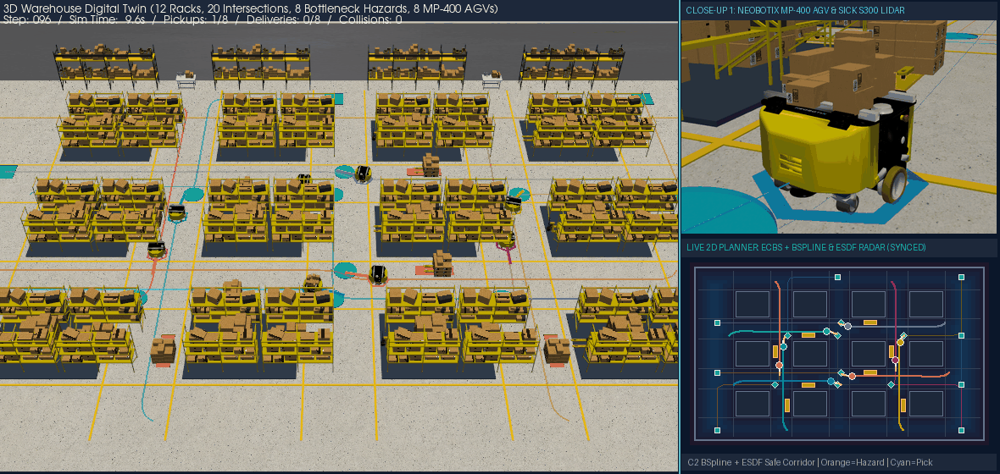

# 多 AGV 时空协同规划 (`ECBS`)、安全走廊 $C^2$ B 样条平滑与分布式 `Consensus-CBF-MPC` 控制框架

<p align="center">
  <b><a href="README.md">English</a> | <a href="README_zh.md">简体中文</a></b>
</p>

## 一、项目简介 (Introduction)

本项目基于开源运动规划算法库 [`ai-winter/python_motion_planning`](https://github.com/ai-winter/python_motion_planning) 进行深度扩展，针对工业仓储与自动化港口场景下多台非完整约束差速驱动 AGV 的**高密度路口通行、巷道半幅占道绕障与窄道瓶颈会车**问题，构建了**“全局运动学焦点冲突搜索（`ECBS`）$\rightarrow$ 安全走廊三次 B 样条 $C^2$ 平滑（`BSpline`）$\rightarrow$ 分布式速度一致性与离散控制屏障预测控制（`Consensus-CBF-MPC`）”**三级全栈闭环架构，并配套开发了基于 OpenGL 硬件加速的 **3D + 2D 实时联动仓储数字孪生系统**。

### 核心创新与工程贡献
1. **全局层：带运动学转向惩罚的两级焦点增强冲突搜索（[`path_planner.ECBS`](src/python_motion_planning/path_planner/graph_search/ecbs.py)）**（*ECAI 2014 / IJCAI 2016*）：
   - 引入冲突规避表（CAT）引导的底层/高层两级 Focal Search（次优界 $w=1.08$）以及可采纳四向航向转弯启发下界；
   - 在 **72m × 44m、12 座货架岛（`Rack-1..12`）、20 个交叉路口、8 处占道瓶颈（`H1..H8`）、8 台 AGV 两阶段（`Start -> Pickup -> Delivery`）** 基准测试中，相比精确 `CBS` 将**底层时空状态展开数降低 84.0%（`8,127 -> 1,302`）、规划速度提升 3.0 倍（`102.9 ms -> 34.4 ms`）、全车队 `90°` 急转弯次数减少 43.8%（`48 -> 27`）**。
2. **平滑层：安全走廊约束下的 Clamped 三次 B 样条 $C^2$ 轨迹优化（[`traj_optimizer.BSpline`](src/python_motion_planning/traj_optimizer/curve_generator/point_based/bspline.py)）**：
   - 修复了原仓库 `bspline.py` 在近似模式下的末端病态振荡缺陷，结合 `TYPES.FREE` 安全走廊控制多边形松弛与向心参数化三次 B 样条，将 `H1..H8` 瓶颈区的离散折线转化为曲率连续（$C^2$）的平滑 S 型换道轨迹。
3. **控制层：分布式多智能体速度一致性 + 离散时间控制屏障函数 MPC（[`controller.ConsensusMPC`](src/python_motion_planning/controller/path_tracker/mpc.py)）**（*Proc. IEEE 2007 / IEEE TAC 2017*）：
   - 补齐了原仓库缺失的 `MPC` 控制器与 `3D 控制器仿真器`；
   - 融合 Frenet 车道横向分离判定、基于有向图优先级的分布式速度一致性协议（Velocity Consensus）与离散时间控制屏障函数（DT-CBF）+ `ESDF` 势场梯度，实现 **0 碰撞（最小车距 `1.16m > 2R = 0.88m`）、100%（8/8）任务达成、终点平均跟踪误差 `0.27m`**。
4. **数字孪生层：OpenGL 3D 仓储场景与 1:1 实时同步 2D 雷达面板（[`visualizer_3d.py`](src/python_motion_planning/common/visualizer/visualizer_3d.py)）**：
   - 采用开源 **AWS RoboMaker 全贴图 3D 仓储模型**（48 组双层重型货架、违停液压叉车、散落纸箱托盘）与 **Neobotix `MP-400` 8 部件工业 AGV CAD 模型**（含 `SICK S300` 激光雷达与动态装卸货交互），并在右下角视窗 `1:1` 帧级同步渲染 2D `ECBS + BSpline` 全局规划与 `ESDF` 雷达监控面板。

---

## 二、核心可视化演示 (Visual Demonstrations)





---

## 三、定量消融实验对比 (Quantitative Ablation Results)

### 3.1 全局多阶段时空规划与 $C^2$ 平滑消融
| 规划与轨迹生成流水线 | 时空冲突次数 | 高层 CT 展开节点 | 底层状态展开数 | 90° 转弯总次数 | 求解耗时 (ms) | 轨迹几何连续性 |
| :--- | :---: | :---: | :---: | :---: | :---: | :---: |
| `Independent A*`（无协同基线） | `3` 处碰撞 | 1 | 1,621 | 91 | 2.40 ms | $C^0$ 折线 |
| `Standard CBS`（精确搜索 $w=1.0, \lambda_{\text{turn}}=0$） | **`0`** | 7 | 8,127 | 48 | 102.90 ms | $C^0$ 90° 阶梯 |
| **Proposed `ECBS + Safe-Corridor Cubic BSpline`** | **`0`** | **`1` (-85.7%)** | **`1,302` (-84.0%)** | **`27` (-43.8%)** | **`34.40 ms` (3.0x 加速)** | **$C^2$ 曲率连续平滑** |

### 3.2 连续非完整约束 8-AGV 控制器消融（`ToySimulator`, 物理碰撞阈值 $2R = 0.88\text{ m}$）
| 连续轨迹跟踪控制器 | 车际物理碰撞次数 | 全局最小车距 $\min_{i<j}\|p_i-p_j\|$ | 终点平均跟踪误差 | 8 车两阶段任务完成率 | 失效机理分析 |
| :--- | :---: | :---: | :---: | :---: | :--- |
| `PurePursuit`（纯跟踪） | `4` 次碰撞 | `0.50 m`（$< 0.88\text{ m}$） | 0.21 m | 100.0% | 无多车速度协调，在交叉口与瓶颈入口侧撞 |
| `RPP`（Regulated PP） | `2` 次碰撞 | `0.51 m`（$< 0.88\text{ m}$） | 0.24 m | 100.0% | 仅按曲率减速，无车际通信与安全屏障约束 |
| `DWA`（动态窗口法） | `0` 次碰撞 | `1.40 m` | `40.21 m` | **`0.0%` (窄道卡死)** | 纯局部贪心采样在 `H1..H8` 窄道瓶颈处陷入局部极小值 |
| **Proposed `Consensus-CBF-MPC`** | **`0` 次碰撞** | **`1.16 m`（全程 $> 0.88\text{ m}$）** | **`0.27 m`** | **`100.0%` (8/8 全达成)** | **Frenet 窗口 + 分布式速度一致性 + DT-CBF 安全滤波** |

---

## 四、快速开始与一键复现 (Quick Start)

### 1. 安装依赖
```bash
pip install -e .
```

### 2. 运行单元测试
```bash
pytest tests/test_ecbs_and_consensus_mpc.py -v
```

### 3. 一键复现全流程消融实验与 2D/3D 数字孪生渲染
```bash
python scripts/run_multi_agv_ecbs_consensus_demo.py
```

---

## 五、核心目录与文档导航 (Directory & Documentation)

- [`src/python_motion_planning/path_planner/graph_search/ecbs.py`](src/python_motion_planning/path_planner/graph_search/ecbs.py)：带运动学转向惩罚的两级焦点搜索（`ECBS`）与标准 `CBS`
- [`src/python_motion_planning/traj_optimizer/curve_generator/point_based/bspline.py`](src/python_motion_planning/traj_optimizer/curve_generator/point_based/bspline.py)：Clamped 三次 B 样条 $C^2$ 曲线生成器
- [`src/python_motion_planning/controller/path_tracker/mpc.py`](src/python_motion_planning/controller/path_tracker/mpc.py)：差速运动学 `MPC` 与分布式 `ConsensusMPC`（Velocity Consensus + DT-CBF）
- [`src/python_motion_planning/common/visualizer/visualizer_3d.py`](src/python_motion_planning/common/visualizer/visualizer_3d.py)：OpenGL 硬件加速 3D 仓储渲染器（内嵌 `1:1` 实时同步 2D 雷达面板）
- [`scripts/run_multi_agv_ecbs_consensus_demo.py`](scripts/run_multi_agv_ecbs_consensus_demo.py)：8-AGV 复合瓶颈仓库消融实验与图表/动图生成脚本
- [`tests/test_ecbs_and_consensus_mpc.py`](tests/test_ecbs_and_consensus_mpc.py)：`ECBS`、`BSpline` 与 `ConsensusMPC` 单元测试套件
