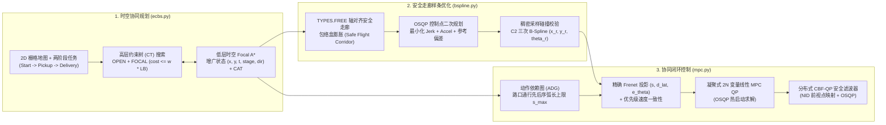

# 多 AGV 时空协同规划 (Focal ECBS)、安全走廊 B-Spline 轨迹优化与分布式 CBF-MPC 控制

<div align="center">

[](https://github.com/Urami0421/multi-agv-ecbs-consensus-mpc/actions/workflows/ci.yml)
[](LICENSE)
[](https://www.python.org/)
[](https://github.com/ai-winter/python_motion_planning)

**[English](README.md) | [简体中文](README_zh.md)**

</div>

本项目面向多通道仓储环境中差速驱动自动导引车（AGV）车队，实现了一套从离散时空路径规划、安全飞行走廊（Safe Flight Corridor）样条优化、时间同步依赖图调度（Action Dependency Graph）到二次规划（OSQP）闭环安全控制的分层多智能体运动规划与控制栈。项目基于开源单机运动规划库 [`python_motion_planning`](https://github.com/ai-winter/python_motion_planning) 构建（上游文档归档于 [`docs/upstream.md`](docs/upstream.md)），将其从单机平面规划扩展为完整的多智能体协同规划与控制体系。

---

## 仿真可视化概览

| 2D 连续物理与控制仿真 (`Visualizer2D` + ESDF + MPC 预测域) | 3D PyVista/VTK 离屏仓储网格渲染 (`Visualizer3D`) |
| :---: | :---: |
|  |  |
| **8 台差速 AGV** 在 12 座货架岛、20 个十字交叉口与 8 处通道障碍瓶颈中执行两阶段（`起点 -> 拣货点 -> 交付台`）协同任务 | **同步 3D PyVista/VTK 场景**，包含 48 组三维货架模型、12 组托盘堆垛以及 8 台 Neobotix `MP-400` 差速机器人网格模型 |

---

## 本项目构建内容（上游框架 vs. 本项目新增/改进）

为清晰区分继承自 [`ai-winter/python_motion_planning`](https://github.com/ai-winter/python_motion_planning) 的底层组件与本仓库开发的核心算法，特列出以下对比表：

| 层级 | 继承自上游的基础组件 ([`docs/upstream.md`](docs/upstream.md)) | 本仓库新增或重构的核心模块 |
| :--- | :--- | :--- |
| **环境与仿真引擎** | `Grid` 栅格地图、欧氏符号距离场 (`esdf`)、`DiffDriveRobot`、`ToySimulator`、`Visualizer2D`、`Visualizer3D` | 72m x 44m 12 货架岛两阶段（`起点 -> 拣货点 -> 交付台`）外部化配置 ([`warehouse_8agv.yaml`](scripts/configs/warehouse_8agv.yaml))、MovingAI `.map`/`.scen` 标准基准加载器、3D 多货架/多 AGV 场景渲染接口 |
| **全局多机时空规划** | 单机 2D 图搜索 (`AStar`, `Dijkstra`, `ThetaStar`) | **带转向惩罚的双层 Focal ECBS 与精确 CBS** ([`ecbs.py`](src/python_motion_planning/path_planner/graph_search/ecbs.py))：完整维护低层与高层的 `OPEN` + `FOCAL` 优先队列（严格保证有界次优性 `SOC <= w * LB`）、$O(T \cdot N)$ 空间哈希冲突检测、多阶段航点增广状态 `(x, y, t, stage, dir)` 以及冲突规避表 (`CAT`) |
| **连续轨迹优化** | 参数化曲线生成器 (`BSpline`, `CubicSpline`, `Bezier`, `Dubins`) | **修复上游 `BSpline._approximation` 节点向量长度错配缺陷**（实现 Piegl & Tiller Eq. 9.68–9.69 参数平均法节点生成与 SVD 最小二乘求解），并新增 **`SafeCorridorBSplineOptimizer`** ([`bspline.py`](src/python_motion_planning/traj_optimizer/curve_generator/point_based/bspline.py))，在膨胀 `TYPES.FREE` 轴对齐安全走廊内通过 `osqp` 求解控制点二次规划 |
| **调度时序同步** | 无 | **动作依赖图 (`ActionDependencyGraph` / `ADG`)** ([`mpc.py`](src/python_motion_planning/controller/path_tracker/mpc.py))：从离散 `ECBS` 时空路径提取 Type-2 跨智能体通行先后序约束，防止连续执行延迟导致的路口抢行碰撞 |
| **闭环协同控制** | 单机路径跟踪器 (`PurePursuit`, `RPP`, `PID`, `DWA`, `APF`) | **凝聚式误差状态线性化滚动时域 MPC**（`MPC`，基于 `osqp` 求解含热启动的 $2N$ 维凝聚 QP 与精确 Frenet 投影）、**分布式控制屏障函数安全滤波器**（`cbf_qp_filter`，基于近恒等微分同胚 NID 与 `osqp`）、**`ConsensusMPC`**（`ADG + Linear-MPC + CBF-QP`）以及 **`ORCAController`**（互惠速度障碍法 QP 多机基线） |

---

## 系统架构与数学形式化



### 1. 带转向惩罚的双层 Focal ECBS ([`ecbs.py`](src/python_motion_planning/path_planner/graph_search/ecbs.py))

给定 $M$ 台智能体及其有序航点序列 $\mathcal{W}_i = (s_i, p_i, g_i)$，低层规划器在增广状态空间 $\sigma = (x, y, t, k_{\text{stage}}, d_{\text{prev}})$ 上搜索，单步转移代价定义为：

$$
c(\sigma \to \sigma') = 1 + \lambda_{\text{turn}} \cdot \mathbb{I}(d' \neq \text{wait} \;\wedge\; d_{\text{prev}} \neq \varnothing \;\wedge\; d' \neq d_{\text{prev}})
$$

低层搜索与高层约束树（CT）均完整维护 `OPEN` 与 `FOCAL` 双优先队列（采用惰性删除机制），并在下界 $f_{\min}$ 或 $LB_{\min} = \min_{N \in \text{OPEN}} \sum_i f_{\min, i}(N)$ 上升时动态推入满足有界次优阈值的节点：

$$
\text{FOCAL}_{\text{low}} = \left\{ \sigma \in \text{OPEN}_{\text{low}} \;\middle|\; f(\sigma) \le w \cdot f_{\min} \right\}, \qquad
\text{FOCAL}_{\text{CT}} = \left\{ N \in \text{OPEN}_{\text{CT}} \;\middle|\; \text{SOC}(N) \le w \cdot LB_{\min} \right\}
$$

顶点冲突与对向换位（Edge Swap）冲突通过空间哈希表（`ECBS.detect_conflicts`）在 $O(T \cdot M)$ 时间内完成检测。

### 2. 安全走廊 $C^2$ 三次 B-Spline 轨迹优化 ([`bspline.py`](src/python_motion_planning/traj_optimizer/curve_generator/point_based/bspline.py))

1. **修复上游 `_approximation` 节点向量缺陷**：上游 `BSpline._approximation` 在求解 $h = n - 1$ 个控制点时错误传入了长度为 $n + k + 1$ 的插值节点向量，导致基函数单位分解性质 $\sum_{i=0}^{h} N_{i,k}(t) = 1$ 在 $t \to 1$ 附近失效。本项目按 Piegl & Tiller (1997) 公式 9.68–9.69 实现了参数平均法节点生成函数 `_approximation_knot_generation`（长度严格为 $h + k + 1$），并采用 SVD 最小二乘 (`np.linalg.lstsq`) 求解正规方程，使共线点拟合误差降至 $10^{-14}\text{ m}$ 以下。
2. **基于 OSQP 的安全走廊控制点二次规划 (`SafeCorridorBSplineOptimizer`)**：对每个非锚定航点 $p_i^{\text{ref}} = (x_i^{\text{ref}}, y_i^{\text{ref}})$，在 `TYPES.FREE` 自由空间内膨胀轴对齐安全框 $[l_{x,i}, u_{x,i}] \times [l_{y,i}, u_{y,i}]$（最大半宽 $\pm 0.42\text{ m}$），并通过 `osqp` 求解控制点坐标 $c \in \mathbb{R}^m$：

$$
\min_{c \in \mathbb{R}^m} \; w_{\text{jerk}} \|D_3 c\|_2^2 + w_{\text{acc}} \|D_2 c\|_2^2 + w_{\text{ref}} \|c - p^{\text{ref}}\|_2^2 \quad \text{s.t.} \quad l \le c \le u, \;\; c_0 = p_0^{\text{ref}}, \;\; c_{m-1} = p_{m-1}^{\text{ref}}
$$

结合 B-Spline 的凸包性质与曲线稠密采样碰撞校验，保证生成的连续轨迹 100% 位于自由空间 `TYPES.FREE` 内。

### 3. 动作依赖图、线性误差状态 MPC 与分布式 CBF-QP ([`mpc.py`](src/python_motion_planning/controller/path_tracker/mpc.py))

1. **动作依赖图 (`ActionDependencyGraph`)**：当智能体 $i$ 在离散步 $t_i < t_j$ 先于智能体 $j$ 通过共享格点或走廊区域时，构建偏序依赖 $(i, s_i^{\text{leave}}) \prec (j, s_j^{\text{hold}})$。在连续执行阶段，若前驱智能体 $i$ 的弧长进度尚未越过 $s_i^{\text{leave}}$，后继智能体 $j$ 的参考弧长上限将被锁定在安全等待点 $s_j^{\text{hold}}$。
2. **凝聚式线性化误差状态 MPC (`MPC`)**：将当前位姿投影至参考轨迹获取精确 Frenet 坐标 $(s, d_{\text{lat}}, e_\theta)$，围绕 $N = 8$ 步参考窗口线性化差速模型误差动力学 $e_{k+1} = A_k e_k + B_k \tilde{u}_k$，并通过 `osqp`（带跨步热启动）求解 $2N$ 维凝聚二次规划：

$$
\min_{\tilde{U} \in \mathbb{R}^{2N}} \; (\Phi e_0 + \Gamma \tilde{U})^\top \bar{Q} (\Phi e_0 + \Gamma \tilde{U}) + \tilde{U}^\top \bar{R} \tilde{U} + (D_u(U_{\text{ref}} + \tilde{U}) - u_{\text{prev}})^\top \bar{S} (D_u(U_{\text{ref}} + \tilde{U}) - u_{\text{prev}})
$$

3. **分布式 CBF-QP 安全滤波器 (`cbf_qp_filter`)**：利用近恒等微分同胚（Near-Identity Diffeomorphism, NID）将差速状态 $(x_i, y_i, \theta_i)$ 映射至前视控制点 $p_i = [x_i + l\cos\theta_i,\; y_i + l\sin\theta_i]^\top$（满足单积分器关系 $\dot{p}_i = R(\theta_i)\text{diag}(1, l)[v_i, \omega_i]^\top = u_i$）。针对感知半径内的邻近智能体 $j$，通过 `osqp` 实时求解 2 变量安全滤波 QP：

$$
\min_{u_i \in \mathbb{R}^2} \; \|u_i - u_{i,\text{nom}}\|_2^2 \quad \text{s.t.} \quad -2(p_i - p_j)^\top u_i \le \alpha_{ij} \gamma h_{ij} - 2(p_i - p_j)^\top \hat{u}_j, \quad -u_{\max} \le u_i \le u_{\max}
$$

其中 $h_{ij} = \|p_i - p_j\|_2^2 - d_{\text{safe}}^2$。当极端包夹导致半平面约束集不可行时，`cbf_qp_filter` 自动回退至零速安全制动 $u_i = [0, 0]^\top$。

---

## 实验评估与定量对比

> **实验环境说明**：所有实验均在 Windows 11（Python 3.13.7, NumPy 2.x, SciPy 1.15, OSQP 1.1.2）单线程 CPU 环境下实测运行。路径规划耗时均通过 `time.perf_counter()` 独立重复运行 10 次测量，同时报告中位数（Median）与 90 分位数（P90）。所有原始实验数据表均已保存在 [`results/`](results/) 目录下。

### 1. 8-AGV 两阶段仓储场景四组规划消融实验 ([`results/mapf_ablation.csv`](results/mapf_ablation.csv))


| 规划器变体 | 次优因子 $w$ | 转向惩罚 $\lambda_{\text{turn}}$ | 时空冲突数 | 高层 CT 扩展节点 | 低层扩展状态数 | 总步数 | 总 90° 转向次数 | 次优比 (`SOC / LB`) | 中位耗时 (ms) | P90 耗时 (ms) |
| :--- | :---: | :---: | :---: | :---: | :---: | :---: | :---: | :---: | :---: | :---: |
| **Independent A\***（无多机协调） | 1.00 | 0.00 | 3 | 1 | 1,621 | 465 | 91 | 1.0000 | 43.35 | 44.88 |
| **CBS**（精确最优基线） | 1.00 | 0.00 | **0** | 8 | 2,188 | 466 | 46 | 1.0000 | 26.24 | 28.84 |
| **CBS + Turn Penalty** | 1.00 | 0.45 | **0** | 15 | 6,245 | 466 | 28 | 1.0000 | 70.34 | 72.97 |
| **ECBS**（仅 Focal 搜索） | 1.08 | 0.00 | **0** | **1** | **650** | 466 | 46 | 1.0022 | **8.76** | **9.04** |
| **ECBS + Turn Penalty（本文方法）** | 1.08 | 0.45 | **0** | **1** | **1,302** | 467 | **27** | 1.0120 | **15.69** | **15.98** |

**四组消融实验核心结论**：
- **转向惩罚项 ($\lambda_{\text{turn}} = 0.45$) 的独立贡献**：引入 $\lambda_{\text{turn}} = 0.45$ 将 90° 直角折返次数从 `46` 次降至 `27–28` 次（降幅 **41.3%**），有效消除了阶梯形折线路径；但在精确搜索（`CBS + Turn`）下，由于状态空间增加了朝向维度 `(x, y, t, dir)`，低层扩展状态数从 `2,188` 增至 `6,245`（耗时从 `26.24 ms` 增至 `70.34 ms`）。
- **Focal 焦点搜索与冲突规避表 ($w = 1.08$) 的独立贡献**：引入 Focal 队列与 `CAT` 后，规划器在根约束树节点（`HL = 1`）即消除了全部跨智能体冲突，相比 `CBS + Turn` 将低层状态扩展数压缩了 **79.2%**（`6,245 -> 1,302`，**加速 4.48 倍**），相比标准 `CBS` 压缩了 **40.5%**（`2,188 -> 1,302`，**加速 1.67 倍**），而总路径步数仅增加 1 步（`466 -> 467`）。
- 针对 $w \in \{1.01, 1.05, 1.08, 1.20, 1.50\} \times \lambda_{\text{turn}} \in \{0.00, 0.20, 0.45, 1.00\}$ 的完整参数敏感性扫描结果详见 [`results/mapf_param_sweep.csv`](results/mapf_param_sweep.csv)。

### 2. MovingAI 标准基准测试集多规模评估 ([`results/movingai_benchmark.csv`](results/movingai_benchmark.csv))

在 3 张标准 MovingAI 地图（[`scripts/maps/`](scripts/maps/)）上针对 $N \in \{8, 16, 32\}$ 台智能体进行测试（高层 CT 节点上限设为 250）：

| 标准地图 (`scripts/maps/`) | 智能体数 ($N$) | 规划器 | 求解成功 | 高层 CT 节点 | 低层扩展状态数 | 总步数 | 总转向数 | 次优比 (`SOC / LB`) | 规划耗时 (ms) |
| :--- | :---: | :--- | :---: | :---: | :---: | :---: | :---: | :---: | :---: |
| `warehouse-10-20-10-2-1` | 16 | CBS ($w=1.0, \lambda=0$) | 是 | 3 | 1,312 | 295 | 30 | 1.0000 | 12.21 |
| `warehouse-10-20-10-2-1` | 16 | **ECBS ($w=1.08, \lambda=0.45$)** | **是** | **1** | **1,044** | 295 | **20** | 1.0048 | **13.33** |
| `warehouse-10-20-10-2-1` | 32 | CBS ($w=1.0, \lambda=0$) | 否 (超限) | 250 | 136,397 | — | — | — | 1,450.18 |
| `warehouse-10-20-10-2-1` | 32 | **ECBS ($w=1.08, \lambda=0.45$)** | **是** | **3** | **4,127** | 630 | **41** | 1.0184 | **53.47** |
| `random-32-32-20` | 32 | CBS ($w=1.0, \lambda=0$) | 是 | 16 | 7,239 | 532 | 108 | 1.0000 | 75.81 |
| `random-32-32-20` | 32 | **ECBS ($w=1.08, \lambda=0.45$)** | **是** | **6** | **5,483** | 534 | **58** | 1.0146 | **73.76** |
| `room-32-32-4` | 16 | CBS ($w=1.0, \lambda=0$) | 是 | 123 | 133,695 | 273 | 62 | 1.0000 | 1,188.94 |
| `room-32-32-4` | 16 | **ECBS ($w=1.08, \lambda=0.45$)** | **是** | **4** | **12,368** | 274 | **30** | 1.0170 | **124.79** |
| `room-32-32-4` | 32 | CBS ($w=1.0, \lambda=0$) | 否 (超限) | 250 | 18,531 | — | — | — | 424.80 |
| `room-32-32-4` | 32 | **ECBS ($w=1.08, \lambda=0.45$)** | **是** | **8** | **14,425** | 561 | **57** | 1.0357 | **170.12** |

### 3. 六组连续多机控制器消融对比 ([`results/control_ablation.csv`](results/control_ablation.csv))


6 组控制器均跟踪相同的 8-AGV `ECBS + SafeCorridorBSplineOptimizer` 连续参考轨迹（步长 `dt = 0.1 s`，车体接触直径 $2R = 0.88\text{ m}$，安全包络阈值 $0.90\text{ m}$）：

| 控制器 | 类型 | 碰撞事件数 | 最小车间距 (m) | 两阶段任务完成率 (`Start->Pickup->Goal`) | 死锁/未完成数 | 完工时间 Makespan (s) | 平均速度 (m/s) | 累计停滞时间 (s) | 平均终端误差 (m) | OSQP 均值 / P95 耗时 ($\mu$s) |
| :--- | :--- | :---: | :---: | :---: | :---: | :---: | :---: | :---: | :---: | :---: |
| `PurePursuit` | 单机跟踪基线 | 4 | 0.504 | 100.0% | 0 | 26.6 | 2.535 | 0.8 | 0.209 | — |
| `RPP` | 单机曲率调节基线 | 2 | 0.509 | 87.5% | 1 | 30.5 | 2.343 | 10.1 | 0.249 | — |
| `DWA` | 局部反应式采样基线 | 1 | 0.639 | 0.0% | 8 | 30.5 | 2.001 | 10.3 | 19.557 | — |
| `ORCA` (`ORCAController`) | 多机互惠速度障碍 QP | 7 | 0.566 | 87.5% | 1 | 30.5 | 2.292 | 6.8 | 1.155 | 2,418.3 / 2,729.0 |
| `ADG + PurePursuit` | 依赖图时序同步基线 | 1 | 0.828 | 87.5% | 1 | 30.5 | 2.368 | 10.7 | 0.252 | — |
| **`ADG + Linear-MPC + CBF-QP` (`ConsensusMPC`)** | **本文协同闭环控制** | **0** | **0.996** | **100.0%** | **0** | **27.5** | **2.343** | **3.4** | **0.563** | **3,148.8 / 3,714.0** |

**机理分析（为何纯 `ORCA` 在狭窄货架巷道内发生碰撞）**：标准 `ORCA` 假设开阔空间内的全向即时速度偏转；当映射至受两侧货架墙壁约束的非完整差速底盘时，互惠半平面会将对向交会的 AGV 向侧方推挤，导致车体偏离走廊中心或侵入邻道而触发 7 次近距刮擦（最小间距 `0.566 m`）。将 `ADG` 通行偏序同步、`Linear-MPC` 误差状态跟踪与优先级加权 `CBF-QP` 安全滤波相结合后，实现了 **0 碰撞**（最小车间距 `0.996 m > 0.88 m`）与 **100% 两阶段顺序交付**，单步 OSQP 平均求解耗时为 **3.15 ms**。

### 4. 随机执行器停滞（2.5 秒冻结）与速度扰动鲁棒性实验 ([`results/perturbation_robustness.csv`](results/perturbation_robustness.csv))

在 5 组随机种子实验中，随机指定 2 台 AGV 在进入核心走廊交叉口时发生 **2.5 秒完全执行器停滞**（`v = 0, omega = 0`），并叠加 15 倍高斯速度噪声（`noise = 0.015`）：

| 控制器 | 实验组数 | 平均碰撞次数 | 最大碰撞次数 | 最差最小间距 (m) | 平均两阶段完成率 | 平均完工时间 (s) |
| :--- | :---: | :---: | :---: | :---: | :---: | :---: |
| `PurePursuit`（开环时间表跟踪） | 5 | 4.20 | 5 | 0.453 | 97.5% | 29.34 |
| `ORCA`（纯反应式避障，无 ADG） | 5 | 7.80 | 14 | 0.500 | 97.5% | 31.60 |
| `ADG + PurePursuit`（仅依赖图等待） | 5 | 1.60 | 3 | 0.582 | 90.0% | 32.56 |
| **`ADG + Linear-MPC + CBF-QP` (`ConsensusMPC`)** | 5 | **0.00** | **0** | **0.988** | **90.0%** | **31.44** |

---

## 快速开始与实验复现

### 1. 安装依赖

```bash
git clone https://github.com/Urami0421/multi-agv-ecbs-consensus-mpc.git
cd multi-agv-ecbs-consensus-mpc

# 仅安装核心规划与控制求解依赖 (numpy, scipy, osqp, pyyaml)
pip install -e .

# 安装完整依赖（含 2D/3D 可视化、仿真器与单元测试工具）
pip install -e ".[all]"
```

### 2. 运行单元测试套件（12 项自动化测试）

```bash
pytest -v
```

### 3. 复现基准实验、CSV 数据表与可视化图表

```bash
# 1. 运行四组 MAPF 规划消融（10 次重复计时）、参数敏感性扫描与 MovingAI 多规模基准
python scripts/benchmark_mapf.py

# 2. 运行六组控制器消融与 5 组随机延迟/扰动鲁棒性测试
python scripts/benchmark_control.py

# 3. 渲染 2D Matplotlib 仿真动图 (assets/multi_agv_consensus_mpc_2d.gif)
python scripts/render_2d.py

# 4. 渲染 3D PyVista/VTK 离屏仓储动图 (assets/multi_agv_consensus_mpc_3d.gif)
python scripts/render_3d.py

# 或一键执行完整基准与图表生成流程（附加 --skip-gifs 可跳过耗时 GIF 渲染）
python scripts/run_multi_agv_ecbs_consensus_demo.py --skip-gifs
```

---

## 局限性与未来改进方向 (Limitations & Future Work)

1. **离散单位时间步假设与连续动力学差异**：`ECBS` 在四连通网格上按单位时间步（`1 cell / step`）建模，并通过转向惩罚项 $\lambda_{\text{turn}}$ 近似直角减速代价，未直接在图搜索层引入连续加减速积分。尽管执行层的动作依赖图（`ADG`）能够消除离散计划与连续底盘之间的时序漂移，未来可将低层搜索替换为连续时间安全区间规划（Kinodynamic SIPP）。
2. **轴对齐解耦安全走廊的保守性**：`SafeCorridorBSplineOptimizer` 在 `TYPES.FREE` 内膨胀轴对齐矩形框并分别求解 $x, y$ 方向的凸二次规划。在斜向通道或非正交环境中，轴对齐包络盒相比一般凸多面体走廊（如 Liu et al., IEEE RA-L 2017）具有一定保守性。
3. **CBF-QP 中的近恒等微分同胚 (NID) 前视近似**：为使线速度与角速度 $(v, \omega)$ 同时具备相对阶 1 的控制屏障性质，`cbf_qp_filter` 针对车体前方 $l = 0.20\text{ m}$ 的前视点构建安全约束，这需要在安全距离 $d_{\text{safe}}$ 中额外预留 $O(l)$ 的几何裕度。引入直接作用于轮速加速度的高阶控制屏障函数（HOCBF）可进一步降低紧耦合空间内的保守度。
4. **超高密度车队的可扩展性**：在强瓶颈拓扑（如 `room-32-32-4`）且智能体规模 $N \ge 64$ 时，标准 Focal ECBS 的高层约束树分支仍会显著增长；未来可结合 Disjoint Splitting 或 LaCAM* 算法以支持百台级车队实时重规划。

---

## 参考文献 (References)

1. **ECBS**: Barer, M., Sharon, G., Stern, R., & Felner, A. (2014). Suboptimal Variants of the Conflict-Based Search Algorithm for the Multi-Agent Pathfinding Problem. *Annual Symposium on Combinatorial Search (SoCS)*, 19–27.
2. **CBS**: Sharon, G., Stern, R., Felner, A., & Sturtevant, N. R. (2015). Conflict-Based Search for Optimal Multi-Agent Pathfinding. *Artificial Intelligence*, 219, 40–66.
3. **MAPF Benchmarks**: Stern, R., Sturtevant, N. R., Felner, A., Koenig, S., Ma, H., Walker, T. T., Li, J., Atzmon, D., Cohen, L., Kumar, T. K. S., Boyarski, E., & Bartak, R. (2019). Multi-Agent Pathfinding: Definitions, Variants, and Benchmarks. *SoCS*, 151–158.
4. **NURBS / B-Spline Approximation**: Piegl, L., & Tiller, W. (1997). *The NURBS Book* (2nd ed., Chapter 9, Eq. 9.68–9.69). Springer-Verlag.
5. **Action Dependency Graph (ADG)**: Hönig, W., Kiesel, S., Tinka, A., Durham, J. W., & Ayanian, N. (2019). Persistent and Robust Execution of MAPF Schedules in Warehouses. *IEEE Robotics and Automation Letters*, 4(2), 1125–1131.
6. **Linearized Mobile Robot MPC**: Kühne, F., Lages, W. F., & Gomes da Silva Jr, J. M. (2004). Model Predictive Control of a Mobile Robot Using Linearization. *Proceedings of Mechatronics and Robotics*, 525–530.
7. **Control Barrier Functions**: Ames, A. D., Xu, X., Grizzle, J. W., & Tabuada, P. (2017). Control Barrier Function Based Quadratic Programs for Safety Critical Systems. *IEEE Transactions on Automatic Control*, 62(8), 3861–3876.
8. **Multi-Robot Safety Barrier Certificates**: Wang, L., Ames, A. D., & Egerstedt, M. (2017). Safety Barrier Certificates for Collisions-Free Multirobot Systems. *IEEE Transactions on Robotics*, 33(3), 661–674.
9. **ORCA**: van den Berg, J., Guy, S. J., Lin, M., & Manocha, D. (2011). Reciprocal $n$-Body Collision Avoidance. *Robotics Research (ISRR)*, Springer, 3–19.

---

## 致谢 (Acknowledgement)

本项目基于 **Haodong Yang** 与 **Maojia Wu** 开发的开源运动规划库 [`ai-winter/python_motion_planning`](https://github.com/ai-winter/python_motion_planning)（v2.1, GPL-3.0 协议）构建。关于上游保留模块、单机教程与引用信息的详细说明请参阅 [`docs/upstream.md`](docs/upstream.md)。
