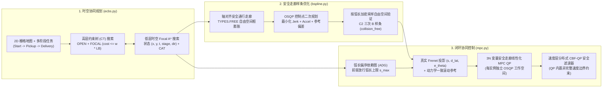

# 多 AGV 时空协同规划 (Focal ECBS)、安全走廊 B 样条优化与分布式 CBF-MPC 跟踪控制

<div align="center">

[](https://github.com/Urami0421/multi-agv-ecbs-consensus-mpc/actions/workflows/ci.yml)
[](LICENSE)
[](https://www.python.org/)
[](https://github.com/ai-winter/python_motion_planning)

**[English](README.md) | [简体中文](README_zh.md)**

</div>

本仓库面向多通道仓储物流场景下的差速驱动自动导引车（AGV）车队，实现了一套完整的多智能体时空路径规划、安全走廊样条轨迹优化、弧长偏序调度同步与基于二次规划（QP）的闭环协同跟踪控制流水线。项目构建于单机器人运动规划库 [`python_motion_planning`](https://github.com/ai-winter/python_motion_planning) 之上（上游原有模块说明见 [`docs/upstream.md`](docs/upstream.md)），将其从单机路径规划扩展为支持多阶段任务约束的时空规划与多车安全协同控制系统。

---

## 可视化总览

| 2D 连续仿真 (`Visualizer2D` + ESDF 距离场 + MPC 预测时域) | 3D 离屏 PyVista/VTK 仓储仿真 (`Visualizer3D`) |
| :---: | :---: |
|  |  |
| **8 台差速驱动 AGV** 在 12 组货架、20 个交叉路口及 8 处瓶颈障碍下执行两阶段 (`起点 -> 拣货点 -> 交付区`) 全流程任务 | **同步 3D PyVista/VTK 场景**：包含 48 个工业货架网格、12 组托盘货物与 8 台 Neobotix `MP-400` 机器人模型 |

### 核心实验结果速览 (Key Results at a Glance)

- **带转向惩罚的双层 Focal ECBS (`w = 1.08, λ_turn = 0.45`)**：在 8-AGV 两阶段仓储场景中将 90° 转弯数减少 **41.3%**（`46 -> 27`），低层状态展开数相比 `CBS + Turn` 减少 **79.2%**（`6,245 -> 1,302`，**4.18 倍加速**）；在多规模合成瓶颈地图上，16 车房间图相比精确 `CBS` 实现 **3.94 倍加速**（`131.59 ms` vs. `517.87 ms`），并在 `CBS` 超出 250 高层节点上限的 32 车仓储图（`55.00 ms`）与 32 车房间图（`168.81 ms`）上稳定求解。
- **20 组真随机停滞故障鲁棒性（`160` 车次，`60.0 s` 完整时域）**：`ConsensusMPC_Corridor`（`ADG + 安全走廊 Linear-MPC + 速度层 CBF-QP`）在全部 20 组随机 2.0–3.5s 执行器停滞与 15 倍速度噪声试验中实现 **0 跨车碰撞**（`20/20` 零碰撞试验，95% Wilson 置信区间 `[83.9%, 100.0%]`），且在 `60.0 s` 时域内达到 **100.0% 最终完成率**（`160/160` 车次，95% Wilson CI `[97.7%, 100.0%]`，车次完工时间中位数 `25.1 s`、P90 `30.32 s`、最大值 `38.2 s`）。
- **规划与控制双层安全走廊复用**：在 `TYPES.FREE` 中膨胀出的安全走廊既用于约束三次 B 样条控制点（`SafeCorridorBSplineOptimizer`，通过按弧长加密采样验证 `collision_free = True`），又作为预测时域内的线性横向边界约束直接写入 `MPC` 的 OSQP 二次规划（`use_corridor=True`），使 8 车名义完工时间从 `28.1 s` 缩短至 **`26.6 s`** 且保持 `0` 货架擦碰。
- **单实例隔离的持久化 OSQP 实时求解**：每个控制器实例各自持有独立的 OSQP 工作空间并通过 `prob.update(Px, q, Ax, l, u)` 原地更新矩阵，24 变量（$3N, N=8$）`MPC` 的 OSQP 内部 C 求解均值耗时仅 **`53.6–65.0 µs`**（2 变量 `CBF-QP` 内部 C 求解均值 **`10.2 µs`**）。

---

## 上游基础与本项目新增内容对照

为明确区分继承自 [`ai-winter/python_motion_planning`](https://github.com/ai-winter/python_motion_planning) 的底层框架与本仓库研发的核心算法，下表列出各模块对照：

| 系统层级 | 继承自上游的基础组件 ([`docs/upstream.md`](docs/upstream.md)) | 本仓库新增 / 修复与重构内容 |
| :--- | :--- | :--- |
| **环境与仿真** | `Grid` 栅格地图、欧氏符号距离场 (`esdf`)、`DiffDriveRobot`、`ToySimulator`、`Visualizer2D`、`Visualizer3D` | 72m x 44m 12 货架两阶段 (`Start -> Pickup -> Delivery`) 仓储场景配置 ([`warehouse_8agv.yaml`](scripts/configs/warehouse_8agv.yaml))、多规模合成栅格测试集 ([`scripts/maps/`](scripts/maps/)) 与 3D 多货架/多车同步渲染器 |
| **全局多车时空规划** | 单机 2D 图搜索 (`AStar`, `Dijkstra`, `ThetaStar`) | **带转向惩罚的双层 Focal ECBS 与精确 CBS** ([`ecbs.py`](src/python_motion_planning/path_planner/graph_search/ecbs.py))：维护完整的高/低层 `OPEN` + `FOCAL` 优先队列 (`SOC <= w * LB`)、$O(T \cdot N)$ 空间哈希冲突检测、多阶段航点增广状态 `(x, y, t, stage, dir)`（当 $\lambda_{\text{turn}} = 0$ 时自动折叠 `dir` 维度以消除冗余展开）与冲突规避表 (`CAT`) |
| **轨迹平滑与优化** | 参数化曲线生成器 (`BSpline`, `CubicSpline`, `Bezier`, `Dubins`) | **修复 `BSpline._approximation` 节点向量长度缺陷**（基于 Piegl & Tiller 公式 9.68–9.69 均值节点与 SVD 最小二乘求解），并新增 **`SafeCorridorBSplineOptimizer`** ([`bspline.py`](src/python_motion_planning/traj_optimizer/curve_generator/point_based/bspline.py))，在膨胀 `TYPES.FREE` 轴对齐框内调用 `osqp` 求解控制点 QP，并执行按弧长加密的多轮回拉验证（显式输出 `collision_free` 标志） |
| **时间偏序同步** | 无 | **受 ADG 启发的弧长偏序依赖图 (`ActionDependencyGraph`)** ([`mpc.py`](src/python_motion_planning/controller/path_tracker/mpc.py))：从离散 `ECBS` 计划中提取无时间截断的完整跨车访问偏序约束，防止连续执行出现延迟或停滞时在交叉口相撞 |
| **闭环协同控制** | 单机轨迹跟踪器 (`PurePursuit`, `RPP`, `PID`, `DWA`, `APF`) | **带横向安全走廊约束的滚动线性化 MPC** (`MPC`，每实例独立持有持久化 `osqp.update()` 工作空间，内置真实 Frenet 投影与可选的 1-Lipschitz 障碍走廊线性约束 `use_corridor=True`)、**速度层分布式控制屏障函数安全滤波器** (`cbf_qp_filter`，在 QP 内部直接施加差速车非完整线性速度/角速度边界、完整 $2l$ 前视偏置补偿且无后处理混合)、**`ConsensusMPC` / `ConsensusMPC_Corridor`** 以及**非完整约束 `ORCAController`** (Alonso-Mora et al., 2013) |

---

## 系统架构与数学建模



### 1. 带转向惩罚的双层 Focal ECBS ([`ecbs.py`](src/python_motion_planning/path_planner/graph_search/ecbs.py))

给定 $M$ 台 AGV 及其有序多阶段任务点序列 $\mathcal{W}_i = (s_i, p_i, g_i)$，低层搜索在五维增广状态空间 $\sigma = (x, y, t, k_{\text{stage}}, d_{\text{prev}})$ 上展开，单步转移代价定义为：

$$
c(\sigma \to \sigma') = 1 + \lambda_{\text{turn}} \cdot \mathbb{I}(d' \neq \text{wait} \;\wedge\; d_{\text{prev}} \neq \varnothing \;\wedge\; d' \neq d_{\text{prev}})
$$

当 $\lambda_{\text{turn}} = 0$ 时，朝向维度 $d_{\text{prev}}$ 恒置为 $-1$，从而保证无转弯惩罚基线（`CBS` 与 `ECBS (λ=0)`）不会因多余的朝向状态放大搜索空间。低层搜索与高层约束树（CT）均维护完整的 `OPEN` 与 `FOCAL` 双优先队列；每当 $f_{\min}$ 或 $LB_{\min} = \min_{N \in \text{OPEN}} \sum_i f_{\min, i}(N)$ 上升时，自动将满足次优界的新节点推入 `FOCAL`：

$$
\text{FOCAL}_{\text{low}} = \left\{ \sigma \in \text{OPEN}_{\text{low}} \;\middle|\; f(\sigma) \le w \cdot f_{\min} \right\}, \qquad
\text{FOCAL}_{\text{CT}} = \left\{ N \in \text{OPEN}_{\text{CT}} \;\middle|\; \text{SOC}(N) \le w \cdot LB_{\min} \right\}
$$

顶点冲突与对向边交换冲突通过按时间步组织的哈希表以 $O(T \cdot M)$ 时间复杂度完成检测（`ECBS.detect_conflicts`）。

### 2. 安全走廊 $C^2$ 三次 B 样条轨迹优化 ([`bspline.py`](src/python_motion_planning/traj_optimizer/curve_generator/point_based/bspline.py))

1. **上游最小二乘逼近 Bug 修复**：上游 `BSpline._approximation` 在求解 $h = n - 1$ 个控制点时错误传入了长度为 $n + k + 1$ 的节点向量，导致基函数单位分解性质 $\sum_{i=0}^{h} N_{i,k}(t) = 1$ 在 $t \to 1$ 附近失效并向原点坍缩。本项目按 Piegl & Tiller (1997) 公式 9.68–9.69 实现了内部节点均值化生成（`_approximation_knot_generation`）与 SVD 最小二乘求解，使共线点集的逼近法向误差降至 $10^{-14}\text{ m}$ 以下。
2. **基于 OSQP 的安全走廊控制点二次规划 (`SafeCorridorBSplineOptimizer`)**：围绕每个非固定离散路径点 $p_i^{\text{ref}} = (x_i^{\text{ref}}, y_i^{\text{ref}})$ 在 `TYPES.FREE` 自由空间内膨胀生成轴对齐安全框 $[l_{x,i}, u_{x,i}] \times [l_{y,i}, u_{y,i}]$（半宽上限 $0.42\text{ m}$），并调用 `osqp` 求解：

$$
\min_{c \in \mathbb{R}^m} \; w_{\text{jerk}} \|D_3 c\|_2^2 + w_{\text{acc}} \|D_2 c\|_2^2 + w_{\text{ref}} \|c - p^{\text{ref}}\|_2^2 \quad \text{s.t.} \quad l \le c \le u, \;\; c_0 = p_0^{\text{ref}}, \;\; c_{m-1} = p_{m-1}^{\text{ref}}
$$

由于为每个控制点单独分配矩形框并不等同于将相邻 4 个控制点的联合凸包约束在同一凸多面体内，在非凸拐角处仅靠单点边界无法从理论上保证曲线段不擦碰膨胀区；因此 `SafeCorridorBSplineOptimizer` 在求解 QP 后执行**多轮按弧长加密采样验证与控制点回拉修正循环**（最多 8 轮，`find_violations` 对相邻采样点按 $\le 0.25 \cdot \text{resolution}$ 弧长线性插值加密以防止稀疏线段跨过障碍格），在返回字典 `info` 中显式记录 `collision_free`、`num_violations` 与 `repair_iters`，并将 `collision_free == True` 纳入 `info["success"]` 的判定条件。

### 3. 弧长偏序依赖图、带安全走廊约束的线性化 MPC 与速度层分布式 CBF-QP ([`mpc.py`](src/python_motion_planning/controller/path_tracker/mpc.py))

1. **受 ADG 启发的弧长偏序依赖图 (`ActionDependencyGraph`)**：借鉴 Hönig 等人 (IEEE RA-L 2019) 的思想并适配至连续弧长参数化轨迹，从离散 `ECBS` 计划中提取无时间截断的完整跨车共享区域访问偏序关系 $(i, s_i^{\text{leave}}) \prec (j, s_j^{\text{hold}})$（对任意 $t_i < t_j$ 均保留）。在闭环运行中，当先序车 $i$ 的弧长进度尚未越过 $s_i^{\text{leave}}$ 时，后继车 $j$ 的参考弧长上限被锁定在 $s_j^{\text{hold}}$。
2. **带横向安全走廊线性约束的滚动线性化误差状态模型预测控制 (`MPC`)**：先将当前位姿正交投影至参考曲线以获取精确 Frenet 状态 $(s, d_{\text{lat}}, e_\theta)$，再从当前位姿 $\bar{x}_0 = x_0$ 出发按参考输入滚动生成动力学一致的名义轨迹 $\bar{x}_{k+1} = f(\bar{x}_k, u_{\text{ref},k})$ 并沿其线性化差速运动学（时域 $N = 8$），通过每实例独立的持久化 `osqp` 工作空间 (`self._mpc_osqp.update(Px=..., q=..., Ax=..., l=..., u=...)` + 热启动，OSQP 内部 C 求解均值耗时约 $54\text{–}65\,\mu\text{s}$) 求解 $3N$ 维（$2N$ 维输入增量 $\tilde{U} \in \mathbb{R}^{2N}$ + $N$ 维非负走廊松弛变量 $\xi \in \mathbb{R}_{\ge 0}^N$）二次规划：

$$
\begin{aligned}
\min_{\tilde{U} \in \mathbb{R}^{2N},\; \xi \in \mathbb{R}_{\ge 0}^N} \quad & (e_{\text{free}} + \Gamma \tilde{U})^\top \bar{Q} (e_{\text{free}} + \Gamma \tilde{U}) + \tilde{U}^\top \bar{R} \tilde{U} + (D_u(U_{\text{ref}} + \tilde{U}) - u_{\text{prev}})^\top \bar{S} (D_u(U_{\text{ref}} + \tilde{U}) - u_{\text{prev}}) + w_{\text{corridor}} \|\xi\|_2^2 \\
\text{s.t.} \quad & 0 \le v_{\text{ref},k} + \tilde{v}_k \le v_{\text{cap}}, \qquad -\omega_{\max} \le \omega_{\text{ref},k} + \tilde{\omega}_k \le \omega_{\max}, \qquad \xi_k \ge 0 \\
& -d_k - \xi_k \le n_k^\top \left( e_{\text{free},p,k} + \Gamma_{p,k} \tilde{U} \right) \le d_k + \xi_k, \qquad \forall k \in \{0, \dots, N-1\}
\end{aligned}
$$

其中 $n_k = [-\sin\theta_{\text{ref},k},\; \cos\theta_{\text{ref},k}]^\top$ 为参考轨迹法向单位向量，$d_k = \max(0,\; c_{\text{obs}}(s_k) - R_{\text{robot}} - d_{\text{margin}})$ 为根据精确障碍物表面距离 (`obstacle_surface_distance`) 由 1-Lipschitz 性质下界保证的无碰撞横向走廊半宽（`MPC.corridor_half_widths`，当 `use_corridor=True` 时启用）。QP 解出的首步控制量 $u_0 = u_{\text{ref},0} + \tilde{u}_0^\star$ 直接作为名义控制输出，不含任何后处理混合或启发式转向覆盖。
3. **速度层分布式控制屏障函数安全滤波器 (`cbf_qp_filter`)**：通过近恒等微分同胚（Near-Identity Diffeomorphism, NID）将差速车位姿 $(x_i, y_i, \theta_i)$ 映射至前视控制点 $p_i = [x_i + l\cos\theta_i,\; y_i + l\sin\theta_i]^\top$（$l = 0.04\text{ m}$，满足 $\dot{p}_i = J(\theta_i)[v_i, \omega_i]^\top = u_i$，$J(\theta_i) = R(\theta_i)\operatorname{diag}(1, l)$）。对感知半径内的**全部**邻车 $j$（采用邻车真实前视点速度 $\hat{u}_j = J(\theta_j)[v_j, \omega_j]^\top$，并在安全距离中补足完整 $2l$ 前视偏置余量 $d_{\text{safe,eff}} = r_i + r_j + 2l + d_{\text{margin}}$，从而由三角不等式保证 $\|p_i - p_j\|_2 \ge d_{\text{safe,eff}} \implies \|x_i - x_j\|_2 \ge r_i + r_j + d_{\text{margin}}$），每个控制器实例独享的 2 变量 `QP2DWorkspace` (`self._cbf_ws`) 求解：

$$
\begin{aligned}
\min_{u_i \in \mathbb{R}^2} \quad & (u_i - u_{i,\text{nom}})^\top M(\theta_i) (u_i - u_{i,\text{nom}}) \\
\text{s.t.} \quad & -2(p_i - p_j)^\top u_i \le \alpha_{ij} \gamma h_{ij} - 2(p_i - p_j)^\top \hat{u}_j, \quad \forall j \in \mathcal{N}_i \\
& 0 \le [\cos\theta_i,\; \sin\theta_i] u_i \le v_{\max}, \qquad -\omega_{\max} \le \tfrac{1}{l}[-\sin\theta_i,\; \cos\theta_i] u_i \le \omega_{\max}
\end{aligned}
$$

其中 $h_{ij} = \|p_i - p_j\|_2^2 - d_{\text{safe,eff}}^2$，$M(\theta_i) = J(\theta_i)^{-\top}\operatorname{diag}(1, \rho_\omega)J(\theta_i)^{-1}$。由于差速车速度边界 $0 \le v_i \le v_{\max}$ 与 $|\omega_i| \le \omega_{\max}$ 已作为精确线性不等式直接写入 QP 内部，逆微分同胚输出 $[v_{i,\text{safe}}, \omega_{i,\text{safe}}]^\top = J(\theta_i)^{-1} u_i^\star$ 在**一阶运动学速度指令层**严格满足 CBF 屏障不等式与速度上限，无需任何后处理截断或角速度混合（关于速度层 QP 精确性与底层受限加速度离散时间执行之间的区别，详见[局限性与指标权衡分析](#局限性与指标权衡分析-limitations--trade-offs)）。

---

## 实验评估与消融分析

> **实验环境说明**：所有实验均在 Windows 11 (Python 3.13.7, NumPy 2.x, SciPy 1.15, OSQP 1.1.2) 单线程 CPU 环境下实测完成。规划耗时通过 `time.perf_counter()` 独立重复运行 10 次并报告中位数（Median）与 P90 分位数。所有原始实验 CSV 数据表均保存在 [`results/`](results/) 目录下。

### 1. 8-AGV 两阶段仓储场景 4 组 MAPF 消融实验 ([`results/mapf_ablation.csv`](results/mapf_ablation.csv))


全部 5 种方法均使用**同一套低层时空 A\* 搜索引擎** (`ECBS._focal_low_level_astar`，当 $\lambda_{\text{turn}} = 0$ 时不展开朝向维度 `dir`)，确保节点展开数与运行耗时具有严格的可比性：

| 规划算法变体 | 次优界 $w$ | 转向惩罚 $\lambda_{\text{turn}}$ | 顶点/边冲突数 | 高层 CT 展开节点 | 低层展开状态数 | 总步数 | 总 90° 转弯数 | 次优比 (`SOC / LB`) | 中位耗时 (ms) | P90 耗时 (ms) |
| :--- | :---: | :---: | :---: | :---: | :---: | :---: | :---: | :---: | :---: | :---: |
| **Independent A\*** (无跨车协同) | 1.00 | 0.00 | 2 (不可行) | 1 | 597 | 465 | 44 | N/A | 5.91 | 6.06 |
| **CBS** (精确最优基线) | 1.00 | 0.00 | **0** | 8 | 1,890 | 466 | 46 | 1.0000 | 24.21 | 25.28 |
| **CBS + Turn Penalty** | 1.00 | 0.45 | **0** | 15 | 6,245 | 466 | 28 | 1.0000 | 72.88 | 75.81 |
| **ECBS** (仅 Focal 启发) | 1.08 | 0.00 | **0** | **1** | **619** | 466 | 46 | 1.0022 | **8.71** | **9.24** |
| **ECBS + Turn Penalty (本文方案)** | 1.08 | 0.45 | **0** | **1** | 1,302 | 467 | **27** | 1.0120 | 17.44 | 18.91 |

**4 组正交消融结论**：
- **转向惩罚 ($\lambda_{\text{turn}} = 0.45$) 的独立作用**：引入 $\lambda_{\text{turn}} = 0.45$ 将总 90° 转弯数从 `46` 次降至 `27–28` 次（减少 **41.3%**），有效消除了网格路径的阶梯状折线抖动；但在精确搜索 (`CBS + Turn`) 下，由于低层状态空间增加了朝向维度 `(x, y, t, dir)`，低层展开状态数从 `1,890` 增至 `6,245`（耗时从 `24.21 ms` 增至 `72.88 ms`）。
- **Focal 次优界 ($w = 1.08$) 的独立作用**：引入双层 `FOCAL` 队列与冲突规避表 (`CAT`) 后，规划器在根节点 (`HL = 1`) 即消除了全部冲突；在 $\lambda_{\text{turn}} = 0$ 下将低层展开从 `1,890` 降至 `619`（减少 **67.2%**，**2.78 倍加速**），在 $\lambda_{\text{turn}} = 0.45$ 下相比 `CBS + Turn` 减少 **79.2%**（`6,245 -> 1,302`，**4.18 倍加速**），相比标准 `CBS` 减少 **31.1%**（`1,890 -> 1,302`，**1.39 倍加速**），而总步数仅增加 1 步 (`466 -> 467`)。
- 完整的 $(w, \lambda_{\text{turn}}) \in \{1.01, 1.05, 1.08, 1.20, 1.50\} \times \{0.00, 0.20, 0.45, 1.00\}$ 参数敏感性网格扫描数据见 [`results/mapf_param_sweep.csv`](results/mapf_param_sweep.csv)。

### 2. 多规模合成栅格地图基准评测 ([`results/synthetic_grid_benchmark.csv`](results/synthetic_grid_benchmark.csv))

在 [`scripts/maps/`](scripts/maps/) 下的 3 张合成拓扑地图（`synthetic_warehouse_48x32`、`synthetic_random_32x32_20`、`synthetic_room_32x32_4`）上，对 $N \in \{8, 16, 32\}$ 台智能体的**全部 9 组（18 行）**实验进行完整测试（高层 CT 节点展开上限设为 250）：

| 合成地图 (`scripts/maps/`) | 可通行格数 | 智能体数 ($N$) | 规划器 | 是否求解成功 | 高层 CT 节点数 | 低层展开状态数 | 总步数 | 总转弯数 | `SOC / LB` | 规划耗时 (ms) |
| :--- | :---: | :---: | :--- | :---: | :---: | :---: | :---: | :---: | :---: | :---: |
| `synthetic_warehouse_48x32` | 1,080 | 8 | CBS ($w=1.0, \lambda=0$) | Yes | 2 | **548** | 153 | 15 | 1.0000 | **6.70** |
| `synthetic_warehouse_48x32` | 1,080 | 8 | ECBS ($w=1.08, \lambda=0.45$) | Yes | **1** | 839 | 153 | **10** | 1.0000 | 8.84 |
| `synthetic_warehouse_48x32` | 1,080 | 16 | CBS ($w=1.0, \lambda=0$) | Yes | 3 | **775** | 295 | 30 | 1.0000 | **8.24** |
| `synthetic_warehouse_48x32` | 1,080 | 16 | ECBS ($w=1.08, \lambda=0.45$) | Yes | **1** | 1,044 | 295 | **20** | 1.0048 | 12.32 |
| `synthetic_warehouse_48x32` | 1,080 | 32 | CBS ($w=1.0, \lambda=0$) | No (超上限 250) | 250 | 57,384 | — | — | — | 746.66 |
| `synthetic_warehouse_48x32` | 1,080 | 32 | ECBS ($w=1.08, \lambda=0.45$) | **Yes** | **3** | **4,127** | **630** | **41** | 1.0184 | **55.00** |
| `synthetic_random_32x32_20` | 813 | 8 | CBS ($w=1.0, \lambda=0$) | Yes | 2 | **280** | 144 | 30 | 1.0000 | **3.63** |
| `synthetic_random_32x32_20` | 813 | 8 | ECBS ($w=1.08, \lambda=0.45$) | Yes | **1** | 437 | 144 | **13** | 1.0000 | 6.28 |
| `synthetic_random_32x32_20` | 813 | 16 | CBS ($w=1.0, \lambda=0$) | Yes | 5 | **1,045** | 292 | 52 | 1.0000 | **12.47** |
| `synthetic_random_32x32_20` | 813 | 16 | ECBS ($w=1.08, \lambda=0.45$) | Yes | **2** | 2,074 | 292 | **24** | 1.0082 | 27.25 |
| `synthetic_random_32x32_20` | 813 | 32 | CBS ($w=1.0, \lambda=0$) | Yes | 16 | **3,637** | **532** | 108 | 1.0000 | **47.96** |
| `synthetic_random_32x32_20` | 813 | 32 | ECBS ($w=1.08, \lambda=0.45$) | Yes | **6** | 5,483 | 534 | **58** | 1.0146 | 84.25 |
| `synthetic_room_32x32_4` | 801 | 8 | CBS ($w=1.0, \lambda=0$) | Yes | 3 | **2,393** | **145** | 28 | 1.0000 | **25.58** |
| `synthetic_room_32x32_4` | 801 | 8 | ECBS ($w=1.08, \lambda=0.45$) | Yes | **2** | 8,202 | 146 | **15** | 1.0126 | 138.14 |
| `synthetic_room_32x32_4` | 801 | 16 | CBS ($w=1.0, \lambda=0$) | Yes | 123 | 54,971 | **273** | 62 | 1.0000 | 517.87 |
| `synthetic_room_32x32_4` | 801 | 16 | ECBS ($w=1.08, \lambda=0.45$) | Yes | **4** | **12,368** | 274 | **30** | 1.0170 | **131.59** |
| `synthetic_room_32x32_4` | 801 | 32 | CBS ($w=1.0, \lambda=0$) | No (超上限 250) | 250 | 15,354 | — | — | — | 402.34 |
| `synthetic_room_32x32_4` | 801 | 32 | ECBS ($w=1.08, \lambda=0.45$) | **Yes** | **8** | **14,425** | **561** | **57** | 1.0357 | **168.81** |

**不同规模下 `ECBS` 与 `CBS` 的性能对比分析**：
- **小规模与稀疏冲突场景下 `ECBS` 无速度优势**：在 `synthetic_warehouse_48x32` ($N=8, 16$)、`synthetic_random_32x32_20` ($N=8, 16, 32$) 与 `synthetic_room_32x32_4` ($N=8$) 上，由于冲突较稀疏，不带转向惩罚的 `CBS (w=1.0, λ=0)` 在三维状态空间 `(x, y, t)` 上仅需展开 `2–16` 个高层 CT 节点即可求得最优解；此时 `ECBS (w=1.08, λ=0.45)` 为将 90° 转弯数降低 `33%–57%` 需要在 4 倍大小的四维朝向状态空间 `(x, y, t, dir)` 上搜索，并维护冲突规避表 (`CAT`) 与 `OPEN`/`FOCAL` 双堆，因此挂钟耗时比 `CBS` 慢。
- **大规模 ($N=32$) 与强瓶颈地图下的优势**：当门洞或长通道瓶颈引发 `CBS` 高层约束树组合爆炸时，`ECBS` 的优势显著体现：在 `synthetic_room_32x32_4` ($N=16$) 上实现 **3.94 倍加速**（`131.59 ms` vs. `517.87 ms`，CT 节点从 `123` 降至 `4`，低层展开从 `54,971` 降至 `12,368`）；在 $N=32$ 的 `synthetic_warehouse_48x32` 与 `synthetic_room_32x32_4` 上，`CBS` 在 250 个高层节点上限内未能求解（若将上限放宽至 5,000，`CBS` 在 `synthetic_warehouse_48x32` 32 车上需展开 `2,677` 个高层节点、耗时约 `35 s`，而在 `synthetic_room_32x32_4` 32 车上展开至 5,000 个节点仍无解），而 `ECBS` 分别在 **`55.00 ms` (`HL=3`)** 与 **`168.81 ms` (`HL=8`)** 内成功求解。

### 3. 11 组控制器组件解耦消融实验 ([`results/control_ablation.csv`](results/control_ablation.csv))


为严格分离 **`ADG`**、**`Linear-MPC`**、**横向安全走廊约束 (`Corridor`)** 与**速度层 `CBF-QP`** 各自的独立贡献，全部 11 组控制器跟踪完全相同的 8-AGV `ECBS + SafeCorridorBSplineOptimizer` 参考轨迹（仿真步长 `dt = 0.1 s`，时域 `30.5 s`，物理跨车接触阈值 $2R = 0.88\text{ m}$，安全包络 $0.90\text{ m}$）。表中同时报告**跨车碰撞次数**、**货架/障碍物擦碰次数**、**OSQP 内部 C 求解耗时** (`osqp_mean_us / osqp_p95_us`) 与包含 Python 矩阵更新开销的**单步总挂钟耗时** (`wall_mean_us / wall_p95_us`)：

| 控制器变体 | 启用模块 (`ADG` / `跟踪器` / `安全层`) | 跨车碰撞数 | 最小车间距 (m) | 货架擦碰数 | 两阶段完成率 | 未完成车辆数 | 完工时间 (s) | 平均速度 (m/s) | 平均终点误差 (m) | OSQP 内部 C 耗时 均值 / P95 ($\mu$s) | 含 Python 单步总耗时 均值 / P95 ($\mu$s) |
| :--- | :--- | :---: | :---: | :---: | :---: | :---: | :---: | :---: | :---: | :---: | :---: |
| `PurePursuit` | — / `PurePursuit` / — | 4 | 0.504 | 0 | 100.0% | 0 | 26.6 | 2.535 | 0.209 | — | — |
| `RPP` | — / `Regulated PP` / — | 2 | 0.509 | 0 | 100.0% | 0 | 27.2 | 2.467 | 0.249 | — | — |
| `DWA` | — / `DWA` / 局部代价 | 1 | 0.639 | 6 | 0.0% | 8 | 30.5 | 2.001 | 19.557 | — | — |
| `ORCA` (`NH-ORCA`) | — / `前视跟踪` / `NH-ORCA QP` | 4 | 0.626 | 0 | 50.0% | 4 | 30.5 | 1.235 | 18.644 | 5.1 / 13.4 | 66.1 / 140.4 |
| `ADG_ORCA` | `ADG` / `前视跟踪` / `NH-ORCA QP` | **0** | 0.923 | **0** | **100.0%** | **0** | 29.8 | 2.235 | **0.173** | **1.1 / 11.0** | **24.5 / 99.6** |
| `ADG_PurePursuit` | `ADG` / `PurePursuit` / — | 3 | 0.662 | 0 | 100.0% | 0 | **26.3** | 2.478 | 0.209 | — | — |
| `ADG_PurePursuit_CBF` | `ADG` / `PurePursuit` / `CBF-QP` | **0** | **1.047** | **0** | **100.0%** | **0** | 27.0 | 2.306 | 0.206 | 10.2 / 24.1 | 115.8 / 220.2 |
| `ADG_LinearMPC` | `ADG` / `Linear-MPC` / — | **0** | 0.991 | **0** | **100.0%** | **0** | 26.5 | 2.410 | 0.544 | 53.9 / 105.6 | 561.7 / 689.7 |
| `LinearMPC_CBF` | — / `Linear-MPC` / `CBF-QP` | **0** | 0.977 | 2 | 75.0% | 2 | 30.5 | 2.148 | 1.386 | 61.0 / 121.8 | 601.9 / 778.0 |
| **`ConsensusMPC`** | **`ADG` / `Linear-MPC` / `CBF-QP`** | **0** | **1.030** | **0** | **100.0%** | **0** | 28.1 | 2.305 | 0.538 | 53.6 / 98.0 | 564.0 / 695.5 |
| **`ConsensusMPC_Corridor`** | **`ADG` / `Corridor-MPC` / `CBF-QP`** | **0** | **1.011** | **0** | **100.0%** | **0** | **26.6** | 2.321 | 0.546 | 65.0 / 125.4 | 608.9 / 759.7 |

### 4. 20 组真随机执行器停滞与速度扰动鲁棒性实验（`33.5 s` 截断 vs. `60.0 s` 完整时域，[`results/perturbation_robustness.csv`](results/perturbation_robustness.csv)）

在 **20 组独立随机种子实验** (`rng = random.Random(1000 + trial_idx)`，共 `160` 车次) 中，每次由随机数生成器无放回随机抽取 2 台 AGV (`rng.sample(rids, k=2)`)，在随机起始步 $t_{\text{start}} \sim \mathcal{U}\{35, \dots, 110\}$ 注入随机持续时间 $\Delta t \sim \mathcal{U}[2.0, 3.5]\text{ s}$ 的执行器完全停滞故障 (`v = 0, omega = 0`)，并叠加 $15$ 倍高斯速度噪声 (`noise = 0.015`)。每组试验均运行完整的 **`60.0 s`（`600` 步）**，同时统计名义 **`33.5 s`（`335` 步）**截断窗口与 **`60.0 s` 最终窗口**下的完成率、**95% Wilson 置信区间**及**车次完工时间分布（中位数 / P90 / 最大值）**：

| 控制器变体 | 平均 / 最大跨车碰撞 | 零碰撞试验组数 (`95% Wilson CI`) | 最差车间距 (m) | 平均货架擦碰 | 完成率 `@ 33.5s` (`95% Wilson CI`, $n=160$) | 完成率 `@ 60.0s` (`95% Wilson CI`, $n=160$) | 车次完工时间 中位数 / P90 / 最大值 (s) | 全员完工试验数 (`/20`) |
| :--- | :---: | :---: | :---: | :---: | :---: | :---: | :---: | :---: |
| `PurePursuit` | 4.10 / 5 | 0/20 (`[0.0%, 16.1%]`) | 0.434 | 0.40 | **100.0%** (`[97.7%, 100.0%]`) | **100.0%** (`[97.7%, 100.0%]`) | 21.9 / 26.70 / 30.3 | 20/20 |
| `ORCA` (`NH-ORCA`) | 3.60 / 4 | 0/20 (`[0.0%, 16.1%]`) | 0.602 | 0.00 | 66.2% (`[58.6%, 73.1%]`) | 66.2% (`[58.6%, 73.1%]`) | 22.6 / 29.00 / 33.2 | 2/20 |
| `ADG_ORCA` | 0.85 / 2 | 6/20 (`[14.5%, 51.9%]`) | 0.707 | 0.00 | 85.6% (`[79.4%, 90.2%]`) | 85.6% (`[79.4%, 90.2%]`) | 24.2 / 29.80 / 33.1 | 13/20 |
| `ADG_PurePursuit` | 2.30 / 4 | 0/20 (`[0.0%, 16.1%]`) | 0.614 | 0.00 | **100.0%** (`[97.7%, 100.0%]`) | **100.0%** (`[97.7%, 100.0%]`) | 22.4 / 26.40 / 30.2 | 20/20 |
| `ADG_PurePursuit_CBF` | **0.00 / 0** | **20/20** (`[83.9%, 100.0%]`) | **1.016** | 0.60 | 90.0% (`[84.4%, 93.8%]`) | 90.6% (`[85.1%, 94.2%]`) | 23.9 / 28.04 / 34.4 | 16/20 |
| `ADG_LinearMPC` | 0.60 / 2 | 9/20 (`[25.8%, 65.8%]`) | 0.550 | 0.00 | 99.4% (`[96.5%, 99.9%]`) | **100.0%** (`[97.7%, 100.0%]`) | 24.4 / 29.21 / 34.1 | 20/20 |
| `LinearMPC_CBF` | 0.05 / 1 | 19/20 (`[76.4%, 99.1%]`) | 0.835 | 8.70 | 84.4% (`[78.0%, 89.2%]`) | 96.9% (`[92.9%, 98.7%]`) | 25.8 / 33.96 / 44.1 | 15/20 |
| **`ConsensusMPC`** | **0.00 / 0** | **20/20** (`[83.9%, 100.0%]`) | 0.926 | 0.25 | 96.3% (`[92.1%, 98.3%]`) | 98.1% (`[94.6%, 99.4%]`) | 25.6 / 29.90 / 36.4 | 19/20 |
| **`ConsensusMPC_Corridor`** | **0.00 / 0** | **20/20** (`[83.9%, 100.0%]`) | **0.978** | 0.30 | 96.3% (`[92.1%, 98.3%]`) | **100.0%** (`[97.7%, 100.0%]`) | 25.1 / 30.32 / 38.2 | **20/20** |

**控制层组件贡献归因分析（结合名义场景与 20 组 60s 随机扰动实验）**：
1. **速度层 `CBF-QP` 的作用 (`ADG_LinearMPC` vs. `ConsensusMPC` / `ConsensusMPC_Corridor`)**：
   - 在无扰动名义场景中，`ADG_LinearMPC` 依靠走廊轨迹跟踪即可实现 `0` 碰撞；但在 20 组随机停滞实验中，当某台 AGV 在非交叉口的相邻通道段随机停滞 2.0–3.5 秒时，仅靠离散交叉口偏序 (`ADG`) 无法应对通道内的局部包络冲突，`ADG_LinearMPC` 发生平均 **`0.60` 次碰撞（`11/20` 组试验发生碰撞，最小间距 `0.550 m`）**，`ADG_PurePursuit` 发生平均 **`2.30` 次碰撞（`20/20` 组试验发生碰撞）**。
   - 引入速度层 `CBF-QP` 安全滤波器后，`ConsensusMPC`、`ConsensusMPC_Corridor` 与 `ADG_PurePursuit_CBF` 在全部 20 组随机停滞试验中均实现 **0 跨车碰撞（`20/20` 组零碰撞，95% Wilson CI `[83.9%, 100.0%]`，最差车间距 `0.926–1.016 m` > $2R = 0.88\text{ m}$）**。
2. **`ADG` 的作用 (`LinearMPC_CBF` vs. `ConsensusMPC`，以及 `ORCA` vs. `ADG_ORCA`)**：
   - 若去掉 `ADG` (`LinearMPC_CBF`)，仅靠局部反应式 `CBF-QP` 在通道拐角处避让时会将 2 台车推向货架边缘（名义场景发生 `2` 次货架擦碰、完成率降至 `75.0%`；随机停滞下平均发生 **`8.70` 次货架擦碰**，`@33.5s` 完成率降至 `84.4%`）。将 `ADG` 与 `Linear-MPC + CBF-QP` 结合 (`ConsensusMPC`) 可消除名义货架擦碰（`0` 次）并将 `@33.5s` 随机扰动完成率提升至 `96.3%`。
3. **`MPC` 横向安全走廊约束的作用 (`ConsensusMPC` vs. `ConsensusMPC_Corridor`)**：
   - 在 `MPC` 中启用横向安全走廊线性约束 (`use_corridor=True`) 后，`ConsensusMPC_Corridor` 将名义完工时间从 `28.1 s` 缩短至 **`26.6 s`**，将随机扰动下的最差车间距从 `0.926 m` 提升至 **`0.978 m`**，并消除了不带走廊约束的 `ConsensusMPC` 在第 20 组试验中的停滞后多车对峙，使 `60.0 s` 完整时域完成率从 `98.1%`（`19/20` 组全员完工）提升至 **`100.0%`（`20/20` 组全员完工）**。

---

## 快速开始与复现指南

### 1. 安装环境

```bash
git clone https://github.com/Urami0421/multi-agv-ecbs-consensus-mpc.git
cd multi-agv-ecbs-consensus-mpc

# 仅安装核心规划与控制依赖 (numpy, scipy, osqp, pyyaml)
pip install -e .

# 安装完整环境（含 2D/3D 可视化、仿真器与 pytest 测试套件）
pip install -e ".[all]"
```

### 2. 运行单元测试（13 项核心算法测试）

```bash
pytest -v
```

### 3. 一键复现实验数据表与可视化图表

```bash
# 1. 运行 4 组 MAPF 消融 (10 次重复测时)、(w, turn_penalty) 参数扫描与多规模合成地图评测
python scripts/benchmark_mapf.py

# 2. 运行 11 组控制器组件解耦消融与 20 组 60s 真随机停滞扰动实验
python scripts/benchmark_control.py

# 3. 渲染 2D Matplotlib 仿真动图 (assets/multi_agv_consensus_mpc_2d.gif)
python scripts/render_2d.py

# 4. 渲染 3D PyVista/VTK 离屏仿真动图 (assets/multi_agv_consensus_mpc_3d.gif)
python scripts/render_3d.py

# 或端到端运行全部流水线（添加 --skip-gifs 可仅运行基准测试与静态图生成）
python scripts/run_multi_agv_ecbs_consensus_demo.py --skip-gifs
```

---

## 局限性与指标权衡分析 (Limitations & Trade-Offs)

1. **速度层 `CBF-QP` 与底层受限加速度、离散时间执行的差距**：
   - 尽管 `cbf_qp_filter` 在一阶运动学速度指令层直接将 $0 \le v \le v_{\max}$ 与 $|\omega| \le \omega_{\max}$ 作为线性约束写入 QP（无后处理截断或角速度混合），但底层仿真器（`DiffDriveRobot` / `PathTracker._get_desired_action`）通过 $(v_{\text{des}} - v) / \Delta t$ 将期望速度转化为加速度指令并按 $\pm 3.5\text{ m/s}^2$ 截断，且以离散步长 $\Delta t = 0.1\text{ s}$ 积分。因此，当车辆处于高速运动时，QP 给出的安全速度或无解时的零速指令（$v = 0, \omega = 0$）无法瞬间达到，连续时间 CBF 条件 $\dot{h}_{ij} + \gamma h_{ij} \ge 0$ 也会引入 $O(\Delta t)$ 离散化误差。**本仓库实验中的“0 跨车碰撞”是该仿真场景下的实验统计结论，而非闭环系统的形式化前向不变性证明**；若需在受限加速度与离散采样下建立严格的形式化安全保证，需改用高阶控制屏障函数（HOCBF）或离散时间 CBF（Discrete-Time CBF）。
2. **较小前视偏置 ($l = 0.04\text{ m}$) 导致避让方式以纵向减速为主**：
   - 将近恒等微分同胚的前视距离设为 $l = 0.04\text{ m}$ 可将前视点与车体中心的几何偏差限制在 $2l = 0.08\text{ m}$ 以内，避免在 `1.0 m` 宽度的窄通道内过度膨胀安全半径。但这也使得前视点的横向速度上限仅为 $l \cdot \omega_{\max} \approx 0.04 \times 3.14 \approx 0.13\text{ m/s}$，因此 `CBF-QP` 实际上几乎不具备横向打方向绕行的能力，**主要依靠沿参考轨迹纵向减速/刹车来规避冲突**。
3. **`33.5 s` 截断完成率 vs. `60.0 s` 完整时域完成率及 Wilson 置信区间分析**：
   - 将 20 组随机停滞实验的仿真时长放宽至 `60.0 s` ([`results/perturbation_robustness.csv`](results/perturbation_robustness.csv)) 后，可以严格区分“时域截断导致的未完赛”与“停滞引发的永久死锁”：
     - **`ConsensusMPC_Corridor`**：在 `33.5 s` 截断处未完成的 `6/160` 车次（`96.3%`，95% Wilson CI `[92.1%, 98.3%]`）全部在 `33.6–38.2 s` 之间抵达终点，在 `60.0 s` 完整时域下达到 **`100.0%` 完成率（`160/160` 车次，95% Wilson CI `[97.7%, 100.0%]`，`20/20` 组全员完工）**，证实其 `96.3%` 完全由 `33.5 s` 统计截断引起。
     - **`ConsensusMPC`（无走廊约束）**：`6` 个延迟车次中有 `3` 个在 `36.4 s` 前抵达终点，`60.0 s` 完成率升至 **`98.1%`（`157/160` 车次，95% Wilson CI `[94.6%, 99.4%]`，`19/20` 组全员完工）**，另有 1 组试验中的 `3` 台车在故障恢复后发生局部对峙而未在 `60.0 s` 内完赛。
     - **`ADG_PurePursuit_CBF`**：完成率仅从 `33.5 s` 的 `90.0%` 微升至 `60.0 s` 的 **`90.6%`（`145/160` 车次，95% Wilson CI `[85.1%, 94.2%]`，`16/20` 组全员完工，最晚完工车次为 `34.4 s`）**，其余 4 组试验中的 `15` 个车次因 `PurePursuit` 切弯触发相互 CBF 制动而陷入永久死锁。
     - **统计显著性 ($n = 160$)**：在 $20 \times 8 = 160$ 个车次样本下，`33.5 s` 处 `ConsensusMPC_Corridor` (`[92.1%, 98.3%]`)、`ADG_LinearMPC` (`[96.5%, 99.9%]`) 与 `PurePursuit` (`[97.7%, 100.0%]`) 的 95% Wilson 置信区间存在重叠；而在 `60.0 s` 完整时域下，`ConsensusMPC_Corridor` (`[97.7%, 100.0%]`) 与 `ADG_LinearMPC` 完全一致，且与 `ADG_PurePursuit_CBF` (`[85.1%, 94.2%]`) 的置信区间完全分离。
4. **终点停止误差权衡 (`ConsensusMPC` 的 `0.538–0.546 m` vs. `PurePursuit` 的 `0.209 m`)**：
   - `Linear-MPC` 在 8 步预测时域内同时惩罚控制量幅值 ($\bar{R}$) 与控制变化率 ($\bar{S}$)，在接近 `goal_dist_tol = 0.70 m` 边界时会提前平滑减速并在进入容差圆后停止；而 `PurePursuit` 保持较高线速度直至跨入容差圆深处才触发硬停止。若将 `goal_dist_tol` 收紧至 `0.25 m`，可将终点误差降至 `0.22 m` 左右，但总完工时间会增加约 `1.5 s`。
5. **小规模稀疏冲突场景下 `ECBS` 的常数开销 ($N \le 16$)**：
   - 如 [`results/synthetic_grid_benchmark.csv`](results/synthetic_grid_benchmark.csv) 所示，在 `CBS` 仅需展开 `2–16` 个高层节点的稀疏冲突场景中，`ECBS (w=1.08, λ=0.45)` 因维护冲突规避表 (`CAT`)、双优先队列 (`OPEN`/`FOCAL`) 及 4 朝向状态空间，其挂钟耗时慢于 `CBS`。`ECBS` 的速度优势主要体现在门洞或长通道瓶颈导致 `CBS` 高层分枝爆炸的场景（$N \ge 16$ 的房间图及 $N = 32$ 的仓储/房间图）。
6. **简化版弧长 `ADG` 与解耦轴对齐走廊框的适用边界**：
   - `ActionDependencyGraph` 在固定路径的连续弧长空间 $s$ 上执行跨车偏序等待，不支持在某台 AGV 永久损坏时触发在线绕行重规划。`SafeCorridorBSplineOptimizer` 对每个控制点采用解耦的轴对齐框，并依靠最多 8 轮按弧长加密采样回拉验证（`collision_free` 判定）来保证曲线位于 `TYPES.FREE` 内，而非将每相邻 4 个控制点的联合凸包约束在一般多面体交集内 (Liu et al., IEEE RA-L 2017)。

---

## 参考文献

1. **ECBS**: Barer, M., Sharon, G., Stern, R., & Felner, A. (2014). Suboptimal Variants of the Conflict-Based Search Algorithm for the Multi-Agent Pathfinding Problem. *Annual Symposium on Combinatorial Search (SoCS)*, 19–27.
2. **CBS**: Sharon, G., Stern, R., Felner, A., & Sturtevant, N. R. (2015). Conflict-Based Search for Optimal Multi-Agent Pathfinding. *Artificial Intelligence*, 219, 40–66.
3. **MAPF Benchmarks**: Stern, R., Sturtevant, N. R., Felner, A., Koenig, S., Ma, H., Walker, T. T., Li, J., Atzmon, D., Cohen, L., Kumar, T. K. S., Boyarski, E., & Bartak, R. (2019). Multi-Agent Pathfinding: Definitions, Variants, and Benchmarks. *SoCS*, 151–158.
4. **NURBS / B-Spline Approximation**: Piegl, L., & Tiller, W. (1997). *The NURBS Book* (2nd ed., Chapter 9, Eq. 9.68–9.69). Springer-Verlag.
5. **Action Dependency Graph (ADG)**: Hönig, W., Kiesel, S., Tinka, A., Durham, J. W., & Ayanian, N. (2019). Persistent and Robust Execution of MAPF Schedules in Warehouses. *IEEE Robotics and Automation Letters*, 4(2), 1125–1131.
6. **Linearized Mobile Robot MPC**: Kühne, F., Lages, W. F., & Gomes da Silva Jr, J. M. (2004). Model Predictive Control of a Mobile Robot Using Linearization. *Proceedings of Mechatronics and Robotics*, 525–530.
7. **Control Barrier Functions**: Ames, A. D., Xu, X., Grizzle, J. W., & Tabuada, P. (2017). Control Barrier Function Based Quadratic Programs for Safety Critical Systems. *IEEE Transactions on Automatic Control*, 62(8), 3861–3876.
8. **Multi-Robot Safety Barrier Certificates**: Wang, L., Ames, A. D., & Egerstedt, M. (2017). Safety Barrier Certificates for Collisions-Free Multirobot Systems. *IEEE Transactions on Robotics*, 33(3), 661–674.
9. **ORCA & Non-Holonomic Lookahead ORCA**: van den Berg, J., Guy, S. J., Lin, M., & Manocha, D. (2011). Reciprocal $n$-Body Collision Avoidance. *Robotics Research (ISRR)*, Springer, 3–19; Alonso-Mora, J., Breitenmoser, A., Rufli, M., Beardsley, P., & Siegwart, R. (2013). Optimal Reciprocal Collision Avoidance for Multiple Non-Holonomic Robots. *Distributed Autonomous Robotic Systems (DARS)*, 203–216.

---

## 致谢 (Acknowledgement)

本项目基于 **Haodong Yang** 与 **Maojia Wu** 开发的 [`ai-winter/python_motion_planning`](https://github.com/ai-winter/python_motion_planning) (v2.1, GPL-3.0 协议) 构建。关于保留的上游基础模块、原始教程与引用信息，请参阅 [`docs/upstream.md`](docs/upstream.md)。
