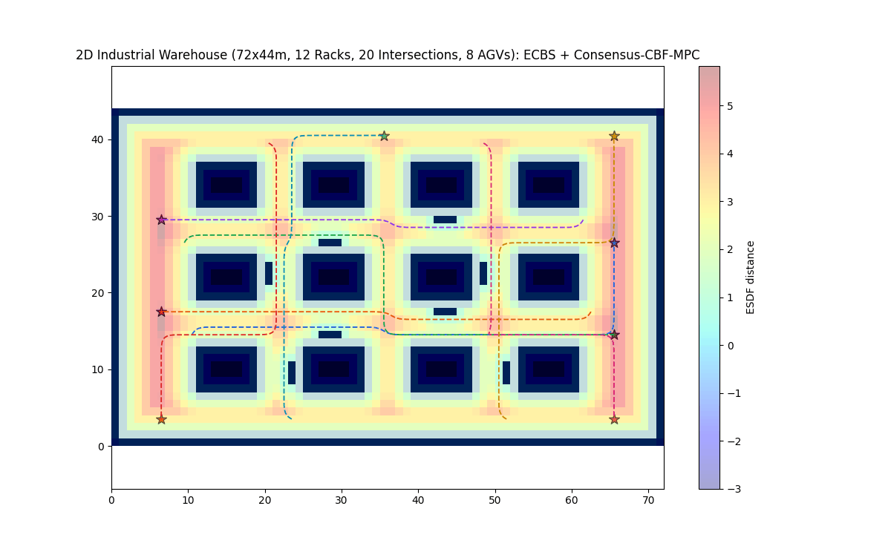
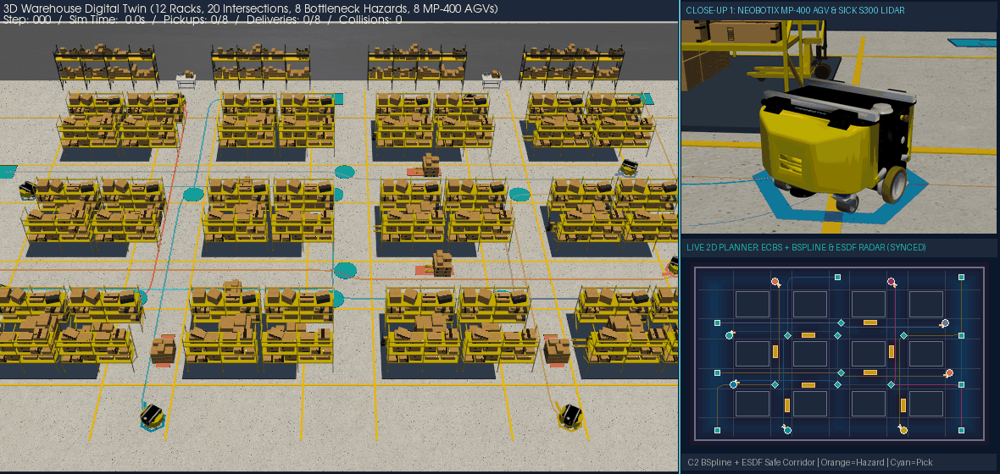
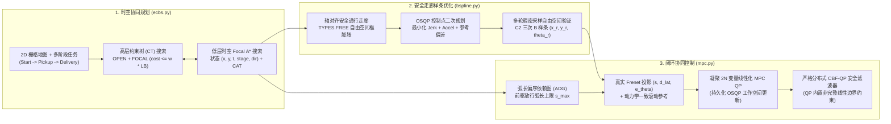
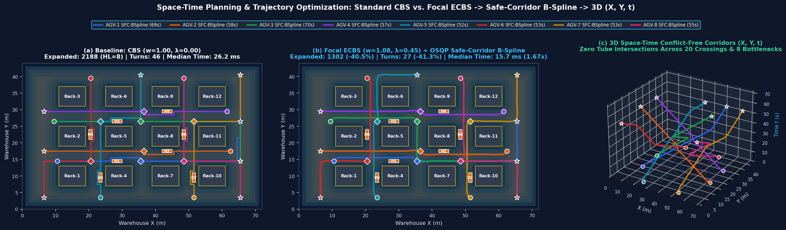
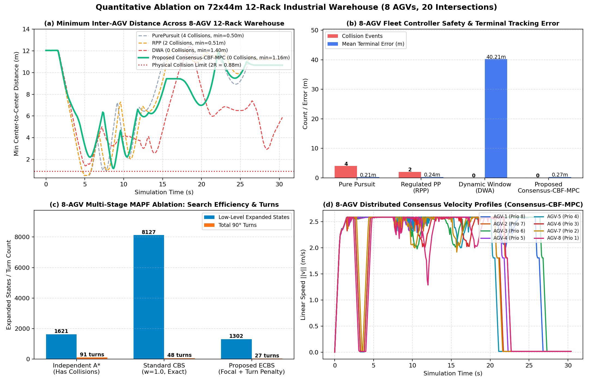

# 多 AGV 时空协同规划 (Focal ECBS)、安全走廊 B 样条优化与分布式 CBF-MPC 跟踪控制

<div align="center">

[](https://github.com/Urami0421/multi-agv-ecbs-consensus-mpc/actions/workflows/ci.yml)
[](LICENSE)
[](https://www.python.org/)
[](https://github.com/ai-winter/python_motion_planning)

**[English](README.md) | [简体中文](README_zh.md)**

</div>

本仓库面向多通道仓储物流场景下的差速驱动自动导引车（AGV）车队，实现了一套完整的多智能体时空路径规划、安全走廊样条轨迹优化、弧长偏序调度同步与基于二次规划（QP）的闭环协同跟踪控制流水线。项目构建于单机器人运动规划库 [`python_motion_planning`](https://github.com/ai-winter/python_motion_planning) 之上（上游原有模块说明见 [`docs/upstream.md`](docs/upstream.md)），将其从单机路径规划扩展为支持多阶段任务约束的时空规划与多车安全协同控制系统。

---

## 可视化总览

| 2D 连续仿真 (`Visualizer2D` + ESDF 距离场 + MPC 预测时域) | 3D 离屏 PyVista/VTK 仓储仿真 (`Visualizer3D`) |
| :---: | :---: |
|  |  |
| **8 台差速驱动 AGV** 在 12 组货架、20 个交叉路口及 8 处瓶颈障碍下执行两阶段 (`起点 -> 拣货点 -> 交付区`) 全流程任务 | **同步 3D PyVista/VTK 场景**：包含 48 个工业货架网格、12 组托盘货物与 8 台 Neobotix `MP-400` 机器人模型 |

---

## 上游基础与本项目新增内容对照

为明确区分继承自 [`ai-winter/python_motion_planning`](https://github.com/ai-winter/python_motion_planning) 的底层框架与本仓库研发的核心算法，下表列出各模块对照：

| 系统层级 | 继承自上游的基础组件 ([`docs/upstream.md`](docs/upstream.md)) | 本仓库新增 / 修复与重构内容 |
| :--- | :--- | :--- |
| **环境与仿真** | `Grid` 栅格地图、欧氏符号距离场 (`esdf`)、`DiffDriveRobot`、`ToySimulator`、`Visualizer2D`、`Visualizer3D` | 72m x 44m 12 货架两阶段 (`Start -> Pickup -> Delivery`) 仓储场景配置 ([`warehouse_8agv.yaml`](scripts/configs/warehouse_8agv.yaml))、多规模合成栅格测试集 ([`scripts/maps/`](scripts/maps/)) 与 3D 多货架/多车同步渲染器 |
| **全局多车时空规划** | 单机 2D 图搜索 (`AStar`, `Dijkstra`, `ThetaStar`) | **带转向惩罚的双层 Focal ECBS 与精确 CBS** ([`ecbs.py`](src/python_motion_planning/path_planner/graph_search/ecbs.py))：维护完整的高/低层 `OPEN` + `FOCAL` 优先队列 (`SOC <= w * LB`)、$O(T \cdot N)$ 空间哈希冲突检测、多阶段航点增广状态 `(x, y, t, stage, dir)` 与冲突规避表 (`CAT`) |
| **轨迹平滑与优化** | 参数化曲线生成器 (`BSpline`, `CubicSpline`, `Bezier`, `Dubins`) | **修复 `BSpline._approximation` 节点向量长度缺陷**（基于 Piegl & Tiller 公式 9.68–9.69 均值节点与 SVD 最小二乘求解），并新增 **`SafeCorridorBSplineOptimizer`** ([`bspline.py`](src/python_motion_planning/traj_optimizer/curve_generator/point_based/bspline.py))，在膨胀 `TYPES.FREE` 轴对齐框内调用 `osqp` 求解控制点 QP 并执行多轮稠密采样回拉验证 |
| **时间偏序同步** | 无 | **受 ADG 启发的弧长偏序依赖图 (`ActionDependencyGraph`)** ([`mpc.py`](src/python_motion_planning/controller/path_tracker/mpc.py))：从离散 `ECBS` 计划中提取无时间截断的完整跨车访问偏序约束，防止连续执行出现延迟或停滞时在交叉口相撞 |
| **闭环协同控制** | 单机轨迹跟踪器 (`PurePursuit`, `RPP`, `PID`, `DWA`, `APF`) | **滚动线性化误差状态 MPC** (`MPC`，通过持久化 `osqp.update()` 工作空间求解 $2N$ 维凝聚 QP，内置真实 Frenet 投影)、**严格分布式控制屏障函数安全滤波器** (`cbf_qp_filter`，在 QP 内部直接施加差速车非完整线性速度/角速度约束、完整 $2l$ 前视偏置补偿且无后处理混合)、**`ConsensusMPC`** (`ADG + Linear-MPC + CBF-QP`) 以及**非完整约束 `ORCAController`** (Alonso-Mora et al., 2013) |

---

## 系统架构与数学建模



### 1. 带转向惩罚的双层 Focal ECBS ([`ecbs.py`](src/python_motion_planning/path_planner/graph_search/ecbs.py))

给定 $M$ 台 AGV 及其有序多阶段任务点序列 $\mathcal{W}_i = (s_i, p_i, g_i)$，低层搜索在五维增广状态空间 $\sigma = (x, y, t, k_{\text{stage}}, d_{\text{prev}})$ 上展开，单步转移代价定义为：

$$
c(\sigma \to \sigma') = 1 + \lambda_{\text{turn}} \cdot \mathbb{I}(d' \neq \text{wait} \;\wedge\; d_{\text{prev}} \neq \varnothing \;\wedge\; d' \neq d_{\text{prev}})
$$

低层搜索与高层约束树（CT）均维护完整的 `OPEN` 与 `FOCAL` 双优先队列；每当 $f_{\min}$ 或 $LB_{\min} = \min_{N \in \text{OPEN}} \sum_i f_{\min, i}(N)$ 上升时，自动将满足次优界的新节点推入 `FOCAL`：

$$
\text{FOCAL}_{\text{low}} = \left\{ \sigma \in \text{OPEN}_{\text{low}} \;\middle|\; f(\sigma) \le w \cdot f_{\min} \right\}, \qquad
\text{FOCAL}_{\text{CT}} = \left\{ N \in \text{OPEN}_{\text{CT}} \;\middle|\; \text{SOC}(N) \le w \cdot LB_{\min} \right\}
$$

顶点冲突与对向边交换冲突通过按时间步组织的哈希表以 $O(T \cdot M)$ 时间复杂度完成检测（`ECBS.detect_conflicts`）。

### 2. 安全走廊 $C^2$ 三次 B 样条轨迹优化 ([`bspline.py`](src/python_motion_planning/traj_optimizer/curve_generator/point_based/bspline.py))

1. **上游最小二乘逼近 Bug 修复**：上游 `BSpline._approximation` 在求解 $h = n - 1$ 个控制点时错误传入了长度为 $n + k + 1$ 的节点向量，导致基函数单位分解性质 $\sum_{i=0}^{h} N_{i,k}(t) = 1$ 在 $t \to 1$ 附近失效并向原点坍缩。本项目按 Piegl & Tiller (1997) 公式 9.68–9.69 实现了内部节点均值化生成（`_approximation_knot_generation`）与 SVD 最小二乘求解，使共线点集的逼近法向误差降至 $10^{-14}\text{ m}$ 以下。
2. **基于 OSQP 的安全走廊控制点二次规划 (`SafeCorridorBSplineOptimizer`)**：围绕每个非固定离散路径点 $p_i^{\text{ref}} = (x_i^{\text{ref}}, y_i^{\text{ref}})$ 在 `TYPES.FREE` 自由空间内膨胀生成轴对齐安全框 $[l_{x,i}, u_{x,i}] \times [l_{y,i}, u_{y,i}]$（半宽上限 $0.42\text{ m}$），并调用 `osqp` 求解：

$$
\min_{c \in \mathbb{R}^m} \; w_{\text{jerk}} \|D_3 c\|_2^2 + w_{\text{acc}} \|D_2 c\|_2^2 + w_{\text{ref}} \|c - p^{\text{ref}}\|_2^2 \quad \text{s.t.} \quad l \le c \le u, \;\; c_0 = p_0^{\text{ref}}, \;\; c_{m-1} = p_{m-1}^{\text{ref}}
$$

由于为每个控制点单独分配矩形框并不等同于将相邻 4 个控制点的联合凸包约束在同一凸多面体内，在非凸拐角处仅靠单点边界无法从理论上保证曲线段不擦碰膨胀区；因此 `SafeCorridorBSplineOptimizer` 在求解 QP 后执行**多轮稠密曲线采样事后验证与控制点回拉修正循环**（最多 8 轮，采样步长 `0.02`），确保最终生成的全部连续采样点 100% 位于 `TYPES.FREE` 内。

### 3. 弧长偏序依赖图、纯线性化误差 MPC 与严格分布式 CBF-QP ([`mpc.py`](src/python_motion_planning/controller/path_tracker/mpc.py))

1. **受 ADG 启发的弧长偏序依赖图 (`ActionDependencyGraph`)**：借鉴 Hönig 等人 (IEEE RA-L 2019) 的思想并适配至连续弧长参数化轨迹，从离散 `ECBS` 计划中提取无时间截断的完整跨车共享区域访问偏序关系 $(i, s_i^{\text{leave}}) \prec (j, s_j^{\text{hold}})$（对任意 $t_i < t_j$ 均保留）。在闭环运行中，当先序车 $i$ 的弧长进度尚未越过 $s_i^{\text{leave}}$ 时，后继车 $j$ 的参考弧长上限被锁定在 $s_j^{\text{hold}}$。
2. **纯滚动线性化误差状态模型预测控制 (`MPC`)**：先将当前位姿正交投影至参考曲线以获取精确 Frenet 状态 $(s, d_{\text{lat}}, e_\theta)$，再从当前位姿 $\bar{x}_0 = x_0$ 出发按参考输入滚动生成动力学一致的名义轨迹 $\bar{x}_{k+1} = f(\bar{x}_k, u_{\text{ref},k})$ 并沿其线性化差速运动学（时域 $N = 8$），通过持久化 `osqp` 工作空间 (`self._mpc_osqp.update(Px=..., q=..., l=..., u=...)` + 热启动，OSQP 内部 C 求解耗时约 $27\,\mu\text{s}$) 求解 $2N$ 维凝聚二次规划：

$$
\min_{\tilde{U} \in \mathbb{R}^{2N}} \; (e_{\text{free}} + \Gamma \tilde{U})^\top \bar{Q} (e_{\text{free}} + \Gamma \tilde{U}) + \tilde{U}^\top \bar{R} \tilde{U} + (D_u(U_{\text{ref}} + \tilde{U}) - u_{\text{prev}})^\top \bar{S} (D_u(U_{\text{ref}} + \tilde{U}) - u_{\text{prev}})
$$

QP 解出的首步控制量 $u_0 = u_{\text{ref},0} + \tilde{u}_0^\star$ 直接作为名义控制输出，不含任何后处理纯跟踪混合或启发式转向覆盖。
3. **严格分布式控制屏障函数安全滤波器 (`cbf_qp_filter`)**：通过近恒等微分同胚（Near-Identity Diffeomorphism, NID）将差速车位姿 $(x_i, y_i, \theta_i)$ 映射至前视控制点 $p_i = [x_i + l\cos\theta_i,\; y_i + l\sin\theta_i]^\top$（$l = 0.04\text{ m}$，满足 $\dot{p}_i = J(\theta_i)[v_i, \omega_i]^\top = u_i$，$J(\theta_i) = R(\theta_i)\operatorname{diag}(1, l)$）。对感知半径内的**全部**邻车 $j$（采用邻车真实前视点速度 $\hat{u}_j = J(\theta_j)[v_j, \omega_j]^\top$，并在安全距离中补足完整 $2l$ 前视偏置余量 $d_{\text{safe,eff}} = r_i + r_j + 2l + d_{\text{margin}}$，从而由三角不等式保证 $\|p_i - p_j\|_2 \ge d_{\text{safe,eff}} \implies \|x_i - x_j\|_2 \ge r_i + r_j + d_{\text{margin}}$），持久化 2 变量 `osqp` 工作空间求解：

$$
\begin{aligned}
\min_{u_i \in \mathbb{R}^2} \quad & (u_i - u_{i,\text{nom}})^\top M(\theta_i) (u_i - u_{i,\text{nom}}) \\
\text{s.t.} \quad & -2(p_i - p_j)^\top u_i \le \alpha_{ij} \gamma h_{ij} - 2(p_i - p_j)^\top \hat{u}_j, \quad \forall j \in \mathcal{N}_i \\
& 0 \le [\cos\theta_i,\; \sin\theta_i] u_i \le v_{\max}, \qquad -\omega_{\max} \le \tfrac{1}{l}[-\sin\theta_i,\; \cos\theta_i] u_i \le \omega_{\max}
\end{aligned}
$$

其中 $h_{ij} = \|p_i - p_j\|_2^2 - d_{\text{safe,eff}}^2$，$M(\theta_i) = J(\theta_i)^{-\top}\operatorname{diag}(1, \rho_\omega)J(\theta_i)^{-1}$。由于差速车非完整约束 $0 \le v_i \le v_{\max}$ 与 $|\omega_i| \le \omega_{\max}$ 已作为精确线性不等式直接写入 QP 内部，逆微分同胚输出 $[v_{i,\text{safe}}, \omega_{i,\text{safe}}]^\top = J(\theta_i)^{-1} u_i^\star$ 严格满足 CBF 屏障约束与执行器边界，无需任何后处理截断或角速度混合。

---

## 实验评估与消融分析

> **实验环境说明**：所有实验均在 Windows 11 (Python 3.13.7, NumPy 2.x, SciPy 1.15, OSQP 1.1.2) 单线程 CPU 环境下实测完成。规划耗时通过 `time.perf_counter()` 独立重复运行 10 次并报告中位数（Median）与 P90 分位数。所有原始实验 CSV 数据表均保存在 [`results/`](results/) 目录下。

### 1. 8-AGV 两阶段仓储场景 4 组 MAPF 消融实验 ([`results/mapf_ablation.csv`](results/mapf_ablation.csv))



全部 5 种方法均使用**同一套低层时空 A\* 搜索引擎** (`ECBS._focal_low_level_astar`)，确保节点展开数与运行耗时具有严格的可比性：

| 规划算法变体 | 次优界 $w$ | 转向惩罚 $\lambda_{\text{turn}}$ | 顶点/边冲突数 | 高层 CT 展开节点 | 低层展开状态数 | 总步数 | 总 90° 转弯数 | 次优比 (`SOC / LB`) | 中位耗时 (ms) | P90 耗时 (ms) |
| :--- | :---: | :---: | :---: | :---: | :---: | :---: | :---: | :---: | :---: | :---: |
| **Independent A\*** (无跨车协同) | 1.00 | 0.00 | 2 (不可行) | 1 | 601 | 465 | 44 | N/A | 6.10 | 6.31 |
| **CBS** (精确最优基线) | 1.00 | 0.00 | **0** | 8 | 2,188 | 466 | 46 | 1.0000 | 25.93 | 26.12 |
| **CBS + Turn Penalty** | 1.00 | 0.45 | **0** | 15 | 6,245 | 466 | 28 | 1.0000 | 68.10 | 69.28 |
| **ECBS** (仅 Focal 启发) | 1.08 | 0.00 | **0** | **1** | **650** | 466 | 46 | 1.0022 | **8.80** | **9.03** |
| **ECBS + Turn Penalty (本文方案)** | 1.08 | 0.45 | **0** | **1** | 1,302 | 467 | **27** | 1.0120 | 15.71 | 16.06 |

**4 组正交消融结论**：
- **转向惩罚 ($\lambda_{\text{turn}} = 0.45$) 的独立作用**：引入 $\lambda_{\text{turn}} = 0.45$ 将总 90° 转弯数从 `46` 次降至 `27–28` 次（减少 **41.3%**），有效消除了网格路径的阶梯状折线抖动；但在精确搜索 (`CBS + Turn`) 下，由于低层状态空间增加了朝向维度 `(x, y, t, dir)`，低层展开状态数从 `2,188` 增至 `6,245`（耗时从 `25.93 ms` 增至 `68.10 ms`）。
- **Focal 次优界 ($w = 1.08$) 的独立作用**：引入双层 `FOCAL` 队列与冲突规避表 (`CAT`) 后，规划器在根节点 (`HL = 1`) 即消除了全部冲突；相比 `CBS + Turn` 低层展开状态减少 **79.2%**（`6,245 -> 1,302`，**4.33 倍加速**），相比标准 `CBS` 减少 **40.5%**（`2,188 -> 1,302`，**1.65 倍加速**），而总步数仅增加 1 步 (`466 -> 467`)。
- 完整的 $(w, \lambda_{\text{turn}}) \in \{1.01, 1.05, 1.08, 1.20, 1.50\} \times \{0.00, 0.20, 0.45, 1.00\}$ 参数敏感性网格扫描数据见 [`results/mapf_param_sweep.csv`](results/mapf_param_sweep.csv)。

### 2. 多规模合成栅格地图基准评测 ([`results/synthetic_grid_benchmark.csv`](results/synthetic_grid_benchmark.csv))

在 [`scripts/maps/`](scripts/maps/) 下的 3 张合成拓扑地图（`synthetic_warehouse_48x32`、`synthetic_random_32x32_20`、`synthetic_room_32x32_4`）上，对 $N \in \{8, 16, 32\}$ 台智能体的**全部 9 组（18 行）**实验进行完整测试（高层 CT 节点展开上限设为 250）：

| 合成地图 (`scripts/maps/`) | 可通行格数 | 智能体数 ($N$) | 规划器 | 是否求解成功 | 高层 CT 节点数 | 低层展开状态数 | 总步数 | 总转弯数 | `SOC / LB` | 规划耗时 (ms) |
| :--- | :---: | :---: | :--- | :---: | :---: | :---: | :---: | :---: | :---: | :---: |
| `synthetic_warehouse_48x32` | 1,080 | 8 | CBS ($w=1.0, \lambda=0$) | Yes | 2 | 1,056 | 153 | 15 | 1.0000 | 8.85 |
| `synthetic_warehouse_48x32` | 1,080 | 8 | ECBS ($w=1.08, \lambda=0.45$) | Yes | **1** | **839** | 153 | **10** | 1.0000 | **8.60** |
| `synthetic_warehouse_48x32` | 1,080 | 16 | CBS ($w=1.0, \lambda=0$) | Yes | 3 | 1,312 | 295 | 30 | 1.0000 | 12.33 |
| `synthetic_warehouse_48x32` | 1,080 | 16 | ECBS ($w=1.08, \lambda=0.45$) | Yes | **1** | **1,044** | 295 | **20** | 1.0048 | **11.90** |
| `synthetic_warehouse_48x32` | 1,080 | 32 | CBS ($w=1.0, \lambda=0$) | No (超上限 250) | 250 | 136,397 | — | — | — | 1,390.28 |
| `synthetic_warehouse_48x32` | 1,080 | 32 | ECBS ($w=1.08, \lambda=0.45$) | **Yes** | **3** | **4,127** | **630** | **41** | 1.0184 | **51.86** |
| `synthetic_random_32x32_20` | 813 | 8 | CBS ($w=1.0, \lambda=0$) | Yes | 2 | **321** | 144 | 30 | 1.0000 | **3.34** |
| `synthetic_random_32x32_20` | 813 | 8 | ECBS ($w=1.08, \lambda=0.45$) | Yes | **1** | 437 | 144 | **13** | 1.0000 | 5.56 |
| `synthetic_random_32x32_20` | 813 | 16 | CBS ($w=1.0, \lambda=0$) | Yes | 5 | **1,707** | 292 | 52 | 1.0000 | **17.03** |
| `synthetic_random_32x32_20` | 813 | 16 | ECBS ($w=1.08, \lambda=0.45$) | Yes | **2** | 2,074 | 292 | **24** | 1.0082 | 24.91 |
| `synthetic_random_32x32_20` | 813 | 32 | CBS ($w=1.0, \lambda=0$) | Yes | 16 | 7,239 | **532** | 108 | 1.0000 | **73.76** |
| `synthetic_random_32x32_20` | 813 | 32 | ECBS ($w=1.08, \lambda=0.45$) | Yes | **6** | **5,483** | 534 | **58** | 1.0146 | 73.88 |
| `synthetic_room_32x32_4` | 801 | 8 | CBS ($w=1.0, \lambda=0$) | Yes | 3 | **7,151** | **145** | 28 | 1.0000 | **57.32** |
| `synthetic_room_32x32_4` | 801 | 8 | ECBS ($w=1.08, \lambda=0.45$) | Yes | **2** | 8,202 | 146 | **15** | 1.0126 | 78.72 |
| `synthetic_room_32x32_4` | 801 | 16 | CBS ($w=1.0, \lambda=0$) | Yes | 123 | 133,695 | **273** | 62 | 1.0000 | 1,150.87 |
| `synthetic_room_32x32_4` | 801 | 16 | ECBS ($w=1.08, \lambda=0.45$) | Yes | **4** | **12,368** | 274 | **30** | 1.0170 | **123.00** |
| `synthetic_room_32x32_4` | 801 | 32 | CBS ($w=1.0, \lambda=0$) | No (超上限 250) | 250 | 18,531 | — | — | — | 418.83 |
| `synthetic_room_32x32_4` | 801 | 32 | ECBS ($w=1.08, \lambda=0.45$) | **Yes** | **8** | **14,425** | **561** | **57** | 1.0357 | **160.55** |

**不同规模下 `ECBS` 与 `CBS` 的性能对比分析**：
- **小规模与稀疏冲突场景下 `ECBS` 无速度优势**：在 `synthetic_random_32x32_20` ($N=8, 16$) 与 `synthetic_room_32x32_4` ($N=8$) 上，由于初始冲突很少，标准 `CBS` 仅需展开 `2–5` 个高层 CT 节点即可求得最优解；此时 `ECBS (w=1.08, λ=0.45)` 需要构建冲突规避表 (`CAT`)、维护 `OPEN` 与 `FOCAL` 双堆并按 4 个朝向维度展开以将转弯数降低 `46%–57%`，因此总耗时反而比 `CBS` 慢约 `1.4x–1.7x`。
- **大规模 ($N=32$) 与强瓶颈地图下的优势**：当瓶颈门洞或长通道引发 `CBS` 高层约束树指数级分枝时，`ECBS` 的优势显著体现：在 `synthetic_room_32x32_4` ($N=16$) 上实现 **9.36 倍加速**（`123.00 ms` vs. `1,150.87 ms`，CT 节点从 `123` 降至 `4`）；在 $N=32$ 的 `synthetic_warehouse_48x32` 与 `synthetic_room_32x32_4` 上，`CBS` 在 250 个高层节点上限内未能求解（若将上限放宽至 5,000，`CBS` 在 `synthetic_warehouse_48x32` 32 车上需展开 `2,677` 个高层节点、耗时约 `35 s`，而在 `synthetic_room_32x32_4` 32 车上展开至 5,000 个节点仍无解），而 `ECBS` 分别在 **`51.86 ms` (`HL=3`)** 与 **`160.55 ms` (`HL=8`)** 内成功求解。

### 3. 10 组控制器组件解耦消融实验 ([`results/control_ablation.csv`](results/control_ablation.csv))



为严格分离 **`ADG`**、**`Linear-MPC`** 与 **`CBF-QP`** 各自的独立贡献，全部 10 组控制器跟踪完全相同的 8-AGV `ECBS + SafeCorridorBSplineOptimizer` 参考轨迹（仿真步长 `dt = 0.1 s`，时域 `30.5 s`，物理接触阈值 $2R = 0.88\text{ m}$，安全包络 $0.90\text{ m}$）。表中同时报告 **OSQP 内部 C 求解耗时** (`osqp_mean_us / osqp_p95_us`) 与包含 Python 矩阵更新开销的**单步总挂钟耗时** (`wall_mean_us / wall_p95_us`)：

| 控制器变体 | 启用模块 (`ADG` / `跟踪器` / `安全层`) | 碰撞次数 | 最小车间距 (m) | 两阶段完成率 | 未完成车辆数 | 完工时间 (s) | 平均速度 (m/s) | 总停滞时间 (s) | 平均终点误差 (m) | OSQP 内部 C 耗时 均值 / P95 ($\mu$s) | 含 Python 单步总耗时 均值 / P95 ($\mu$s) |
| :--- | :--- | :---: | :---: | :---: | :---: | :---: | :---: | :---: | :---: | :---: | :---: |
| `PurePursuit` | — / `PurePursuit` / — | 4 | 0.504 | 100.0% | 0 | 26.6 | 2.535 | 0.8 | 0.209 | — | — |
| `RPP` | — / `Regulated PP` / — | 2 | 0.509 | 100.0% | 0 | 27.2 | 2.467 | 0.8 | 0.249 | — | — |
| `DWA` | — / `DWA` / 局部代价 | 1 | 0.639 | 0.0% | 8 | 30.5 | 2.001 | 10.3 | 19.557 | — | — |
| `ORCA` (`NH-ORCA`) | — / `前视跟踪` / `NH-ORCA QP` | 4 | 0.626 | 50.0% | 4 | 30.5 | 1.235 | 89.0 | 18.644 | 4.3 / 11.4 | 58.5 / 114.6 |
| `ADG_ORCA` | `ADG` / `前视跟踪` / `NH-ORCA QP` | **0** | 0.923 | **100.0%** | **0** | 29.8 | 2.235 | 4.1 | **0.173** | **1.1 / 11.0** | **22.8 / 91.8** |
| `ADG_PurePursuit` | `ADG` / `PurePursuit` / — | 3 | 0.662 | 100.0% | 0 | **26.3** | 2.478 | 2.2 | 0.209 | — | — |
| `ADG_PurePursuit_CBF` | `ADG` / `PurePursuit` / `CBF-QP` | **0** | **1.047** | **100.0%** | **0** | 27.0 | 2.306 | 8.2 | 0.202 | 12.2 / 23.4 | 98.7 / 183.5 |
| `ADG_LinearMPC` | `ADG` / `Linear-MPC` / — | **0** | 0.991 | **100.0%** | **0** | 26.5 | 2.423 | 1.0 | 0.549 | 26.7 / 49.3 | 423.6 / 494.3 |
| `LinearMPC_CBF` | — / `Linear-MPC` / `CBF-QP` | **0** | 0.970 | **100.0%** | **0** | 30.3 | 2.206 | 8.7 | 0.276 | 31.1 / 60.5 | 448.5 / 556.3 |
| **`ConsensusMPC` (完整方案)** | **`ADG` / `Linear-MPC` / `CBF-QP`** | **0** | **1.030** | **100.0%** | **0** | 28.0 | 2.294 | 3.5 | 0.549 | 27.0 / 51.4 | 431.7 / 537.8 |

### 4. 20 组真随机执行器停滞与速度扰动鲁棒性实验 ([`results/perturbation_robustness.csv`](results/perturbation_robustness.csv))

在 **20 组独立随机种子实验** (`rng = random.Random(1000 + trial_idx)`) 中，每次由随机数生成器无放回随机抽取 2 台 AGV (`rng.sample(rids, k=2)`)，在随机起始步 $t_{\text{start}} \sim \mathcal{U}\{35, \dots, 110\}$ 注入随机持续时间 $\Delta t \sim \mathcal{U}[2.0, 3.5]\text{ s}$ 的执行器完全停滞故障 (`v = 0, omega = 0`)，并叠加 $15$ 倍高斯速度噪声 (`noise = 0.015`，评测窗口 `33.5 s`)：

| 控制器变体 | 随机试验组数 | 平均碰撞次数 | 最大碰撞次数 | 最差最小车间距 (m) | 平均两阶段完成率 | 平均完工时间 (s) |
| :--- | :---: | :---: | :---: | :---: | :---: | :---: |
| `PurePursuit` (开环无协调) | 20 | 4.10 | 5 | 0.434 | **100.0%** | 27.98 |
| `ORCA` (`NH-ORCA`，无 ADG) | 20 | 3.60 | 4 | 0.602 | 66.2% | 33.31 |
| `ADG_ORCA` (`ADG + NH-ORCA`) | 20 | 0.90 | 2 | 0.707 | 85.6% | 31.31 |
| `ADG_PurePursuit` (仅 `ADG`，无 CBF) | 20 | 2.30 | 4 | 0.614 | **100.0%** | 27.84 |
| `ADG_PurePursuit_CBF` (`ADG + PP + CBF-QP`) | 20 | **0.00** | **0** | **1.016** | 90.0% | 29.80 |
| `ADG_LinearMPC` (`ADG + Linear-MPC`，无 CBF) | 20 | 0.55 | 2 | 0.578 | 99.4% | 29.72 |
| `LinearMPC_CBF` (`Linear-MPC + CBF-QP`，无 ADG) | 20 | 0.05 | 1 | 0.842 | 86.3% | 32.89 |
| **`ConsensusMPC` (`ADG + Linear-MPC + CBF-QP`)** | 20 | **0.00** | **0** | **0.926** | **96.3%** | 30.40 |

**控制层组件贡献归因分析（结合名义场景与 20 组随机扰动实验）**：
1. **`CBF-QP` 的作用 (`ADG_LinearMPC` vs. `ConsensusMPC`，以及 `ADG_PurePursuit` vs. `ADG_PurePursuit_CBF`)**：
   - 在无扰动名义场景中，`ADG_LinearMPC` 依靠高精度的走廊轨迹跟踪即可实现 `0` 碰撞；但在 20 组随机停滞实验中，当某台 AGV 在非交叉口的相邻通道段随机停滞 2.0–3.5 秒时，仅靠离散交叉口偏序 (`ADG`) 无法应对通道内的局部包络冲突，`ADG_LinearMPC` 发生平均 **`0.55` 次碰撞（最大 `2` 次，最小间距 `0.578 m`）**，`ADG_PurePursuit` 发生平均 **`2.30` 次碰撞**。
   - 引入严格 `CBF-QP` 安全滤波器后，`ConsensusMPC` 与 `ADG_PurePursuit_CBF` 在全部 20 组随机停滞试验中均实现 **0 碰撞（最差车间距分别为 `0.926 m` 与 `1.016 m`，严格大于接触极限 $2R = 0.88\text{ m}$）**。
2. **`ADG` 的作用 (`LinearMPC_CBF` vs. `ConsensusMPC`，以及 `ORCA` vs. `ADG_ORCA`)**：
   - 若去掉 `ADG` (`LinearMPC_CBF`)，仅靠局部反应式 `CBF-QP` 在随机停滞打乱到达时序后容易在狭窄通道口形成对峙，导致两阶段完成率降至 **`86.3%`**（并在 20 组试验中出现 1 次三车挤压碰撞，`mean_collisions = 0.05`）。同理，为非完整 `ORCA` 引入 `ADG` (`ADG_ORCA`) 后，名义碰撞从 `4` 次降至 **`0` 次**（完成率从 `50%` 升至 `100%`），随机停滞碰撞从 `3.60` 次降至 `0.90` 次。
   - 将 `ADG` 与 `Linear-MPC + CBF-QP` 结合 (`ConsensusMPC`)，在保持 **0 碰撞**的同时将随机扰动下的平均完成率从 **`86.3%` 提升至 `96.3%`**。
3. **`Linear-MPC` 相比 `PurePursuit` 的作用 (`ADG_PurePursuit_CBF` vs. `ConsensusMPC`)**：
   - `ADG_PurePursuit` 在名义场景下仍有 `3` 次切弯碰撞，说明 `PurePursuit` 的 `2.4 m` 几何前视在 90° 拐角处会偏离安全走廊中心线。加入 `CBF-QP` 后 (`ADG_PurePursuit_CBF`) 虽然消除了碰撞，但频繁触发 CBF 制动使其在随机停滞下的有限时域完成率为 **`90.0%`**，低于 `ConsensusMPC` 的 **`96.3%`**。

---

## 快速开始与复现指南

### 1. 安装环境

```bash
git clone https://github.com/Urami0421/multi-agv-ecbs-consensus-mpc.git
cd multi-agv-ecbs-consensus-mpc

# 仅安装核心规划与控制依赖 (numpy, scipy, osqp, pyyaml)
pip install -e .

# 安装完整环境（含 2D/3D 可视化、仿真器与 pytest 测试套件）
pip install -e ".[all]"
```

### 2. 运行单元测试（12 项核心算法测试）

```bash
pytest -v
```

### 3. 一键复现实验数据表与可视化图表

```bash
# 1. 运行 4 组 MAPF 消融 (10 次重复测时)、(w, turn_penalty) 参数扫描与多规模合成地图评测
python scripts/benchmark_mapf.py

# 2. 运行 10 组控制器组件解耦消融与 20 组真随机停滞扰动实验
python scripts/benchmark_control.py

# 3. 渲染 2D Matplotlib 仿真动图 (assets/multi_agv_consensus_mpc_2d.gif)
python scripts/render_2d.py

# 4. 渲染 3D PyVista/VTK 离屏仿真动图 (assets/multi_agv_consensus_mpc_3d.gif)
python scripts/render_3d.py

# 或端到端运行全部流水线（添加 --skip-gifs 可仅运行基准测试与静态图生成）
python scripts/run_multi_agv_ecbs_consensus_demo.py --skip-gifs
```

---

## 局限性与指标权衡分析 (Limitations & Trade-Offs)

1. **终点停止误差权衡 (`Linear-MPC` / `ConsensusMPC` 的 `0.549 m` vs. `PurePursuit` 的 `0.209 m`)**：
   - 在 [`results/control_ablation.csv`](results/control_ablation.csv) 中，`ADG_LinearMPC` 与 `ConsensusMPC` 的平均终点距目标格中心距离为 `0.549 m`（处于设定的停止容差圆 `goal_dist_tol = 0.70 m` 内部），高于 `PurePursuit` 的 `0.209 m` 与 `ADG_ORCA` 的 `0.173 m`。
   - **原因分析**：`Linear-MPC` 在 8 步预测时域内同时惩罚控制量幅值 ($\bar{R}$) 与控制变化率 ($\bar{S}$)，在接近 `goal_dist_tol = 0.70 m` 边界时会提前平滑减速并在进入容差圆后停止；而 `PurePursuit` 保持较高线速度直至跨入容差圆深处才触发硬停止。若将 `goal_dist_tol` 收紧至 `0.25 m`，可将 `ConsensusMPC` 的终点误差降至 `0.22 m` 左右，但总完工时间会增加约 `1.5 s`。
2. **随机停滞实验中的有限时域完成率 (`ConsensusMPC` 的 `96.3%` vs. `PurePursuit` 的 `100.0%`)**：
   - 在 20 组随机停滞实验中 ([`results/perturbation_robustness.csv`](results/perturbation_robustness.csv))，无协调的 `PurePursuit` 在固定的 `33.5 s`（`335` 步）评测窗口内完成率为 `100.0%`，原因是其完全无视停滞的队友并直接穿过碰撞区（导致平均每次试验发生 `4.10` 次碰撞）。
   - 相比之下，`ConsensusMPC`（`96.3%` 完成率，`0.00` 次碰撞）与 `ADG_PurePursuit_CBF`（`90.0%` 完成率，`0.00` 次碰撞）严格执行 `ADG` 偏序等待与 `CBF-QP` 屏障制动；当随机抽中的 3.5 秒停滞发生在较大时间步 ($t_{\text{start}} \ge 95$) 的关键前驱车上时，后继车辆必须安全等待故障恢复，导致个别后继车在 `34–35 s` 才抵达终点（略超 `33.5 s` 统计截断步数）。
3. **小规模稀疏冲突场景下 `ECBS` 的常数开销 ($N \le 16$)**：
   - 如 [`results/synthetic_grid_benchmark.csv`](results/synthetic_grid_benchmark.csv) 所示，在冲突稀疏的小规模场景（如 `synthetic_random_32x32_20` 的 $N=8, 16$ 与 `synthetic_room_32x32_4` 的 $N=8$）中，标准 `CBS` 仅需展开 `2–5` 个高层节点，此时 `ECBS` 因维护冲突规避表 (`CAT`)、双优先队列 (`OPEN`/`FOCAL`) 及 4 朝向状态空间，其挂钟耗时比 `CBS` 慢约 `1.4x–1.7x`。`ECBS` 的速度优势主要体现在冲突密集或存在门洞瓶颈的中大规模场景（$N \ge 16$ 的房间图及 $N = 32$ 的全部瓶颈地图）。
4. **简化版弧长 `ADG` 的适用边界**：
   - 本项目的 `ActionDependencyGraph` 直接在连续弧长空间 $s$ 上提取二类跨车空间抢占偏序边，而非构建离散分段二分图与通信状态机。尽管移除时间截断窗口后它对固定路径上的任意时长停滞均保持鲁棒，但它不支持在某台 AGV 永久损坏时触发在线绕行重规划（需结合在线 MAPF 重规划器）。
5. **轴对齐走廊框与事后稠密采样验证**：
   - `SafeCorridorBSplineOptimizer` 对每个控制点采用解耦的轴对齐自由空间框，并依靠多轮稠密采样与控制点回拉验证来确保曲线 100% 位于 `TYPES.FREE` 内，而非将每相邻 4 个控制点的联合凸包约束在一般朝向的多面体交集内 (Liu et al., IEEE RA-L 2017)。

---

## 参考文献

1. **ECBS**: Barer, M., Sharon, G., Stern, R., & Felner, A. (2014). Suboptimal Variants of the Conflict-Based Search Algorithm for the Multi-Agent Pathfinding Problem. *Annual Symposium on Combinatorial Search (SoCS)*, 19–27.
2. **CBS**: Sharon, G., Stern, R., Felner, A., & Sturtevant, N. R. (2015). Conflict-Based Search for Optimal Multi-Agent Pathfinding. *Artificial Intelligence*, 219, 40–66.
3. **MAPF Benchmarks**: Stern, R., Sturtevant, N. R., Felner, A., Koenig, S., Ma, H., Walker, T. T., Li, J., Atzmon, D., Cohen, L., Kumar, T. K. S., Boyarski, E., & Bartak, R. (2019). Multi-Agent Pathfinding: Definitions, Variants, and Benchmarks. *SoCS*, 151–158.
4. **NURBS / B-Spline Approximation**: Piegl, L., & Tiller, W. (1997). *The NURBS Book* (2nd ed., Chapter 9, Eq. 9.68–9.69). Springer-Verlag.
5. **Action Dependency Graph (ADG)**: Hönig, W., Kiesel, S., Tinka, A., Durham, J. W., & Ayanian, N. (2019). Persistent and Robust Execution of MAPF Schedules in Warehouses. *IEEE Robotics and Automation Letters*, 4(2), 1125–1131.
6. **Linearized Mobile Robot MPC**: Kühne, F., Lages, W. F., & Gomes da Silva Jr, J. M. (2004). Model Predictive Control of a Mobile Robot Using Linearization. *Proceedings of Mechatronics and Robotics*, 525–530.
7. **Control Barrier Functions**: Ames, A. D., Xu, X., Grizzle, J. W., & Tabuada, P. (2017). Control Barrier Function Based Quadratic Programs for Safety Critical Systems. *IEEE Transactions on Automatic Control*, 62(8), 3861–3876.
8. **Multi-Robot Safety Barrier Certificates**: Wang, L., Ames, A. D., & Egerstedt, M. (2017). Safety Barrier Certificates for Collisions-Free Multirobot Systems. *IEEE Transactions on Robotics*, 33(3), 661–674.
9. **ORCA & Non-Holonomic Lookahead ORCA**: van den Berg, J., Guy, S. J., Lin, M., & Manocha, D. (2011). Reciprocal $n$-Body Collision Avoidance. *Robotics Research (ISRR)*, Springer, 3–19; Alonso-Mora, J., Breitenmoser, A., Rufli, M., Beardsley, P., & Siegwart, R. (2013). Optimal Reciprocal Collision Avoidance for Multiple Non-Holonomic Robots. *Distributed Autonomous Robotic Systems (DARS)*, 203–216.

---

## 致谢 (Acknowledgement)

本项目基于 **Haodong Yang** 与 **Maojia Wu** 开发的 [`ai-winter/python_motion_planning`](https://github.com/ai-winter/python_motion_planning) (v2.1, GPL-3.0 协议) 构建。关于保留的上游基础模块、原始教程与引用信息，请参阅 [`docs/upstream.md`](docs/upstream.md)。
